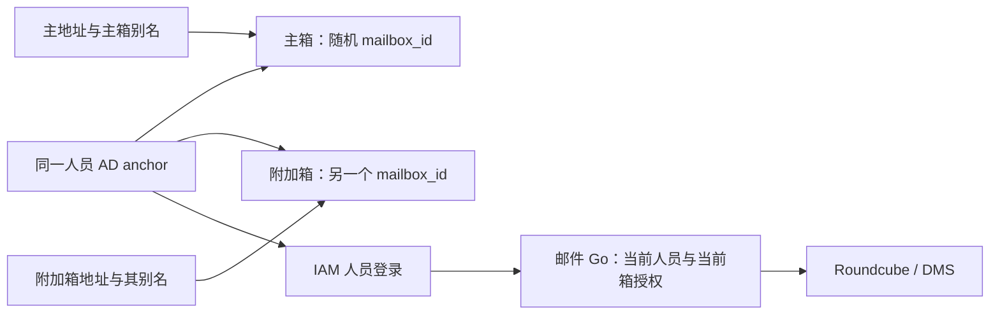

# 门户用户管理、邮箱归属与域级管理方案

> 2026-10-30 最新确认：邮件地址管理页面与受限写接口归邮件 Module；门户仅在新建用户时检测主地址冲突并提供邮件管理入口，返回后及提交时重新检查。Samba 仍为邮箱/地址权威，复用既有目录占用规则。下文 2026-10-25 的“门户维护、邮件只读”及对应候选实现属于历史职责，迁移进度以配套计划为准。

> 2026-10-25 职责更新：用户明确要求 Samba 保存邮箱及地址数据，门户维护与排重，邮件 Module 只读消费；独立邮箱仍可由本人自助开通。此前“邮件 Go 写 AD、PostgreSQL 独占邮箱映射、门户仅入口”的段落属于旧提案，不能继续作为实施依据。用户已确认独立箱是同一人员下的资源，共用人员登录，不创建额外 AD 用户或密码。两类非登录 AD 对象及跨入口占用方向已获用户确认，见 §14；正在实现并先做隔离域验证，当前业务域未安装邮件 schema；以[正式要求](https://github.com/anas-project/ANAS/blob/master/dev-docs/requirements/mail-integration.md)及[计划 D4](https://github.com/anas-project/ANAS/blob/master/dev-docs/plans/mail-integration.md)为准。新增身份读取/验证库不是已开放的登录或邮件服务。

> 状态：已确认设计与后续邮件提案；门户界面、资料和管理员管理已在finance完成当前制品复验，历史基线及逐项结果见配套计划。邮件实现未完成；2026-10-24 用户将邮件模型明确为 Go 统一认证与管理，主箱别名和独立附加箱并存。2026-10-16 确认的域级操作采用本人已有域权限和逐次验证，个人别名可自助维护。已实施范围以[独立用户门户设计](user-portal-design.md)及其配对需求、计划为准，不能据本文认定邮件候选能力已经存在。

2026-10-23 用户确认：**邮件内容全部保存在邮件 Module 的 `DATA_PATH`**。收件、已发送、草稿、附件、隔离区、未投递队列及恢复必需的元数据一并纳入保存和备份清单；不能把内容留在容器可写层或 `USERDATA_PATH`。2026-10-24 的固定制品隔离实验已验证保存集合和空目录停机恢复，正式 ANAS 备份集成仍未实现。托管收发及外部 Module 读取的候选路径见[专项研究](../research/mail-routing-alias-and-module-access.md)，不属于已完成的公网部署。

2026-10-24 最新方向：**Go 中间件自带 Web 管理页，统一验证邮件身份、别名和多个邮箱的归属；可配置主邮箱及其别名，也可配置独立附加邮箱，Roundcube 和 DMS 均通过 Go 认证识别。** Go 复用现有 IAM/AD 作为上游身份设施，不复制人员密码；此方向替代前稿 Roundcube 直接对接 IAM 的推荐。个人地址最终落 AD，PostgreSQL 保存邮箱归属、地址到箱映射、预留、状态及邮件会话。主地址继续由 `sAMAccountName` 派生，当前不实现改名/任意改主址，只预留未来旧址转同箱别名。邮件 Module 交付 Go、DMS、Roundcube，门户只留入口；共享数据库物理文件仍由 Provider 保存，恢复覆盖邮件文件、AD、PostgreSQL、IAM 和相关 Secret。finance 隔离 PoC 的确认矩阵已达 **20/20**，包含 Go 登录交接、单箱凭据、AD 别名、真实界面发信、既有连接撤权和新架构恢复。已开始正式 Module 的 M1 数据基础；完整邮件功能、跨系统配置生效/失败恢复、最小权限与正式生命周期仍待落实。规范来源是[邮件 Module 与目录集成要求](https://github.com/anas-project/ANAS/blob/master/dev-docs/requirements/mail-integration.md)，冲突以其矩阵为准；实施状态见[配套计划](https://github.com/anas-project/ANAS/blob/master/dev-docs/plans/mail-integration.md)，实验边界见[研究报告](../research/mail-management-layer-feasibility.md)末节。

2026-10-24 通讯录范围：一期由 Go 同步 Samba AD 业务用户、组和成员关系，Roundcube 展示公司只读目录并补全收件人；只公开主地址，不枚举全部个人别名。**组内与全局共享联系人为二期**，一期只保留来源、查询和授权接口，不创建共享联系人 CRUD 或权限管理界面。隔离实验已验证目录显示、来源拒绝反例、真实 AD 事件及 IAM 后台登出引发的 Go/Roundcube、已有 IMAP 和 SMTP 新提交撤权，健康依赖下测量低于 60 秒。恢复准入不复活旧会话，未受影响会话保持。生产目录故障与撤权任务的处理隔离仍待落实；这与已完成的健康依赖实验是不同边界。共享通讯录始终不等于共享邮箱或邮件列表。

## 1. 方案范围与当前差距

2026-10-24 用户追加外部邮件服务：一期接入 Cloudflare Email Routing 入站规则，以及 Resend 和兼容认证 SMTP 服务的出站代发（当前兼容服务实测为 eusend；SMTP2GO 已取消）。Go 统一管理供应商配置、受管规则、检测和模式选择，DMS 执行 SMTP 收发、队列与发件检查，Roundcube 继续读写本地邮箱；别名移除和配置失败纳入同一操作恢复。主域收件 MX、投递子域和发送认证记录分开维护，自管云转发每个公开地址采用独立投递目标以支持云端清理失败时的本地撤销。

最新用户取消 Gmail IMAP 和所有正文直接投递 NAS，改为常态云端持久接收；Worker/R2 与自管云均支持每 60 秒拉取及可选通知加速。25 检测只针对自管云 SMTP 入口；NAS 无需开放 25，也不再自动降级/回切。邮件服务内提供方案选择和配置 Tutorial（§13），列明注册材料、权限、限制与实际就绪检查。用户已同意隔离验证后开始实施；原型子集与 M1 数据基础结果、仍未完成的正式功能见[计划](https://github.com/anas-project/ANAS/blob/master/dev-docs/plans/mail-integration.md)。

用户进一步提出一键部署在线云中转供选择，并随后明确自管云中转与 Worker/R2 都支持“Webhook 通知后立即取信＋60 秒补取”，云端记录通知/交付结果，NAS 去重。候选比较见接入研究第 13—15 节，本方案第 11 节描述选择界面和部署建议，第 12 节定义共同流程；这次追加对应 R-056—059。D7/D8 的账号、部署自动化与保管政策仍待明确，SMTP/IMAP 的额外传输能力只作比较。

继续使用 Casdoor 登录、Samba AD 保存身份和密码、单独门户提供界面。优先使用原生 OIDC、Casdoor 原生读取 API 和 LDAPS，不把这轮设计建立在新增 Casdoor 源码补丁上。Authentik 不再纳入方案。

| 范围 | 本轮方案 |
| --- | --- |
| 普通用户 | 查看授权应用；切换用户应用分类；修改自己的姓、名和显示名；使用旧密码修改密码；查看主邮箱、分组与账号状态；自行增删个人别名 |
| ANAS 管理员 | 管理全部人员账号，包括其他 ANAS 管理员；修改资料、重置密码、要求下次改密、单独解锁、维护允许的分组；自身操作有保护规则 |
| 域级操作 | 管理域级高权限人员和分组，但另走显式授权、本人验证和操作确认；普通管理权限不自动变成域权限 |
| 邮件 Module | Go 统一登录、按 anchor 管理多个邮箱及其地址；主箱别名共箱，附加箱独立；自带管理页及 DMS/Roundcube，门户提供入口 |
| 暂不加入 | 改登录名、删除账号、忘记旧密码自助找回、团队共享邮箱、邮件列表、任意 LDAP 属性或 ACL 编辑 |

2026-10-17 用户确认管理边界改为目录 Provider 指定的用户 OU（默认 `OU=People`）及子 OU，门户新建也仅在此范围；不再跨管理员 OU 枚举。内置 Administrator 不在普通人员列表；`krbtgt`、计算机、服务绑定账号和信任账号属于系统主体，不通过人员页面重置。这些主体的密钥生命周期留给目录/对应 Module。

实施前的差距是个人资料只读、管理依赖显式委派且 finance 未配置。当前实现已扩展账号查询范围、姓名写入、保护规则与界面；部署和逐 ID 验证结果记录在[门户计划](https://github.com/anas-project/ANAS/blob/master/modules/user_portal/dev-docs/plans/archived/user-portal.md)，尚未验证的能力不作为已交付结论。

## 2. 字段归属与写入路径

“归属”指谁决定值和生命周期；“保存位置”不意味着该位置的每个应用都可以修改它。

| 字段 | 权威与保存位置 | 用户自助 | 管理员 | IAM 与应用 |
| --- | --- | --- | --- | --- |
| 永久身份锚点 | AD `mS-DS-ConsistencyGuid`；既有 UUID 投影 | 只读 | 只读 | 使用稳定身份，不以邮箱匹配替代 |
| 登录名 | AD `sAMAccountName` | 只读 | 本轮只读 | 只读消费 |
| 域登录主体名 | AD `userPrincipalName` | 只读 | 本轮只读 | 不当作默认邮箱 |
| 名、姓 | AD `givenName`、`sn` | 可改本人 | 可改人员账号 | 只读同步；映射不足时补原生配置/API 接线 |
| 显示名 | AD `displayName` | 建议可改本人 | 可改人员账号 | 只读同步 |
| 主邮箱 | AD 单值 `mail` 为权威，继续按 `sAMAccountName` 与配置后缀派生 | 只读 | 当前无独立改址；未来随登录名变更处理旧址，当前不实现 | 只读；不用 IAM 本地编辑覆盖 AD |
| 邮箱别名、发信许可 | 有效别名最终保存 AD；邮件 Module 维护写入、发信策略及下游配置，PostgreSQL 记录占用/状态 | 可增删本人的个人别名，发信许可由统一规则生成 | 可维护人员邮箱地址 | 别名建议用 `proxyAddresses`，不塞进单值 `mail` 或 OIDC `email` |
| 密码 | AD 密码机制；不读取、复制或同步密码散列 | 旧密码修改 | 受控重置 | Casdoor 认证；不另建邮箱密码同步机制 |
| 组成员关系 | AD；ANAS 注册表说明组的用途与所有权 | 查看有效组及来源 | 按下文风险规则维护 | 根据实际有效权限读取 |
| 备用/恢复邮箱 | 将来独立设计，须验证控制权 | 本轮无编辑入口 | 不与主邮箱混用 | 不把新填地址立即当恢复渠道 |

2026-10-17 的已实施基线是主邮箱完全由系统管理，不允许手工地址或来源认领例外。Samba 新建日常 admin 与门户创建普通人员时直接赋值；指定 OU 的既有人员由目录 Worker 维护，修改后缀会按规则更新。邮箱后端未安装时也有主地址，但页面明确不代表收件箱已开通，不标记已验证。2026-10-24 最新方案保留此派生规则，当前不接管任意主址写入；未来开放登录名变更前再协调旧址保留与下游身份连续性。现有后缀更新不等于完整邮件迁移已实现；个人别名写入也仍未交付。

姓名采用独立字段和显式显示名，不根据中文/英文推测姓氏位置，也不在修改姓名时自动重命名邮箱。资料更新按字段白名单校验长度、控制字符及空值规则；并发编辑携带读到的字段版本，发现冲突时提示重新载入，不能覆盖其他管理员刚保存的资料。

## 3. 主邮箱、别名与独立附加邮箱

统一模型为“人员 → 多个邮箱资源 → 每箱一个默认地址及若干别名”。例如用户 `U1` 的主箱 `M1` 使用 `alice@example.com`，别名 `a.wang@example.com` 也投到 M1；独立附加箱 `M2` 使用 `work@example.com`，有自己的收件、已发送和草稿。人始终是同一个 AD anchor，邮箱 ID 是资源编号；别名不建箱，独立地址才新建邮箱资源，两者都由 Go 验证和管理。

逻辑上需要以下信息；2026-10-24 方案明确 AD 保存有效地址，复用 PostgreSQL 保存绑定、占用及执行状态，DMS/Roundcube 消费受管配置：

| 信息 | 规则 |
| --- | --- |
| 用户锚点 → 邮箱内部标识 | 一个人可拥有主箱和附加箱；每个箱的 ID、协议登录名和存储引用稳定，Go 验证选中箱归属 |
| 主地址 | 人员的 AD mail 只有一个并对应主箱；每个附加箱另有默认地址，不覆盖人员 mail 或 OIDC email |
| 别名列表 | 多个受管地址，每个显式归属该邮箱；同一地址不得另指其他人员、列表或邮箱 |
| 发信地址集合 | 必须属于本邮箱且被显式许可；接收别名不自动代表允许任意地址发信 |
| 生命周期状态 | 未开通、可用、变更待完成、停用、保留；与 AD 账号禁用分开展示 |
| 最近操作结果 | 邮件后端、AD 投影、IAM 同步分别报告，保留可定位的操作编号 |

AD 保存本人有效地址归属；PostgreSQL 补充各地址属于哪个邮箱资源。DMS 与 Roundcube 消费 Go 的映射和授权结果，不能再独立把同一人的全部 `proxyAddresses` 推断为主箱别名。Roundcube 本地用户按邮箱资源区分，当前箱仅展示该箱的已授权发件地址，不混入该人的其他箱。

现行[目录主邮箱要求](https://github.com/anas-project/ANAS/blob/master/dev-docs/requirements/directory-primary-email.md)及已实施基线由系统持续维护用户名加 `mail_domain`，后缀未指定时继承目录域。2026-10-24 最新方案维持系统派生，不提供独立主址编辑，仅预留未来 `sAMAccountName` 变更；正式开放前须衔接原需求与新邮件需求，并保留原验收基线。独立配置邮箱后缀不改变 AD realm、UPN 或身份；实际收发还需验证邮件域控制权。用户名非法或地址冲突时报告失败，不静默删字符生成另一个地址。国际化邮箱地址另做客户端兼容验证。

主地址和别名使用同一命名空间校验：人员邮箱、邮箱别名、组地址、保留地址均参与唯一性检查。`postmaster`、`abuse` 等系统用途地址交由域配置预留。`+tag` 地址是后端的子地址规则，不能当成一条条已登记别名；catch-all 默认不开启。

首期建议登记的个人别名均可收信，用户可从其中选择发信身份，默认仍是主地址。仅收信的兼容旧址允许单独标记。SMTP envelope sender 与可见 `From`、Webmail 身份都应限制在授权范围，不能通过关闭全域 sender check 来实现别名发信。

### 用户自行维护个人别名

用户可从门户进入 Go 邮件页，查看本人邮箱及新增、移除个人别名。目标邮箱可以从本人资源中选择，Go 必须核对当前 anchor 的归属，不能信任浏览器声明的 owner。可选择的域来自管理员允许的受管域；不能新增域、管理团队地址或改动人员主地址。2026-10-25 已确认独立附加箱也支持本人自助开通，管理员可代办；服务端不接受普通用户指定他人 owner。箱数、容量和限速仍由部署政策约束，不默认无限额。

新增前执行同一地址规范化、全局唯一性、保留名称和每人别名数量限制。配额、限速、可用域及保留名称是邮件 Module 的部署策略；具体数值在 Module 方案中确定，不在门户硬编码产品上限。冲突只告知地址不可用，不披露属于哪位用户。后端原子唯一约束或等效机制是必要条件，不能仅靠页面先查一次。

移除前提示停止新来信和撤销该发信身份；邮件历史不删除。主地址以及管理员标记为必须保留的旧主地址不能由用户删除。已移除地址进入保留状态，首期不自动释放给其他身份；原用户重新启用也需检查原绑定和后端状态，管理员转让另行确认。不能用新增、删除、重放请求绕过配额、占用系统地址或保留他人的发信权限。

个人别名维护同样要求登录有效、本人邮箱可用、近期认证、CSRF 防护和审计；管理员代办使用独立动作和目标检查。邮箱后端不可达、配额满或结果未知均要在当前表单可见反馈，不显示虚假成功。

### 地址和身份变更

| 场景 | 建议行为 |
| --- | --- |
| 改名、改姓、改显示名 | 不改邮箱地址、登录名、邮箱 ID |
| 今后允许改登录名 | 本轮只预留 `sAMAccountName` 改名引起主址变化；当前没有改名入口，开放前验证原邮箱与 Webmail 用户连续性 |
| 更换主地址 | 无独立入口；未来只随上述登录名变更处理，保持 anchor、邮箱及 Webmail 用户不变 |
| 旧主地址 | 将来因登录名变更改址时自动保存为本人 AD 别名并保留路由；当前不实现该流程 |
| 增删别名 | 不创建或删除收件箱；新增检查冲突和域归属；移除不会删除旧邮件 |
| 将别名设为主地址 | 当前用户、管理员均不提供该入口；未来派生新主址若与本人别名重叠，在改名流程内部处理 |
| 更换邮件域 | 既有目录后缀更新是历史基线；本轮不新增邮件迁移能力，邮件 Module 接入后仍须评估既有入口准入，避免绕过归属约束 |
| 禁用 AD 用户 | Go 撤销该人的所有邮箱访问与相关凭据/会话，DMS/Roundcube 执行；收信保留策略单独设置，不默认为删除邮件 |
| 停用独立邮箱 | 只撤销目标箱访问/发送并按策略停止新收信，保留其邮件数据；不删除同一人的其他箱 |
| 退役/释放地址 | 先停用并保留归属记录；不立即分配给另一身份。建议首期只人工释放，不自动到期转让 |
| 恢复旧备份 | 对照地址归属和邮箱 ID 检查冲突；不能让旧快照重新占有已经转让的地址 |

### 邮件后端与 AD 的一致性

当前主地址由 Samba 配置和目录规则维护；邮件 Module 消费 `mail`，受限写入 `proxyAddresses`，不提前取得改登录名或主地址权限。个人别名与目录建号的地址占用仍需协调，不能接受任意 LDAP 写入。后缀迁移牵涉目录、PostgreSQL、后端收发域和既有别名，没有共同事务；现有目录侧维护不等于完整邮件迁移已实现。

本轮不实现改名/迁移流程；先保存 anchor 到邮箱和 Webmail 用户的稳定绑定，保留历史占用。将来开放改名时需确认新地址冲突、旧址保留及 IAM/应用投影。原生组合的改址身份连续性失败保留为历史记录；后续 Go 原型用固定邮箱身份和测试预配改址通过连续性验证，不代表自动改名工作流已实现。

若目录已更新而后端失败，必须显示“目录地址已变更，邮件待同步”，保留旧收件箱和地址归属，不报告收发已就绪，不用删除已有邮件或创建第二个邮箱假装回滚。个人别名独立于系统主地址，不能通过设为别名主址覆盖 AD `mail`。

## 4. 门户页面和交互

导航为“应用 / 我的账号 / 用户管理 / 操作记录”。用户管理与跨用户记录只对有实际权限的管理员显示，接口仍独立鉴权。中英文使用同一布局和键值，未支持的语言直接回落英文。

应用页保留“用户应用”和“后台管理”两个大组。在用户应用组提供“显示分类”开关，默认开启，记住当前浏览器选择；关闭后只在用户大组内平铺，后台管理分组保持原样。切换不改变授权、排序、搜索或重复条目规则。语言、筛选、开关与搜索共用一套对齐的工具栏，窄屏换行，卡片使用一致图标框和操作区。

未登录首页使用真正的主按钮“登录 / Sign in”，统一按钮、间距、对齐和键盘焦点。辅助入口命名“密码已过期或被要求修改？”，说明需要当前密码或管理员给的临时密码。“首次登录”本身不表示必须走改密流程；普通首次登录仍点主按钮。没有旧密码时说明联系管理员，不提供尚未实现的找回承诺。

我的账号提供资料、密码、分组来源和邮箱四块。主邮箱只读，别名显示新增/移除及归属、是否已开通；邮件 Module 未就绪时说明原因并关闭写入。资料保存只提交姓名/显示名。管理员看自己时仍使用个人功能，不把自己的“重置密码”混入自助改密。

密码和资料表单的结果显示在当前可见位置：提交中禁重复提交，失败不清空需要保留的非密码字段，密码不回显；错误用 `role=alert` 和焦点引导，成功用状态提示。后端用稳定错误码区分凭据错误、密码策略拒绝、近期认证过期、无权限、目录不可达、写入状态未知。可验证的密码策略给出可操作提示；不能解析的 LDAP 拒绝只说目录拒绝并给操作编号，不猜测一定是密码最短使用时间。

## 5. 用户管理的普通权限

管理员判定使用 ANAS 注册的 `platform_admin` 对应组的稳定标识；当前通常名为 `Admins`，不能硬编码显示名或用 Casdoor 自带 `isAdmin` 替代。每次敏感读取和写入重新检查账号启用、IAM 策略及 AD 有效组；移除管理员后，旧页面和旧会话不能继续写入。

以下普通写入只处理不触及域级保护的变更。人员涉及域级高权限、或目标组能授予域级权限时转第 6 节；“可以查看全部人员”不意味着受限写入账号获得全部人员的重置权。

| 功能 | 具体行为与边界 |
| --- | --- |
| 用户列表 | 分页搜索指定用户 OU 及子 OU 的人员；显示登录名、显示名、主邮箱、状态、是否管理员；不向普通用户提供目录枚举 |
| 资料编辑 | 姓、名、显示名白名单；本人和其他管理员都可编辑；主邮箱始终由系统管理，只读展示 |
| 密码重置 | 生成一次展示的随机临时密码，默认要求下次登录修改；不在 URL、日志、审计、剪贴板自动操作中留下密码 |
| 解锁 | 独立操作；重置密码不隐式表示解锁，页面可明确勾选并逐项报告结果 |
| 分组管理 | 展示直接与继承成员关系、授予路径、用途和风险；只对直接关系提供增删，不伪装可以删除继承结果 |
| 操作记录 | 可按人员和操作编号查看；普通用户只看允许公开的自身结果，不暴露其他人员资料或 Secret |
| 邮箱区 | 未装邮件 Module 时只读；后续通过邮件 Module 的受控入口管理地址，不直接改 `mail` 冒充开通邮箱 |

补充建议：列表状态可区分禁用、锁定、密码到期/强制改密、目录同步中；保存前展示差异；批量改组和批量重置先不加入，以免一个错误选择影响全部人员。管理员建号已于2026-10-17单独确认，权限和未完成验收见配套计划；启用/禁用及删除仍需另外确认，不随“改信息”隐式加入。

### 分组默认视图与高级视图

默认显示 ANAS 明确注册、创建并管理的组，分为“应用访问（`APP_*`）/ 应用能力（`CAP_*`）/ 文件与资源访问 / 管理角色”。名称前缀仅辅助展示，不能用来判定所有权或安全程度。

点击“高级：系统和其他分组”后再展示系统组、人工创建组和未知组，并显示该组实际作用。风险提示须具体，例如 Domain Admins 可管理整个域，Administrators 可获得广泛管理权，Unix Admins 可能通过嵌套组取得域/主机权限，FS Admins 可取得广泛文件访问。

ANAS 创建的组不一定是普通组：`Unix Admins` 当前具有危险嵌套；`FS Admins` 的高文件权限也不能隐藏在普通文件分类中。分类描述用途，风险单独标识。任何能通过嵌套路径授予域级权限的组自动进入域级流程；未知组不因为高级面板已展开就变为可写。首期人员管理只加减“人员 → 组”，不提供任意“组 → 组”嵌套编辑。

### 管理员自身保护

建议以下保护由服务端统一执行，不能仅禁用按钮：

- 不能把自己移出 ANAS 管理员的有效成员集合，包括通过移除自己的上级成员路径间接实现。
- 不能通过管理员重置入口重置本人密码；本人走旧密码修改。不能借其他操作禁用或删除自己的管理身份。
- 可以管理其他 ANAS 管理员，但不得让最后一个可用管理员失去管理能力。账号已禁用或不能使用的管理员不能充当最后管理员兜底。
- 普通管理路径不能改平台授权规则、受限写入账号、域级授权来源，也不能用重置受保护人员密码来绕过域级验证。
- 操作前后按稳定身份和有效成员关系检查，不用 DN 字符串或姓名比较。域级风险沿嵌套关系计算，循环和无法读取的路径按不可确定处理。

现有单进程写锁只约束门户内的操作。固定 Samba 基线不支持已测试的 LDAP assertion control，多对象检查与写入没有全局原子性；来自 RSAT、其他管理员或自动任务的并发写仍可能竞态。实施时必须明确此限制并复测，不能承诺在任意外部并发写下绝对保证“最后管理员”。不通过降低目标保护或授予受限账号全域权限来绕过失败。

## 6. 域级高权限：推荐使用操作者本人的域权限

已确认采用以下授权模型：保持一个门户进程，普通操作继续使用已有受限目录写入账号。域级操作改为**操作者本人 LDAPS 绑定后执行单次操作**，不用长期挂载一个可接管整个域的服务账号。

操作必须同时满足：当前用户属于 ANAS 管理员；部署配置显式开启相应域级操作及组/目标范围；用户本人在 AD 已有执行该操作的权限；近期 OIDC 认证有效；本次输入本人域密码并绑定到与登录锚点一致的 AD 对象。ANAS 管理员角色本身不授予 Domain Admins，也不能从普通用户管理入口给自己补上域权限。

这意味着：有平台权限但没有域权限的管理员能管理普通人员，域级按钮显示缺少域授权；既有 ANAS 管理员又具备域授权的管理员才能管理域级对象。最初的域授权由部署者/既有域管理员通过门户外的受控入口配置，不由普通门户管理员自行批准。现有 bootstrap 管理员可能同时具备两类身份，应检查实际组而非假定所有管理员都一样。

### 单次域操作流程

1. 服务端重新读取操作者和目标的稳定标识、有效组、保护状态与允许的动作。展示目标、改前/改后、可能得到或失去的权限，要求填写原因。
2. 使用已验证的独立近期认证 client；检查真实 `auth_time`。不能只设置 Casdoor 的 `max_age=0` / `prompt=login` 就认为一定重新认证，现有实验已发现其可能复用旧认证。
3. 服务端签发一次性确认凭据，绑定操作者、目标、动作和完整参数摘要，建议有效期不超过 120 秒；此时不接收域密码。到期、修改目标、切换组、权限改变后必须重新验证。凭据不可转用为通用“高级模式已解锁”。
4. 最终提交同时携带确认凭据与本人域密码；服务端先校验参数和权限并消费一次性凭据，再绑定本人。核对绑定账号与 OIDC 用户锚点一致，拒绝另一管理员代输的凭据。密码仅经 TLS 提交、在本次请求内使用，不跨预览和执行请求暂存。
5. 持久写入无 Secret 的审计意图，再以本人绑定执行一项类型化 LDAP 写入，重新读取确认结果。只允许约定的重置、解锁或单成员增删，不接受任意 LDAP 过滤器、DN、shell 或 ACL 脚本。
6. 关闭 LDAP 连接，不把域密码保存在会话、任务、磁盘或失败重试队列中。超时未知则查询实际状态并报告；密码写入无法读取确认，不自动重复。

域操作建议每次确认，本人域密码不能因一次成功而缓存数分钟。内存清理只能尽力减少驻留，不能声称 Go 进程绝不残留密码。普通门户进程在此请求内会接触域凭据，进程被攻破仍可能泄露它；这个方案减少长期高权 Secret，并不实现进程级隔离。

首次提供 Domain Admins、Administrators、Unix Admins 等已知危险组成员维护，以及高权限人员（包括内置 Administrator）的密码重置/解锁；同样保护本人和最后可用管理身份。`adminCount` 只是保护线索，不能单独证明当前有效权限。Microsoft 的[受保护账号和 AdminSDHolder 说明](https://learn.microsoft.com/en-us/windows-server/identity/ad-ds/plan/security-best-practices/appendix-c--protected-accounts-and-groups-in-active-directory)解释了为什么普通 OU 委派不能直接覆盖所有域级对象；Samba 的实际 ACL 和保护行为仍须固定版本实验，不照搬 Windows 的全部实现假设。

重新输入密码是再次凭据验证，**不等于多因素认证**。可使用 Casdoor 原生 MFA 增强域级 client，但只有实验确认该 client 强制执行、认证结果可被可靠验证，才能宣称域级操作要求 MFA；仅配置页面或任意 `amr` 字符串不能通过验证。

### 与其他路径的取舍

| 路径 | 优点 | 成本与边界 | 建议 |
| --- | --- | --- | --- |
| 本人域权限 + 单次本人 LDAPS 绑定 | 不新增服务或长期全域高权 Secret；AD 原生 ACL 决定能否执行 | 操作者须已有域权限；门户请求内接触密码；须逐项验证受保护对象权限 | 用户已确认 |
| 普通门户挂全域写入账号 | 操作步骤少，ANAS 管理员无需本人域权限 | 门户进程失陷即可接管域；加配置开关或 MFA 不构成凭据隔离 | 不推荐 |
| 独立特权执行服务 | 可让无个人域权限的授权管理员操作；高权 Secret 与普通门户分离 | 新服务、独立策略和身份验证、凭据轮换、审计及故障恢复；仅接受门户声称“已批准”仍不安全 | 仅在明确要求集中代办时另确认设计 |

## 7. 近期认证、审计与失败反馈

普通敏感操作建议要求五分钟内真实认证；域级操作仍叠加每次本人密码证明。角色撤销、账号禁用、会话失效后不能继续。OIDC 负责身份；近期认证可来自 OIDC 重新登录的 `auth_time`，也可在门户页内输入本人密码、由门户向 Samba 核验（PORTALUX-R-026，2026-10-20 用户确认，不经过 IAM，因此不覆盖 IAM 将来的多因素认证）；人员与系统主地址写入走 LDAP，后端邮箱和别名配置走邮件后端 API/原生配置；不向浏览器下发应用级 Casdoor 管理凭据。

保持门户登出与当前 IAM 浏览器会话一同登出。重置密码后分别报告 AD 写入、强制改密标记、会话撤销/应用同步结果。成功修改 AD 密码不代表所有已登录客户端立即退出；邮件应用密码和既有 IMAP 连接需要邮件 Module 的撤销能力，并在未完成时显示状态。

审计包括操作者/目标锚点、操作类型、组标识、允许公开的变更摘要、原因、认证时间、目录结果码、操作编号和最终/未知状态，不记录密码、OIDC token、请求正文或完整 LDAP 诊断中的敏感值。审计不可持久化时拒绝敏感写入。写入成功但审计终态失败时保留意图并报告待核对，不能重新执行来补日志。默认不提供代登录他人、读取收件箱或管理员查看用户邮件内容。

## 8. 性能与现有问题的修复方向

此前 finance/Chrome 只读观察表明：页面重复调用 `/api/me`，一次认证链路涉及 IAM 原生读取与 LDAP，图标读取也重复鉴权；Chrome 中部分请求耗时明显高于服务本机直连。尚不足以把慢归因于单个后端，也未确认改密失败的原始具体原因。

实施时先合并同一次页面加载的重复请求，使用一次已核对的请求结果渲染账号区，避免切页重复发起相同读取；对静态部署图标采用按内容版本的缓存策略。权限撤销、敏感读取和写前复核保留，不用长期权限缓存换取速度。分段记录 IAM/LDAP/公网请求耗时、超时及操作编号，不记录个人凭据。分别验证缓存开启/关闭和中英文窄屏布局，不能用本地接口快推断公网访问快。

## 9. 实施顺序、验证主题与复杂度

建议按独立可复验阶段推进：

1. **界面与反馈**：工具栏、首页按钮、分类开关、双语、表单可见结果、重复请求治理；不依赖邮箱后端选型。
2. **个人资料与普通用户管理**：字段白名单、跨人员 OU 查询、明确配置 ANAS 管理策略、组所有权与风险、自身保护、重置/解锁和审计。先把现有首版限制与本轮变更形成配对需求、计划。
3. **域级操作**：按已确认的本人权限模型，逐项验证本人绑定、受保护对象 ACL、近期认证、参数绑定、角色撤销、嵌套提权路径和并发限制；未通过的操作保持关闭。
4. **邮件 Module**：DMS + Roundcube + Go 的确认 PoC 已完成，按[正式计划](https://github.com/anas-project/ANAS/blob/master/dev-docs/plans/mail-integration.md)推进部署骨架、统一认证、地址管理、公司目录/撤权、外部服务接入和恢复六个里程碑。D1 故障验收、云端持久中转、Resend/兼容 SMTP、每分钟取信与配置 Tutorial 已纳入一期；已开始隔离 Worker/R2 验证，不等同正式 Module 或自动改名已实现。

验证主题应写入实施时的配对需求矩阵并分配稳定 ID，包括：姓名保存及冲突；默认组/高级组和继承路径；自我降权及最后管理员保护；无域权限的 ANAS 管理员被拒绝；另一人域密码被拒绝；确认凭据重放/改参拒绝；审计故障与 LDAP 结果未知；AD/IAM/邮件后端部分失败；别名共箱、改主址身份不变、冒发拒绝及地址回收；中英文、未支持语言、键盘和窄屏；真实公网性能及 IAM 一同登出。本文没有新增“已通过”的验收结论。

现有首版 `PORTAL-R-009` 等只读资料及保护范围约束与本轮范围有语义变化。实施前按需求规范保留历史基线、退役冲突条款并新建标准，不直接把旧 41 项通过结论延伸到新方案。

复杂度评估：界面调整为**低**，资料和普通委派为**中**，包含域级凭据、嵌套权限和邮件/AD 部分失败的完整方案为**高**。高复杂度来自现有门户、AD、IAM、未来邮件后端的不同权限和失败语义，不来自新增门户数据库。本方案首选复用一个门户、原生 LDAPS 和后端 API；独立特权执行服务会进一步增加组件和维护成本，未获确认前不实施。

## 10. 已确认决策与后续选型参数

1. **域级授权模型（2026-10-16 已确认）**：“ANAS 管理员且本人已有对应 AD 域权限”，每次输入本人域密码执行。本轮不新增集中代办服务。
2. **个人别名管理权（2026-10-16 已确认）**：首期允许用户自行增删本人的个人别名；管理员也可维护。主地址仅按系统配置规则变更；受保护兼容旧址和地址转让由管理员管理。

邮件后端采用 DMS + Roundcube + Go。2026-10-26 用户确认 finance 使用 `mail-poc.bengbu.cc.cd`，后缀迁移保留旧主地址；每人 2 个附加箱、10 个别名，每箱 2 GiB、每分钟 30 封。云暂存总容量 2 GiB，已交付副本保留 7 天，满时先清理最老已交付副本，仍不足则拒收并告警，未交付邮件不自动删除。其他部署仍须在 Tutorial 明确设置限额；正式制品和完整验收进度见邮件计划。

2026-10-17 的建号补充：创建绑定可以指定已有授权账号，finance 采用仅在人员 OU 创建 user 的独立普通账号。若将创建绑定配置为域管理员，进程会长期保存其既有权限；域级操作路由虽仍逐次验证本人，也不能隔离这份后台凭据。因此默认最小绑定与操作者本人域权限分别使用。


2026-10-17 已确认：门户为人员加入域风险组前，先用操作者本人 LDAPS 连接将对象 owner 移交给同域 Domain Admins；只写 owner、回读后再加组。所有权失败/未知不继续，成员失败不回退所有者，两步结果分别显示并审计。此路径不提供跨对象事务，也不会消除指定绑定的既有额外权限。实验只在无生产信任的假域执行。原生协议依据：[SD Flags control](https://learn.microsoft.com/en-us/openspecs/windows_protocols/ms-adts/3888c2b7-35b9-45b7-afeb-b772aa932dd0) 和 [SECURITY_DESCRIPTOR](https://learn.microsoft.com/en-sg/openspecs/windows_protocols/ms-dtyp/7d4dac05-9cef-4563-a058-f108abecce1d)。

## 11. 邮件接入选择与云中转提案

本节按 2026-10-24 最新确认更新：取消 Cloudflare＋Gmail IMAP 和直接正文投递 NAS，收件先经持久云中转。用户同意先验证 Worker/R2，再复用接口验证自管云；这是隔离验证授权，尚无正式邮件 Module。已确认的 Go、AD、DMS、Roundcube 职责继续沿用。

### 管理页面如何让用户选择

管理员在邮件 Module 的“邮件接入”页面先选收件方式，再选发件服务。普通用户继续管理自己的邮箱/别名和进入 Roundcube，无需处理云主机或供应商凭据。

| 页面步骤 | 用户看到的选择或结果 |
| --- | --- |
| 收件方式 | Worker/R2 或自管云持久中转；Resend 接收仅保留研究说明，不开放启用。Gmail 和直接投递 NAS 已取消 |
| 连接条件 | NAS 的出站 HTTPS、预计最长离线时间；自管云额外检查公网入站 25、磁盘和 TLS。未知不判为正常 |
| 云中转方式 | 自管云与 Worker/R2 使用通知加 HTTPS 拉取；逐项显示所需组件和离线保管期限。通知只用于提前取信；当前不提供 SMTP 正文推送或 IMAP 接入 |
| 发件服务 | Resend、兼容 SMTP（当前验证 eusend）；显示验证域、账号共享额度与认证检查，不随收件方式自动切换 |
| 校验与启用 | 显示收件路径、DNS/目标验证、云端保管、本地投递结果、费用及未就绪原因；验证成功后才启用受管地址 |
| 日常状态 | 云端已接收、本地已入箱、积压数量/大小、最老邮件年龄、最近同步/探测、可用空间、临近保管期限和需处理的失败 |

运行时继续复用已确认的配置模型，不建立通用插件市场或多云编排系统。每个收件域选择一个明确入口；地址仍按 AD 与 Go 的稳定映射分配。未实现的候选不作为界面中可点击的承诺。

### 推荐的云中转边界

自管云采用常态中转加每分钟取信（B2），路径为：

```text
外部邮件 → Cloudflare Routing → 云 Postfix → 云 Go 持久暂存
                                            ↑ NAS 主动 HTTPS，每 60 秒
                                      NAS Go → 本地 DMS → Roundcube

外发：Roundcube → 本地 DMS / Go 授权 → Resend 或已配置的兼容 SMTP
管理：NAS Go / PostgreSQL → AD 地址、云端受管目标和部署状态
```

NAS 的 Go/PostgreSQL 继续拥有人员到邮箱、地址、会话及操作状态。云端只保管原文、可信信封、交付状态、受管目标清单和配置版本；不复制 AD 密码、IAM 登录或 Roundcube。云端接收不能依赖每封邮件实时访问 NAS，否则 NAS 离线时无法保管。新增地址需云端确认才显示公网就绪；移除地址先撤销本地访问/投递，再同步云端。云端使用旧清单期间接收的邮件，由 NAS 按当前映射拒绝或隔离，不能重新启用撤销别名。离线期间目录变更无法同步的边界须明确展示。

云端规则只允许本实例受管目标，原文与实际 SMTP 信封绑定；目标 ID 是路由标识，不是身份凭据。NAS 导入按来源实例、稳定消息 ID 和目标记录结果，正常重复枚举不重复导入。DMS 确认丢失时进入结果核对，不能直接删云副本或盲目换通道重发。云端保管到本地确认后按约定保留期清理；云端磁盘/队列也有独立备份和容量预算，NAS 的 DATA_PATH 备份不包含尚未取回的邮件。

B2 的云端接收与暂存状态不能依赖 NAS 上的 PostgreSQL 在线。候选采用云端本地持久元数据与原文配套保存，NAS 继续复用现有 PostgreSQL；具体格式和中断恢复需随 B2 验证，不默认再部署第二套 PostgreSQL 或消息队列。

历史 B1 私网 SMTP 推送和 B3 IMAP 暂存仅保留在研究比较，不进入本轮 Tutorial 的可选项。两个受支持云来源均使用下节通知加 HTTPS 取信，不提供正文直推 NAS。

### “一键部署”的两种含义

| 范围 | 需要提供 | 建议 |
| --- | --- | --- |
| 在已有 VPS 安装中转 | 云主机地址、SSH 主机指纹与专用部署凭据、受支持系统、磁盘和域名参数 | 首版优先。限定专用主机和固定部署包，展示预检及安装进度；不用先开发云厂商 API |
| 自动创建云主机并安装 | 云商 API 凭据、地域、规格、预算、网络/磁盘和删除策略 | 后续可选。涉及计费、资源创建及失败后的费用处理，需确定一个云商并单独确认，不默认购买或销毁主机 |

当前 [compute Contract](https://github.com/anas-project/ANAS/blob/master/contracts/compute/docs/technical.md) 提供 Incus 沙箱租约；它不是任意公有云的一键购机接口。云部署可复用项目的 Secret 引用、操作记录和状态展示习惯，具体安装动作仍需实现和验收，不能把现有 Incus 能力记作已经支持此功能。

建议安装流程为：预检专用主机、端口与空间 → 展示安装范围 → 部署固定版本并挂载持久目录 → 配置限定目标与 NAS 连接 → 验证独立外网 SMTP 和完整本地交付 → 启用受管 Cloudflare 规则。Cloudflare 目标验证须沿用正常流程；验证信可以通过中转取回展示，尚未启用的公网地址不能阻断管理人员完成验证。生产 DNS/规则写入应是整个检查流程最后一步，并有相应操作授权。

部署中断后按操作 ID 回读实际状态、继续缺失步骤；升级、重装和解除绑定默认保留队列与原文，不能因重试重新初始化持久目录。主机上已有邮件服务或非受管配置时报告冲突，不自动覆盖。云主机整体故障时，这一路径也会受影响；多节点高可用不隐含在“一台云中转”中。

### 复杂度与待确认范围

完整方案为**高复杂度**。B2 新增一个外部云节点、Go 接收程序、持久存取及两端确认/恢复；B1/B3 可减少自建协议，但仍增加网络或邮箱运维。简单的直投无法满足 NAS 无公网入口和离线保管；低用量托管 API 是更省运维的替代，代价是配额、留存和平台限制。

建议把“已有 VPS 一键安装”作为云部署首个范围，具体主机和保管参数仍由 D8 落实。最新用户已取消直投及自动降级，旧 R-051/R-053/R-055 标为废弃；R-050 仅检测自管云入口，60 秒拉取与双确认保留。Tutorial、常态云入口和显式来源切换写入 R-060—066，当前 63 项有效要求。

## 12. Webhook 通知、立即取信与统一交付状态

**已确认行为：只推送新邮件通知，NAS 收到后立即取信，同时每 60 秒补取。** 自管云暂存与 Worker/R2 都使用这套语义。下列存储格式、端点和退避数值是建议实现，不代表已部署；完整方案复杂度仍为高，新增的主要工作是云端持久状态、两端确认与恢复，而非另一套用户认证。

```text
云端持久保存原文和真实目标
  → Webhook 通知 → NAS 验证并持久登记任务 → 返回“通知已接收”
                         ↓
                 立即拉取原文 ← 每 60 秒补取也进入同一任务
                         ↓
                   DATA_PATH + 接收记录
                         ↓
                 DMS 持久接收 → 本地记完成
                         ↓
                  向云端确认交付完成
```

### 服务器的两个成功标记

| 记录 | 何时成立 | 不能推导什么 |
| --- | --- | --- |
| notification_acked_at | NAS 验证通知、持久记录待取任务，并返回匹配事件 ID 的成功响应 | 不代表正文下载完成、DMS 已收到或可删除云副本 |
| delivery_acked_at | NAS 确认 DMS 已持久接收且本地完成记录已保存，云端验证对应目标的最终确认 | 不代表云副本已清理，或已进入 NAS 的后续备份 |

云端保存来源实例、稳定 delivery_id、真实目标、原文位置、通知尝试/错误及两个标记；通知事件 ID 可另记。按目标记录交付，不能因同一封信的一个目标完成就删除其他目标的副本。NAS 的持久接收记录区分待取、待投递、结果待核对、已交付/待回执和已确认；永久无法识别目标时隔离，不报成功。

通知不携带原文或长期下载凭据，来源标识只用于找到管理员已配置的服务。用 TLS 与覆盖请求内容、事件 ID 和时间的认证/签名防止伪造和重放；NAS 不访问通知中任意提供的 URL。重复合法通知返回既有结果，不重复建任务；来源认证失败或未知目标不能修改邮箱映射。Webhook 端点需 HTTPS 可达，可由既有受控入口暴露；NAS 只能出站时仅轮询可工作，不能显示“推送已就绪”。

### 超时：拉取继续，通知有限重试

建议每次通知总超时 5 秒；首次失败后在约 1 分钟、5 分钟各重试一次，加入少量抖动并按来源合并同轮唤醒。超时、连接故障、429/5xx 可重试；认证/配置错误先显示需处理，避免无限请求。具体参数作为计划 D9 的实现参数评审，不属于第三方服务保证。

**不等待客户端拉完正文才结束 Webhook，也不因超时就停止轮询。** 云端在已持久存信后独立发送通知；失败只改变通知状态。通知确认后停止该事件的重复提醒，最终交付确认尚未到达时仍保留待取项目，NAS 每分钟核对会补上任务中断。即使通知响应丢失、邮件先被轮询成功取回，最终确认也应停止后续通知。有限重试耗尽后显示通知失败、依赖拉取补齐；云端不得因此丢弃原文。

自管云使用现有云 Go 的持久任务循环；Worker/R2 使用同一 Worker 的定时触发处理持久待通知记录，不在一次调用里 sleep 数分钟。不默认为通知引入 Queues。定时触发未运行或 NAS 没有 Webhook 入口时，持久原文和正常轮询仍能独立工作。

### 客户端去重、最终确认与恢复

NAS 以来源实例＋来源消息 ID＋投递目标建立唯一接收键；Webhook、定时轮询和重试复用同一处理器。并发任务只能认领同一条记录一次，未完成任务在重启后继续。发件人控制的 Message-ID 不作唯一依据；不同合法目标不能被错误合并。云端上游发生新的 SMTP 重投且没有稳定事件标识时，不能把它未经证明合并成旧项目，更不能宣称端到端恰好一次。

NAS 取回完整原文并保存后再投递 DMS。若 DMS 已接收但响应丢失，保留待核对结果，用固定受限适配器确认，不盲目再次导入。若本地已完成但向云端回执丢失，下次遇到相同键只重发回执；云端回执必须幂等，迟到通知结果不得回退 delivery_acked_at。原文清理由云端完成标记和保留策略共同决定，不能见到通知 2xx 就删除。

恢复时同时核对源实例、取信进度、已交付记录与云端回执；旧 NAS 备份可能缺少云端曾确认交付的邮件，不能只列“未确认”项就声称补齐。应在保留窗口内读取交付清单并核对本地记录，按当前地址归属恢复缺项；来源已清理则明确报告不可补回。去重/回执记录的保留窗口应覆盖可重放、云副本保留和受支持的恢复窗口，具体时长在 D8 确定，不默认永久保存全部原文。

这套接收/确认记录是两种后端共用的最小接口语义；云端实现分别是 Go 本地持久暂存和 Worker/R2，NAS 业务仍复用 Go/PostgreSQL。当前不增加 SMTP 正文推送或 IMAP 执行器，减少双路径交付与去重协调。

## 13. 邮件服务配置 Tutorial

本节定义正式邮件 Module 管理 Web 的引导内容，关联 R-063—066。2026-10-26 已加入管理员页面与非秘密草稿候选；实际云配置、核验及启用尚在实施，不能把下述完整流程视为已交付。入口为管理员的“邮件服务 → 配置引导”，首次配置自动进入，之后可重新打开。普通用户仍只看到邮箱、别名与 Roundcube 入口。保留现有组件、语言、主题和 Secret 交付方式，不在门户再建立一套邮件配置。

### 第一步：选择收件方案

| 可选方案 | 适用条件 | 需要准备 | 页面必须说明的限制 |
| --- | --- | --- | --- |
| Cloudflare Worker + R2 | 希望减少云主机运维；NAS 允许主动 HTTPS | Cloudflare 账号、已接入的自有域、Routing、Worker、R2 订阅及私有 bucket | 有免费额度，超额可能计费；受邮件大小、Worker 资源和 R2 容量/请求限制；需维护少量 Worker 代码 |
| Cloudflare + 自管云中转 | 已有可长期在线的专用 VPS，需要自主控制暂存 | Cloudflare 账号/域、VPS、可达公网 25、云投递子域、TLS、磁盘与备份 | VPS/存储不是免费服务；单机故障仍会影响收件，保管受空间和策略限制 |

不显示 Gmail IMAP、NAS 直收、自定义端口直投或正文 Webhook 直推作为可选路径。Resend 接收 API 可放在“其他方案研究”说明中，但可信分箱、额度耗尽行为和恢复未验收前不开放启用。通知回调是可选加速：没有 NAS 公网 HTTPS 入口时仍可每分钟拉取，状态显示“拉取可用，通知未配置”。

### 第二步：按方案准备账号、权限和资源

Worker/R2 页面依次列出：

1. **账号与域名**：注册/登录 Cloudflare，确认自己管理的 Zone ID、Account ID、测试域/正式收件域；核对当前 MX，展示将受影响的现有收信服务。给出 [Routing 开通指引](https://developers.cloudflare.com/email-service/get-started/route-emails/)。
2. **存储**：按 [R2 开通步骤](https://developers.cloudflare.com/r2/get-started/)完成订阅流程，新建邮件专用 Standard bucket，关闭公共访问。免费额度不等于无需订阅；展示订阅及超额收费信息，不代替用户点击付费确认。
3. **Worker**：部署本项目固定版本，绑定这个 bucket，设置来源实例 ID、受管目标清单与 NAS 取信凭据。Worker 通过 R2 binding 访问存储；NAS 只持有该来源的 HTTPS 取信/确认权限，不需要 Cloudflare Global API Key 或 R2 管理凭据。
4. **管理权限**：手工在 Dashboard 配置也可完成准备；自动管理时，分别获取限定账号的 Worker/R2 部署权限及限定 zone 的 Email Routing 规则权限。自动启用 Routing 还需核对[启用 API](https://developers.cloudflare.com/api/resources/email_routing/subresources/dns/methods/create/)要求的区域设置写权限；DNS 修改按需单独声明。Token 的 zone 权限不能收敛到某一个子域，预览要说明实际授权范围。DNS 初版展示待操作清单和回读核验，日常拉取凭据不附带 DNS 写入权限。具体权限名称以部署时官方 token 模板及实际预检为准，不索要全局密钥。
5. **可选通知**：填写已配置的 NAS HTTPS 通知入口，单独生成签名 Secret；只能唤醒已绑定来源的取信任务。无入口时略过，不通过额外暴露 SMTP 端口来补齐。
6. **保管策略**：填写预计最长离线时间、容量预算、已交付副本保留窗口及告警阈值。未交付邮件不按普通“完成后清理”规则删除；任何硬到期策略都先明确展示可能无法补回的影响。具体默认值由 D8 确定。

自管云页面依次列出：

1. 已有专用 VPS 的主机地址、支持的系统版本、SSH 主机指纹、受限部署凭据、数据盘/备份位置及资源预算；云商 API 购机暂不提供。主机已有非受管邮件服务时显示冲突。
2. Cloudflare 收件主域与单独的云投递子域；后者 MX/A/AAAA 指向云 SMTP 主机。生成实际值，不要求用户把示例域照抄到 DNS。
3. 从独立外网验证云主机入站 25 和 SMTP；检查 HTTPS/TLS、磁盘和本地持久交接。云 Go 不依赖 NAS PostgreSQL 在线，每封邮件写入云存储成功后才确认接收。
4. 获取该云实例的受限取信凭据，可选通知签名，填写相同保管策略。Cloudflare 转发目标需正常验证；验证信先由已验证的云来源取回供管理员处理，不提前开放公网地址。
5. 安装预览说明服务、端口、目录、固定版本和变更；恢复/重试保留已有暂存。具体一键安装制品尚待实现，不把“已保存 SSH 参数”显示为“已部署”。

### 第三步：独立选择发件服务

2026-10-26 用户已取消 SMTP2GO，不再提供该预设或要求注册。兼容 SMTP 当前按用户指定的 eusend 验证；Resend 与 eusend 共享测试发送域时应使用不同 DKIM selector，退信子域若已有 CNAME，不覆盖为另一服务的 TXT/MX。

| 服务 | 需注册与取得 | 连接指引 | 核查于 2026-10-24 的限制 |
| --- | --- | --- | --- |
| Resend | Resend 账号、已验证发件域、限定用途 API key | smtp.resend.com；用户名 resend，密码为 API key；587/STARTTLS 或 465/TLS | Free 收发合计 3,000 封/月、100 封/天；适用使用政策，不能承诺所有普通邮件用途自动获准 |
| 兼容 SMTP | 现有供应商账号、验证域、SMTP 专用凭据及限制 | 手动填写服务器、端口、TLS 和凭据引用 | 未测试服务明确标注兼容性待验证；不因连通就标记外部投递成功 |

所有发件仍是 Roundcube → DMS（Go 检查当前箱及 From）→ 供应商。生成 DNS 清单时区分收件 MX、发信 DKIM/SPF、退信子域；不覆盖 Cloudflare 收件 MX，也不创建多个互相冲突的 SPF TXT。额度不足后提示人工处理，不自动换免费账号、改供应商或付费。

套餐依据：[Resend SMTP](https://resend.com/docs/send-with-smtp)、[Resend 限制](https://resend.com/docs/knowledge-base/account-quotas-and-limits)与[使用政策](https://resend.com/legal/acceptable-use)。Cloudflare 的 [Routing 限制](https://developers.cloudflare.com/email-service/platform/limits/)包括入站 25 MiB、每域 200 条规则及每账号 200 个已验证目标；Worker 路由不为每个地址创建普通转发目标，不能将两种额度混计。[R2 Standard 免费额度](https://developers.cloudflare.com/r2/pricing/)为每月 10 GB-month、100 万次 Class A、1,000 万次 Class B；不是邮件封数额度。页面显示核查日期、官方链接和账号实际值，无法读取实际值时显示未知。

### 第四步：核验、启用与后续状态

按顺序显示“本地箱已就绪 → 云端可存可取 → 目标/路由验证 → 真实测试入箱 → 外发及回复 → 启用”。每一项有待提供、待验证、通过、失败、未知状态及最近检查时间。DNS/API 配置成功不代替真实投递；真实测试使用管理员明确指定的受控地址，未指定不发送。启用前展示所选路径、影响的域/地址、权限、费用及未完成项。

Worker 部署 API 成功后仍分别检查取信入口和已配置的通知入口；路由传播期间显示“部署中”，超过有界等待则显示待重试，不以任一端成功代替全链路就绪。通知记录区分 HTTP 拒绝、网络/响应错误和实际超时，保留时间与次数；页面不能把状态查询在内的总耗时标成单次通知耗时。这些约束来自 2026-10-25 的隔离云验证，实际配置引导界面仍待实现。

取信检查从 NAS 实际发起，覆盖 DNS、IPv4/IPv6、TLS、认证、原文完整下载与最终回执；控制端能访问 `workers.dev` 或单次 TLS 握手成功不能代替这些结果。测试机发现过默认地址解析异常和自定义域 IPv6 超时；可配置自定义 HTTPS 域并明确显示当前可用地址族，不通过关闭证书校验消除错误。暂时失败保留原文和未完成状态，进行有限重试。

子域配置预览也要比较整个受管 zone 的 DNS 差异。Cloudflare 的子域启用界面实测会同时添加父域 SPF 和共用 DKIM；不能承诺只新增子域记录，也不能自动覆盖父域发信策略。先核对原状态和所需改动，按实际记录 ID 保存回退信息；测试或取消后复核副作用，不能按域名前缀批量删除。相关过程和证据见[邮件集成计划 §4.3—4.4](https://github.com/anas-project/ANAS/blob/master/dev-docs/plans/mail-integration.md)。

可以保存非秘密草稿后离开再回来；秘密提交到后端受管 Secret，浏览器存储、草稿导出和配置预览只保留引用/是否已配置。方案改变时保留通用字段，仅使受影响的核验结果失效，不能借用另一来源的通过记录。更改现有收件来源沿用 R-062 的逐地址操作并继续补取旧源。

完成后显示云端已收、待取数量/大小、最老积压、NAS 最近成功取信、DMS 入箱、通知状态与共享额度。NAS 离线显示积压和预计容量风险；通知成功不表示正文已到达。重新进入 Tutorial 应显示真实已配置状态，不要求重新录入密钥或重新安装已有云服务。

## 14. 同一人员多邮箱的 AD 资源结构

2026-10-25 用户已确认：独立邮箱是同一人员下的邮箱资源，共用人员登录；每箱没有单独的 AD 用户、密码或 IAM 主体。主箱与附加箱都有独立随机 `mailbox_id`，各自保留收件、已发、草稿和 Roundcube 状态。此项已经定案。在进一步明确人员 anchor、主箱与附加箱资源、别名地址记录后，用户明确“同意这个草案”。下述两类非登录对象及共用地址占用方案已确认，复杂度仍为高；实现先在隔离域验证，不能把方案确认视为现有业务域已升级或全部功能已可用。

### 14.1 已采用：资源对象与地址占用对象

复用现有 Samba、门户、邮件 Go/PostgreSQL，不增加服务。AD 增加 `anasMailbox` 和 `anasMailAddressClaim` 两个非登录对象类型，分别置于 `OU=Mailboxes,OU=Mail,<域 DN>` 和 `OU=Addresses,OU=Mail,<域 DN>`。类型定义归属 Samba Module，schema GUID/OID 按项目 OID 注册表固定分配；独立安装器先验证隔离域，不提前接入业务域启动路径。

| 对象 | 保存内容 | 关键规则 |
| --- | --- | --- |
| 邮箱资源 | mailbox_id、人员 owner_anchor、主箱/附加箱、默认地址、登录/发送是否停用、配置版本 | 不继承 user，不设置 sAMAccountName、UPN 或密码；一个人员只能有一个主箱，主箱默认地址消费人员 mail |
| 地址占用 | 规范化完整地址、owner_anchor、mailbox_id、主址/别名/独立箱默认地址、有效/保留状态、操作 ID 与进度 | DN 的相对名称由规范地址的 SHA-256 确定，同一地址在受管占用目录只能 Add 一次；保存原地址并回读核对，不仅比较哈希 |

人员 `mail` 继续由系统维护。个人 `proxyAddresses` 保留有效的受管 SMTP 地址及原有非 SMTP 值；邮箱/地址对象表达这些地址分别属于哪个箱。两处均在 AD，邮件 Go 只在它们相互一致、目录无冲突且下游配置确认后开放对应许可；不把人员全部 proxyAddresses 汇入主箱。占用对象保留已移除地址的历史归属，不因删别名或停用邮箱自动删除或转让。

主箱的目录定位须由人员 anchor 唯一确定，再保存独立随机 mailbox_id；该目录定位仅用于 AD 幂等协调，不能成为协议登录、Roundcube 用户键或邮件存储路径。附加箱使用随机资源 ID，owner 从已认证操作者/管理员代办目标决定，不接受浏览器任意指定。人员禁用或箱停用继续保留收件路径，关闭相应登录及发送；公开公司目录仍只列人员 mail。



### 14.2 所有受控写入者共用占用规则

门户别名/附加箱操作、门户建号、Samba 系统主地址维护及既有后缀更新必须使用同一占用规则，不能只修邮件页面。先检查已有 `mail`/SMTP proxyAddresses 和受管对象，再以确定 DN 的 Add 争夺占用；Add 冲突时只允许同一 owner/箱/操作的幂等续行，不认领其他归属。直接的域管理员修改仍可能制造脏数据；目录核对必须隔离冲突地址并呈现原因，不把它当作第二个有效投递归属。

不同 AD 对象没有 LDAP 跨对象事务。门户先保存受限操作意图，再逐步确认占用、人员 proxyAddresses 与资源配置；每阶段回读，完成前保持 pending。重试以操作 ID、原配置版本和当前目录状态核对，不能靠“前一次调用无响应”判断失败并重建或释放。单对象版本更新使用 LDAP 原子 Modify 的旧值删除/新值增加作为比较更新，须用实际 Samba 版本验证冲突时整项回滚；不能退化为先读后无条件覆盖。

本地主地址维护若由 SamDB 执行，应在同一事务中更新占用和人员主地址；当前 anchor worker 已增加 LDAP 持久占用/恢复候选入口，见 §14.10；正式全部入口排重仍须完成别名/附加箱、迁移和真实绑定验证。LDAP 门户采用上述持久意图继续多步操作。门户的待执行意图保存在受管 AD 对象中，邮件 PostgreSQL 保存消费版本、下游执行与确认状态，避免新增门户数据库或强迫目录建号依赖邮件 Go 在线。目录不可读或邮箱归属未知时不签发许可；已经持久化的撤权任务继续执行。

配额并发同样需要协调：附加箱分配和别名申请先按人员配置版本保留额度，pending 也占额度，避免两项并发请求同时通过最后一个名额。配额与跨对象中断恢复的具体字段在 schema 设计中一并确定；不能仅靠门户单进程 mutex。已经承诺的 R-007/R-014/R-017/R-033 按同一组故障用例验证，本文没有新增产品范围或放宽判据。

### 14.3 复杂度、替代方案与实施门槛

复杂度评为**高**：现有 Samba、门户、Go/PostgreSQL 和 DMS/Roundcube 共五类参与方；新增两个 AD 对象类型、权限与事件覆盖，并须同时改三个目录写入入口、迁移既有占用、处理多对象中断/回读及下游未就绪。没有新增常驻服务，但维护成本明显高于给人员增加一个多值字段。

更简单的“人员字段＋LDAP 预查询”能表示多个箱，不能原子阻止不同人员及不同入口争抢同一地址，也无法独立保留已移除地址的占用。只在邮件 PostgreSQL 做唯一约束则需要所有目录写入者依赖邮件服务，且目录在邮件模块缺席时仍维护主地址，不能把这种依赖当成已经存在的能力。因此采用已确认的目录内资源/占用方案。先实现定义、只读检查和显式安装器，并在隔离域验证；业务域的自动升级与迁移须等初始化、ACL 和既有地址协调就绪，当前不因方案获准而直接写入业务 AD。

实施时先在隔离 Samba 验证 Add 唯一、单对象比较更新、ACL、事件范围、配额和重放/崩溃恢复，再接入正式迁移与门户。必须核对“既有人员地址有冲突”“同名资源被删后重建”“未知结果”“目录故障但有待撤权任务”和“停用后仍收件”等情况。安装到现有业务域仍按明确部署目标和迁移备份执行，不以源码实现成功代替真实域升级验收。

### 14.4 用户补充的建号冲突交互与复杂度

最初讨论时用户进一步要求 Samba 保存子邮件地址和别名，门户新建用户时提示与既有地址的冲突，并选择重新设定新用户名或修改冲突别名/子地址。该交互已写入正式 R-067，测试场景见配套计划 §4.12。后续明确人员和邮箱各有独立标识、别名记录指向具体邮箱后，用户已确认本节草案，采用状态见 §14 开头。

只做有权限的冲突提示、改新用户名和跳转地址维护，复杂度为**中**。共用人员登录减少了子账号密码、独立 IAM 主体和多套认证的维护，但不消除全局地址竞争。若修改旧地址后还要把原地址交给新用户，复杂度为**中高**，涉及明确授权的归属切换、旧许可撤销、失败恢复、历史邮件隔离及云端积压目标；用户已确认允许管理员明确确认后的建号冲突旧址移交，规范为 R-068；原箱历史内容不转让，主地址/必须保留地址及普通删除不增加释放路径。完整邮件一期仍为**高**，UI 预检查不能替代 R-007 的服务端并发保证，也不能凭此次交互变更宣称整个系统已降为中复杂度。

移交采用具体操作确认，显示冲突旧址、原人员/箱、替代地址、新人员/箱和影响；确认绑定当前配置版本并在服务端重查权限。地址待处理时不向新箱签发许可，下游未确认不显示完成。保留来源实例和投递目标的历史绑定，移交前已接收或暂存的邮件不能按新的地址快照交给新用户；无法判定时继续隔离核对。单纯改 AD 字符串再删除占用不能满足这一要求。中断恢复、历史内容及云积压测试见计划 §4.12，当前均未执行。

原用户继续用同一人员登录，在 Go 管理页打开同一稳定邮箱。移除或移交别名只改变地址许可；独立箱交出默认地址前须让替代地址生效，不能删除其唯一有效默认地址。原收件、已发、草稿和私人联系人留在原箱，Roundcube 用户键及存储引用不变。新用户得到旧地址对应的新箱，不继承这些内容。发送及回复使用当前有效地址，历史邮件头不重写；一期不将地址操作扩展成删除邮箱或新增归档邮箱模式。

### 14.5 已登记的 schema 与字段

类型和字段的源文件为 Samba Module 的 `samba_dc/root/usr/local/share/anas/mail-schema.json`；OID 登记在[项目注册表](/governance/oid-registry)，GUID 固定保存在定义文件中。`anasMailbox` 的 class OID 为 `1.3.6.1.4.1.66678.1.1.1`，`anasMailAddressClaim` 为 `1.3.6.1.4.1.66678.1.1.2`。两者直接继承 top，只能置于 OU 下，不继承 user，不包含 sAMAccountName、密码或人员 anasIdentityAnchor。

| 字段 | 作用与约束 |
| --- | --- |
| anasMailboxID | 邮箱自己的稳定 UUID；地址记录用它引用目标箱 |
| anasMailOwnerAnchor | 引用现有人员 anasIdentityAnchor；地址记录的 owner 必须等于目标箱 owner |
| anasMailboxKind | primary 或 additional；每人仅一个 primary，主箱定位由人员锚点确定 |
| anasMailDefaultAddress | 邮箱默认地址；主箱消费人员 mail，附加箱独立维护 |
| anasMailAddress / anasMailAddressKind | 规范化完整地址及 primary/additional/alias 类型；各种类型竞争同一地址占用目录 |
| anasMailState | 资源或地址的生命周期状态；保存 pending 不授予访问许可，停用箱不删除有效接收地址 |
| anasMailConfigVersion | 36 字符 UUID 配置版本，更新时以同一 LDAP Modify 删除预期旧值、加入新值并修改业务字段 |
| anasMailOperationID / State / Data | 当前操作 ID、步骤和不含秘密的 JSON 意图，用于各入口中断后核对续行 |
| anasMailOwnershipHistory | 地址归属变更的历史记录，以操作 UUID 标识；不承载邮件正文或密码 |
| anasMailQuotaState | 主箱资源上的配额及待执行预留状态；待执行项也占用额度，具体值由管理员初始化 |

owner 是对用户属性的显式引用，AD schema 本身不提供关系数据库式外键检查；门户写入及邮件只读校验都要确认唯一受管人员、邮箱和地址一致。人员换名或移动 OU 不改变引用；同名新账号的新锚点不能继承原资源。人员 proxyAddresses 保存有效别名，地址对象补充分箱归属，两处不一致时拒绝开放该地址。

主箱 RDN 使用 `SHA-256("anas-primary-mailbox\n" + 人员锚点)` 的 64 字符 hex，附加箱 RDN 为 `mailbox-<mailbox_id>`；它们只是目录定位，不作为协议登录或存储路径。地址 RDN 使用规范化完整地址的 SHA-256，保存在独立 Addresses OU，回读仍须核对完整地址及归属，不能只核对哈希。两种 RDN 都符合 AD cn 长度限制。共享 Go 定位逻辑在 `internal/directorymail/resources.go`；门户新建人员的候选写入已调用 `primary.go` 的占用/版本更新，系统主地址、别名及附加箱仍待接入，不能据此声称全链路排重已生效。

开发安装器默认只读检查；显式安装只增加缺失且通过所有名称/OID/GUID 预检的定义，不覆盖漂移对象。中断后的完整匹配定义可继续安装，未完整通过检查前不启动资源写入或消费。安装器不改人员、不创建 OU/ACL，也尚未接入 Samba 自动启动；业务域的快照、迁移和权限引导仍待完成。字段就绪不表示操作恢复协议、自动配额或管理员地址移交已实现。

目录安全描述符的所有者和邮箱业务归属是两件事：类定义把 AD 对象安全所有者设为域管理员，以免创建服务取得隐含的 ACL 修改权；邮件会话仍只按 anasMailOwnerAnchor 对应的人员与邮箱授权，不因目录安全所有者是管理员就授予管理员读取他人邮箱的产品权限。

### 14.6 新建人员的候选写入顺序

门户原有建号已由服务端预先生成二进制/文本人员锚点，因此无需新增临时人员对象。候选路径在主箱资源保存 `user.create` 操作、目标 DN/登录名/UPN、资料摘要和强制改密选项；不保存密码。先写主箱 pending 意图，再竞争地址占用，保留同一 owner/mailbox/operation。不同意图、归属或状态不匹配时拒绝，普通失败不删除占用。

主箱操作从 `reserved` 以单对象版本比较更新进入 `creating`，只有获胜调用可发出人员 Add。回读确认普通人员类型、受管 DN、二进制/文本锚点和全部建号字段后，保存其 objectGUID 并进入 `account_created`；先将同一占用提交为 active，再将主箱置为 active/complete。后续核对必须匹配已绑定的 objectGUID，不能让删除重建的人员继承原资源。这里的 active 仅表示 AD 配置提交，消费端还要核对人员/资源/地址一致性和下游生效。

响应丢失时保留每个对象，重新读取同一主箱意图，继续已验证人员的目录提交。密码不持久化，因此仅本次 Add 确认成功且提交完整才向本次调用返回临时密码；核对恢复不得返回另一份新生成密码或重置现有密码。`creating` 阶段找不到匹配人员时保持未知，不能自动重新 Add 或释放地址；管理员核对入口仍待实现，不能把此状态算成 R-033 全部恢复通过。当前只有内部同操作恢复，HTTP 再次建号生成新的人员锚点，不自动认领前次操作。

候选门户缺少 schema、Mail OU 或权限时关闭建号，不使用旧的仅预查询路径。Samba 另有显式 OU/ACL 准备工具，正式自动引导与既有地址迁移尚未接入，不能单独发布此门户升级并宣称建号可用；隔离域结果及剩余事项统一记录在[邮件集成计划](https://github.com/anas-project/ANAS/blob/master/dev-docs/plans/mail-integration.md)。

### 14.7 邮件只读资源核对的实现边界

`identity.Directory.Mailbox` 已提供单箱配置读取：以人员 anchor 和稳定 mailbox_id 选择箱，核对固定 OU/确定 DN、类、owner、版本、操作和状态；逐项核对该箱地址占用、当前人员 mail/SMTP proxy 和默认地址。不会把未关联的 proxyAddresses 合并入主箱；有效地址还须检查全域既有 mail/SMTP proxy，包含未建立占用的对象，发现不同归属则隔离。正式只读绑定必须具备完整受管地址命名空间的必要读取权限，不能把不可见对象当成不存在。读取后重新验证当前人员/组准入，并回读箱配置版本和字段，发现跨读变更则拒绝当前结果。

它返回配置事实，保留 pending 以及停用/保留箱的有效接收地址，不能直接作为登录或发件许可。当前尚无消费这些结果的后台 PostgreSQL 投影、下游配置确认或管理 API；交接与协议入口的版本/撤权联动仍须接线。跨对象 LDAP 没有快照事务，后续受控写入仍须按已确认的父箱版本和持久操作顺序推进，消费端不能凭一次读取代替撤权事件、后续复查及下游确认。

### 14.8 目录引导的候选实现

Samba 的 `install-mail-directory.py` 在已安装精确 schema 后，以一个本地事务准备固定 Mail/Mailboxes/Addresses OU，并回读确认。默认只读检查，明确 prepare 才写；同名非本工具对象、owner/权限漂移、混用角色和异常服务账号均拒绝，不覆盖未知状态。当前限制单一可写且持有 Schema Master 的 DC，不把确定 DN 唯一外推为多 DC 并发保证。

分 reader、creator、address_writer、primary_writer 四个既有服务账号：邮件只读资源和地址事实；建号仅创建资源/普通人员并推进操作字段；地址维护可写人员 proxyAddresses 与受管映射，不能改系统 mail 或 mailbox 的人员归属；主地址维护复用 svc_anchor，保留人员锚点/mail 写权并增加 proxyAddresses 和资源操作/默认地址/地址类型权限，不能改邮箱 ID/人员归属、登录名或删除资源。各账号的 API 仍须执行实时人员权限、版本、地址占用及操作状态校验；目录 Create Child 允许初次提交字段，不等于目录能验证业务归属。工具复用现有 Samba Python，不新增常驻服务；地址维护账号的正式创建/Secret 交付尚未接入。

引导工具与 schema 安装器都仍是开发候选，未自动进入启动或 Hook。全卷快照、既有地址导入、人员主址及后缀维护入口、绑定的完整地址可见性和下游确认仍是正式迁移前置，隔离目录的引导成功不能代替这些验收。

### 14.9 既有主地址迁移候选的范围

Samba 本地 `migrate-mail-primary.py` 在已准备 schema/OU/权限后，只为已经收敛到系统规则的人员主地址建立稳定主箱和占用。复用原地址规则，检查 owner anchor、原生 objectGUID/SID、命名空间和已有完整资源；创建、占用及回读用同一 SamDB 事务，不新增服务或门户数据库。已有门户建号资源可按原 objectGUID 核对复用；资源缺失、未知操作或人员删除重建不能自动接管。

默认只读规划；明确 execute 需要停写、调用者已验证的完整快照引用及私有证据位置。脚本只能检查当前容器的 Samba 进程，不能替代宿主停写和真实 ANAS 快照验证。提交前后分别记录意图和结果，响应未知时先回读，再幂等核对同一资源，不重置人员或创建第二个箱。

当前不推断既有 SMTP proxy 属于哪个独立箱，也不改变人员主地址或后缀；待映射地址保留原值，仍阻挡其他人员占用。自动引导、全部主址写入口、既有别名明确映射和下游应用仍是正式升级前置；目录迁移子集通过不能代表邮件一期或业务升级已完成。

### 14.10 系统主地址的持久协调候选

现有 Anchor Worker 不增加服务或数据库。未安装邮件 schema 的旧部署沿用原规则；一旦发现 schema，必须读取固定标记的 Mail OU，改走共享确定 DN 的占用协议，OU 缺失/不可见或权限不完整时拒绝，不回退只写 mail。先持久写入绑定人员 objectGUID、原址/目标址的 `system.primary` 意图，再争夺目标地址占用、原子写人员 mail/proxyAddresses、回读、确认占用及箱配置。每阶段保留同一随机 mailbox_id；失败/未知由下一次完整核对继续，pending 不代表 DMS 或公网可用。已完成占用被删除、人员被重建、重复 anchor、未知操作、他人地址和旧字段冲突均不自动接管。

现有后缀变更保留原箱与旧地址占用，旧主址成为同箱有效别名，所有原 SMTP/非 SMTP 值保持。目标 local-part 必须与原主址一致，不开放 sAMAccountName 改名流程；未来改名入口仍待实施。自己的有效旧后缀可重新成为默认，停用/保留地址不自动重启。资源版本在同一 Modify 严格删除旧值/增加新值；人员通过 GUID 定位，同一 Modify 比较双锚点和 mail/proxy 原值，并在前后重新核验用户名/范围。其他 proxy 的并发新增不被覆盖，回读不一致则保持 pending；不授予 sAM 写权，当前不提供改名锁或改名流程。RootDSE 未声明 RFC 4528 控制，因此复用已验证的严格原子 Modify。

这只是已确认 D4 的系统写入入口，尚不代表一期全部写入者或目录下游已完成。需要四角色 ACL、显式既有主箱迁移和所有旧 writer 停写后启用；旧三角色候选 OU 漂移不会自动升级，业务域当前未应用。实际源基线、故障测试及限制记录于邮件计划 §4.20。

### 14.11 门户附加箱/别名协调候选

门户新增受限邮箱目录 API 和本人/管理员界面，邮件端继续只读。`additional.create` 分配随机 mailbox_id，先占用完整地址，再创建箱、增加人员 proxy、确认地址和箱；`alias.add/remove` 只修改指定箱的 SMTP proxy，移除后保留 claim 和原箱。系统主地址和旧主地址不在删除范围；旧主地址写入 `system.primary.previous` 标记，覆盖其曾经可移除的个人别名来源。

为避免两个浏览器请求同时用掉最后一个配额，复用主箱已有 `anasMailQuotaState`，保存一项 pending 意图和最后回执，并用同一主箱配置版本选出执行者。意图绑定人员 objectGUID、操作者、请求 ID、原配置版本、目标箱、动作、地址和显式配额策略。重试只能继续原意图，不因刷新或重启重新分配箱；后续版本拒绝旧请求重新执行。占用被其他受控入口抢先取得、且本操作尚未建箱或改 proxy 时，只把本操作结束为冲突，不释放他人占用；已写入自身资源或结果不明则保留待恢复。全流程不增加服务或门户数据库。

地址和箱是多对象写入，AD 目录完成仍不等于下游完成。主箱记录不得覆盖系统主地址的操作字段；附加箱别名操作在变更两端更新目标箱版本，供只读端末次版本复核发现读取期间的变更；系统后缀变更先检查个人 pending，再争夺相同配置版本。本人和管理员代办均在每次写前重新核验 IAM、当前 GUID/权限和范围。读取与写入使用不同受限绑定；秘密只来自固定私有配置投影，正式 Secret/Hook 引导仍待实施。

页面提供原操作重试及页内移除确认，未就绪返回 `mail_ready:false`，不提供假定可用的 Webmail 跳转。完整停用、管理员地址移交、跨操作者恢复、PG/DMS/Roundcube 投影及正式部署尚未完成。源/制品和真实 LDAPS 子集见根邮件计划 §4.21，不能把候选目录 CRUD 当成一期验收。

门户到 Go 的查看入口复用已授权应用目录，限正式 mail Module 的 HTTPS 原点及当前 IAM/AD 准入；本人管理页进入 Go，由 Go 判断箱的实际可用性和 Roundcube 交接。目录管理的 mail_ready:false 保留，不新增状态复制或服务器登录凭据。管理员查看他人资源时不附指向本人邮箱的入口。此简化只覆盖导航，不替代 R-068 地址移交所需的下游关闭证据。

R-068 的目标准备候选复用主箱资源：PrepareAccount 只持久保存 pending 非登录箱及无密码建号意图，返回稳定 owner/mailbox/operation UUID，不取得冲突旧 claim、不建人员；PreparedAccount 仅有界回读。真正 Reserve/StartCreation 仍要求地址已属于目标。anasMailOwnershipHistory 继续使用既有多值属性，每条 anas.mail-address-transfer/v1 JSON 记录旧/新 owner 与箱、旧配置版本、仍有效默认地址、管理员、目标建号操作及 Go proof UUID；不改 schema/OID。当前只是解析和匹配当前 owner/box 的候选，历史字符串不能替代 Go 持久证明，PG 仍拒绝跨归属。完整准备确认、旧许可关闭、证明、AD CAS 移交与幂等恢复尚待接线。

## 15. 云邮件原生投递结果的可信证明：已确认、待实现和验证（2026-10-29）

用户已确认实施本节所述的受限本机投递监听方案；该确认不表示其已实现或通过验收。当前 DMS 通过 Postfix 异步投递到 Dovecot；Sieve 可以有意丢弃邮件，所以目标邮箱没有副本并不等于投递失败。Postfix 队列编号可能复用，单凭“私有追踪头对应队列编号”和同编号的投递日志无法证明两者属于同一次投递。此前已存在的 `processed` 回执也可能依赖这一推断；截至确认来源事实之前，不能将它作为新的云交付确认或删除本地原文的依据。原始已确认回执和已经清除的副本无法自动恢复，升级前须盘点并单独处理。

一个候选是复用 DMS 控制程序，在容器内部增加受限、本机专用的原生投递监听：Postfix 对仅来自受控导入路径的邮件，将最终单目标投递交给该监听；监听从可信追踪头及本地持久意图核对原文摘要、原邮箱和目标，再通过 Dovecot LMTP 执行原生投递。只有对当前目标收到匹配的 LMTP 结果并将事实持久化后，才允许报告 `stored` 或有证据的 `processed`；SMTP 提交成功、Postfix 日志或断开的连接均不能代替该事实。实际监听边界、用户过滤行为、错误响应及崩溃恢复尚未实现或验证；不能通过修改用户的 Message-ID 或禁用 Sieve 达到关联。

复杂度评估为**高**：多出 Postfix 到受限监听、再到 Dovecot 的内部协议环节，必须处理重投、同一原文的并发、逐目标 LMTP 结果、超时、返回成功但持久化失败、真实进程重启及原生队列恢复。桥接过程中需要避免自动重复投递，确保云来源、邮箱和原文绑定，仍执行原有反垃圾、配额和 Sieve，并且普通 SMTP 或用户自报的头不能伪造处理结果。新监听不应暴露到公网、不引入新的独立部署服务，意图及凭据仍按现有组件的受限存储处理；这并不消除新增协议和维护成本。

本方案存在尚未验证的重要约束：Postfix 的 `FILTER` 操作会覆盖默认 `content_filter`，多个过滤器命中时仅最后一个生效，且对一封邮件的所有收件人有效。不能简单追加一条 `FILTER` 就假定现有反垃圾链仍完整；需先在固定 DMS 镜像中验证受控导入与普通 SMTP 路径、实际配置回读、异常及多收件人行为。上游说明见 [Postfix 后排队过滤](https://www.postfix.org/FILTER_README.html) 和 [header_checks](https://www.postfix.org/header_checks.5.html)。如果无法证明不绕过现有过滤链，此候选不能采用。

当前代码仅凭目标箱追踪头确认 stored，已被后续反例证明不足以防伪，不能作为安全替代。较简单的临时保护候选是：缺少完整消息证明时均保留原文并报告未知，不新增没有依据的完成确认；它不能满足现有 Sieve 丢弃最终处理及完整一期验收。另一个候选是专门的 Dovecot 插件提供绑定的最终结果，但需维护插件和上游版本兼容，同样尚未评估。已确认方案在修改生产路径前仍须通过可复现的固定镜像隔离验证；确认不覆盖未经验证的过滤链或安全边界。
2026-10-29 的固定 DMS 隔离试验仅证明：受控导入专用 cleanup 可将一封合成邮件路由到回环 SMTP 测试接收器，接收器看到的目标与私有头一致；测试配置中 smtpd milter 已配置、默认 content_filter 为空。接收器直接结束该邮件，未连接 Dovecot，未证明 milter 实际执行或其他过滤器共存。证据与失败边界见[计划 §4.169](https://github.com/anas-project/ANAS/blob/master/dev-docs/plans/mail-integration.md#4169-postfix-内部投递监听的隔离可行性探测2026-10-29)。

随后的单收件人隔离试验将两封合成邮件经测试监听转至实际 Dovecot LMTP：普通邮件入箱，另一封被测试 Sieve 丢弃，均观察到 LMTP 成功；成功响应本身不区分这两种结果。监听仅在内存中转发，没有持久回执或故障恢复，也未证明其他过滤链和权限边界；详见[计划 §4.170](https://github.com/anas-project/ANAS/blob/master/dev-docs/plans/mail-integration.md#4170-postfix-到-dovecot-lmtp-的隔离探测2026-10-29)。

对上述隔离轮次日志进一步核对，两封合成消息有实际 Rspamd 扫描记录，对应队列随后到达本机测试监听；仅能说明该固定测试配置下的扫描路径。测试没有证明其他内容过滤器共存或垃圾邮件被正确拒绝，不能据此解除 Postfix FILTER 的限制。

受控监听还须验证调用方来源：仅绑定回环不足以区分容器内的其他进程。候选可以评估仅允许 Postfix 投递进程访问的 Unix 套接字及 Linux 对端身份检查，并为每次导入生成不可预测、持久绑定邮箱和原始意图的令牌。Postfix 官方说明 [LMTP 可使用 Unix 套接字](https://www.postfix.org/VIRTUAL_README.html)，实际运行身份和权限仍须在固定镜像中验证。令牌不得由外部邮件或浏览器指定，重复使用也不得产生第二次本地投递。Postfix 及过滤器可能增删或重排传输头，原文摘要的核对方式必须通过实际 MIME、签名、附件及可见头测试确定；不能直接假设接力后字节与归档原文完全相同。这些措施仍是待验证设计，不代表现有安全边界已满足。

固定 DMS 的后续隔离反例表明，普通 SMTP 注入私有头未进入测试监听，GTUBE 合成邮件在监听前被拒绝；这只覆盖该次配置和消息，不证明其他过滤器、对端身份、伪造令牌或恢复均安全。结果见[计划 §4.171](https://github.com/anas-project/ANAS/blob/master/dev-docs/plans/mail-integration.md#4171-受控导入监听的伪造头及反垃圾隔离探测2026-10-29)。

固定 DMS 的后续隔离实验已观察到 Postfix 通过 Unix LMTP 套接字连接时，对端 UID 与该容器 Postfix 账号一致；普通邮件、Sieve 丢弃、外部伪造头与 GTUBE 反例均在该试验通过。UID 不能证明具体进程或消息意图，持久回执、消息绑定及恢复仍未实现；见[计划 §4.172](https://github.com/anas-project/ANAS/blob/master/dev-docs/plans/mail-integration.md#4172-unix-lmtp-监听对端身份隔离探测2026-10-29)。

再次在同一固定镜像的隔离环境测试：无关 UID 不能连接该套接字，但另一个以 Postfix UID 运行的测试进程可以连接。因此套接字权限和对端 UID 只能作为第一层约束，不能代替单次意图/消息绑定；见[计划 §4.173](https://github.com/anas-project/ANAS/blob/master/dev-docs/plans/mail-integration.md#4173-unix-lmtp-同账号进程反例2026-10-29)。

随后的固定镜像隔离反例将一封合成消息保持在 Postfix 队列，并以同一 Postfix UID 调用 `postcat`，实际读到了队列中的随机标识。因此，只把随机标识放在排队消息中并检查 UID，不能证明提交方只能发送原始意图对应的内容。监听器必须把当前接收的完整目标和邮件内容与私有持久意图可靠绑定，限制成功后的重放；无法证明时保持未知。四封合成邮件经当前过滤链后的正文及原有头块字节没有变化，增加了 `Received` 和缺失时的 `Date`；此观察不能保证其他消息或过滤器不会变化，也不能将未绑定的新增头当成可信内容。实验与范围见[计划 §4.204](https://github.com/anas-project/ANAS/blob/master/dev-docs/plans/mail-integration.md#4204-受控原生过滤后的字节观察2026-10-29进行中)。

进一步隔离反例以同 Postfix UID 从保留的测试队列中读取标识，再携带该标识向只验证 UID 与标识的临时测试监听提交更改过的正文；该临时监听实际接收并将合成伪造邮件交到测试箱。这个监听不是正式产品，结果证实“只验 UID 和标识”不足以绑定邮件；后续监听必须拒绝更改后的消息，而不只是避免重复。Postfix 自身可能增加、删除或改写头，Milter 也可能修改内容，因此对于额外或变化的头不能凭观察猜测可信；无法验证完整内容及保留过滤行为时不确认投递。[Postfix cleanup](https://www.postfix.org/cleanup.8.html)、[Milter 处理顺序](https://www.postfix.org/MILTER_README.html) 说明了这些变化可能发生。

### 15.1 过滤前后内容绑定的补充候选：已确认隔离原型（2026-10-30）

此前批准的受限 LMTP 监听和持久意图继续有效。用户已确认本节额外过滤协议代理的有界隔离原型；确认不等于生产接入或通过验证。其目的只是在 R-041/R-052/R-057/R-058 的既有安全和过滤要求内补足完整内容绑定，不增加验收范围。

简单地在监听处比较原文 SHA-256 无法覆盖合法的 Postfix/Rspamd 改写；忽略不认识的新增头又允许同 Postfix 身份的进程注入影响 Sieve 的内容。另设一个“见到标记就签名”的末端 Milter 也不够：同账号可以模拟它的调用者。因此候选必须先验证输入内容，再亲自执行并见证过滤变换，不能只相信调用者提供的过滤结果或摘要。

建议先在固定 DMS 的隔离环境验证以下候选，验证通过后才决定是否接入产品：

1. 在既有 DMS 控制进程内增加仅供导入使用的 Milter 协议代理（Milter 是 Postfix 调用反垃圾过滤器的协议）。代理从私有持久意图取得预期目标和完整原文，严格验证输入；保留头、重复头、折叠、换行和 Postfix 自动增加的头均须有明确的字节处理规则。不能证明的输入保留未知，不签发证明。
2. 代理调用原有 Rspamd，并完整记录它返回的允许、拒绝和内容修改。只有确认目标没有漂移、所有修改可重放且过滤成功时，才持久保存过滤后的完整内容摘要及本次意图。原过滤器拒绝或不可用时不签发成功证明。额外过滤器、队列过滤和现有 header/body policy 的组合未经验证前不得自动支持。
3. 已确认的 LMTP 监听只接受与这份私有记录完全匹配的内容和目标；同账号读到标记后改正文、添加/删除/重排头或替换目标均拒绝。证明不是单纯随邮件传递的可复制令牌。新增的 Postfix 自有 `Received` 等头同样必须解决绑定，不能默认忽略后仍转交给 Sieve。
4. 对 Dovecot 实际逐目标结果先持久保存，再响应 Postfix；重放不二次投递，崩溃、超时、确认丢失保持未知。LMTP 成功只证明最终处理完成，不单独证明入箱；`stored` 还需要对应箱副本证据，合法丢弃可为 `processed`。旧回执无此证明时不得据此新增云确认或释放原文。

**复杂度为高，并且高于已确认的单一投递监听。** 虽不增加独立服务或数据库，但增加一个协议代理、过滤修改的重建与核验、前后摘要的持久关联，以及两个协议阶段的故障恢复。需要维护固定 Postfix/Rspamd 版本的兼容测试；可能需要 Milter 协议库，选型和必要性应在原型前明确，不预先引入依赖。

验证必须覆盖正常及带附件邮件、重复/折叠头、过滤器添加/删除/修改头和正文、GTUBE 拒绝、Sieve 分箱/丢弃、同 Postfix UID 读取标记后的替换攻击、重复投递以及在各次持久化和响应之间中断。尤其要验证 Postfix 发送给 Milter 的字段与最终 LMTP 字节的对应关系；官方说明其自加的 `Received` 不提供给 Milter，因此本候选仍有实质可行性风险，不能仅按协议顺序推定安全。若该问题不能可靠解决，应停止此候选并重新评估 Dovecot 内部结果接口。

较简单的替代是继续保留来源及原文，对无法证明的最终状态保持未知，并暂停完成回执功能；它能避免基于猜测删除原文，却不能满足已确认的 Sieve 最终处理和完整一期要求，也不能将当前仅凭追踪头的 `stored` 视为安全。按用户确认执行上述有界隔离原型，保留“原型失败则不接入生产路径”的退出条件。

该有界原型的第一阶段已在 finance 固定 DMS 内执行，结果见[计划 §4.218](https://github.com/anas-project/ANAS/blob/master/dev-docs/plans/mail-integration.md#4218-测试清理修复及过滤协议原型2026-10-30)。实际 Rspamd 增加头、正文/附件转发、Sieve 丢弃和 GTUBE 拒绝均有观察；四封最终 LMTP 消息各有一个未出现在 Milter 输入中的 Postfix `Received`，且本轮未协商头值前导空白保留。完整字节绑定的前提仍不成立；没有签发证明、实现持久回执或接入产品。不得把删去未知头后比较摘要、随后仍转交这些未知头给 Sieve 当作修复。头部完整重建、篡改拒绝和故障恢复尚未验证，继续阻止该候选进入产品。

另一个实测风险是固定镜像默认 `milter_default_action=accept`：原型启动时 Rspamd 暂未监听，Postfix 在 Milter 握手失败后仍将合成邮件投递入箱。后续实验仅在隔离导入服务临时使用 `tempfail` 并等待实际端口就绪。§4.220 后续代码已为专用导入配置该失败策略并核验实际过滤列表，实机验证仍待完成，未部署业务。未来可信证明必须同时拒绝“过滤器没有执行但 Postfix 接受”的路径。

### 15.2 完整内容绑定受阻后的投递副本候选：已确认隔离验证（2026-10-30）

用户要求先补齐缺失代码。§15.1 的观察结果不满足原方案接入产品的前提；不能继续把 Postfix 新增但未验证的头交给 Sieve，也不能只放开完成回执。过滤器故障时临时拒绝及实际配置回读可以独立修复，不依赖本节候选。

建议仍复用已确认的 DMS 控制进程、Milter 代理和受限 LMTP 监听，不增加部署服务或库，但调整最终投递副本的构造方式，先进行有界隔离验证：

1. 代理从私有原文和单次持久意图核验完整输入，亲自调用 Rspamd；严格重放允许的头/正文变换，将过滤后的完整副本持久保存。无法解释的输入、协议操作、额外过滤器及不完整结果均不签发完成依据。
2. LMTP 对目标、单次意图和内容逐字节核对。仅对固定 DMS 版本、已回读配置下固定位置的一个本机 `Received` 允许替换：该行不进入 Sieve；其余原有/过滤器头、头顺序和正文必须与私有副本完全一致，额外、缺少或修改均拒绝。
3. 最终交给 Dovecot 的内容由私有过滤副本构造，并由 DMS 控制进程生成、持久保存新的本机 `Received`；时间、目标和本地意图来自私有事实，不采用 LMTP 调用者自报字段。云端归档原文不变。用户若按这一条本机追踪头写 Sieve 规则，其匹配内容会变化，须明确文档化；其他邮件头不得借此放宽。
4. 复用已有单次意图，发送前记状态，最终逐目标响应持久化后才确认；响应丢失或崩溃间隙保持未知，不能自动再次投递。额外副本纳入本地容量核算，终态及云确认后才能按既定规则清理；不建立第二套数据库。

复杂度为**高**。相对 §15.1 增加一份过滤后内容的受限暂存及容量核算，改变一条本机追踪头，并继续承担两个协议阶段、过滤操作重建和崩溃恢复的维护。好处是 Sieve 不会看到无法验证的字节；代价是额外磁盘与固定版本兼容测试，并且仍不能预判原型可行。较简单的替代是保留原文、对无法证明的结果保持未知，继续补外围代码，但它不能完成 Sieve 丢弃及可靠回执验收。

用户已明确选择“验证投递副本方案”，允许本节的有界隔离验证；原型通过后才接入产品。验证范围沿用 §15.1 的正常/附件/重复折叠头、过滤变换、GTUBE、Sieve、同 UID 篡改、重放及持久化间隙故障，特别增加替换行不能把伪造内容带给 Sieve 的反例。若精确比较、容量或恢复边界不能成立，停止候选；不得将本节写成现有能力。

后续在 ln 固定 DMS 的第一阶段验证已通过普通、折叠头、附件、Sieve 丢弃、实际 Rspamd 增加头及 GTUBE 拒绝；同 UID 改正文、原有头或增加头均拒绝，完成后重放不重复投递，缺少完成事实保持未知。该阶段仍未覆盖真实协议进程的完整崩溃恢复、所有过滤变换和容量故障，也尚未接入正式回执。详细制品、失败轮次和边界统一记录于[计划 §4.221](https://github.com/anas-project/ANAS/blob/master/dev-docs/plans/mail-integration.md#4221-ln-主机续测与-cloudflare-区域准备2026-10-30进行中)。
