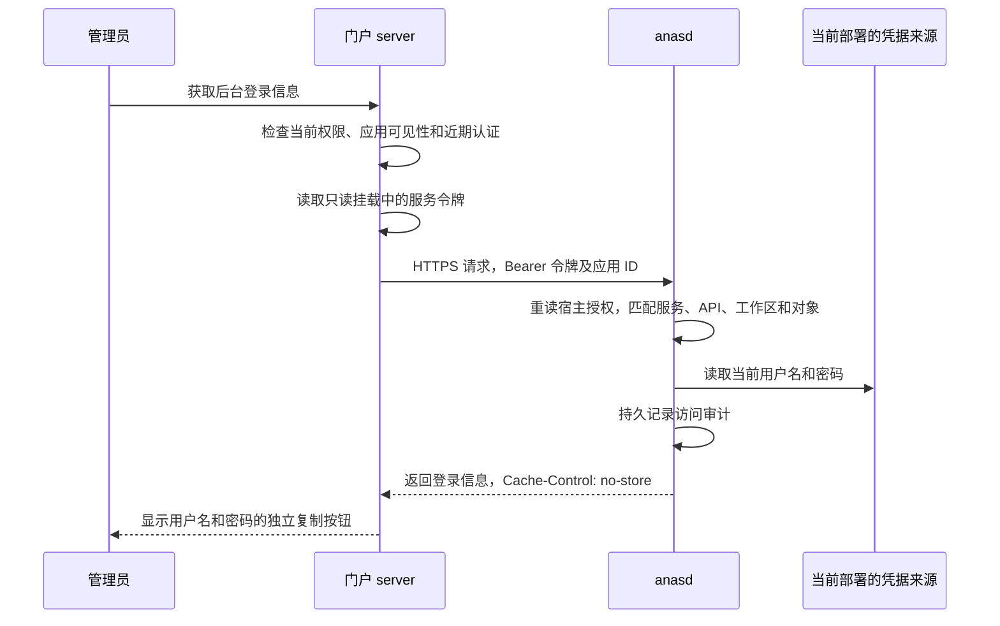

# anasd 服务授权与后台凭据 API

状态：当前模型。代码已实现；实施范围和验证结果见[配套计划](https://github.com/anas-project/ANAS/blob/master/dev-docs/plans/archived/service-api.md)。

对应需求：`SVCAPI-R-001` 至 `SVCAPI-R-018`，见[需求矩阵](https://github.com/anas-project/ANAS/blob/master/dev-docs/requirements/service-api.md)。

## 职责和请求流程

一个门户部署使用一个服务身份和一套令牌。门户 server 判断当前用户是否启用、是否具有管理员权限、是否可见该后台，以及是否满足现有 5 分钟近期认证。认证过期时，门户要求验证管理员本人的密码；该密码不发送给 anasd。

anasd 信任调用服务作出的用户授权决定，但逐请求限制服务能够使用的 API、工作区和对象。服务令牌不映射为控制台 `owner`，不能替代控制台用户会话、CSRF 或原有一次性 step-up。后续服务可以登记独立客户端并复用这一认证机制；新增数据 API 仍需在 anasd 明确实现和登记权限。



调用方提交的 `actor` 是服务报告的用户标识，只进入审计。它不参与 anasd 授权，也不能扩大该服务的权限。

## 宿主配置和权限

服务授权位于 root 管理的 `anasd.yml`，不能放在 workspace 配置中。下面是追加到已有[服务配置](/reference/anasd-service-configuration)的片段；`main` 必须已在 `workspaces` 中登记。

```yaml
service_api:
  credentials_dir: /var/lib/anas/service-clients
  clients:
    - id: user-portal
      enabled: true
      uid: 65532
      gid: 65532
      grants:
        - permission: application.credentials.read
          workspace: main
          resources:
            - traefik-admin
            - ddns-go-admin
            - collabora-admin
```

| 字段 | 含义 |
| --- | --- |
| `credentials_dir` | anasd 管理的专用绝对目录；不得与任何注册 workspace 或备份目的地重叠，包括解析后的符号链接路径。交付层拒绝符号链接祖先。 |
| `clients[].id` | 独立服务身份；1–64 个字母、数字、下划线或连字符，不能重复。 |
| `enabled` | 显式启用；未设置或为 `false` 时不签发、不续期且拒绝鉴权。 |
| `uid` / `gid` | 令牌交付文件的宿主 UID/GID；门户进程默认使用 `65532:65532`。 |
| `grants` | 同一条记录必须同时匹配 `permission`、`workspace` 和 `resources` 中的一个对象，不跨记录拼接授权。 |
| `permission` | 支持 `application.credentials.read`；邮件候选另支持 `mail.ingress.install` 和独立的 `mail.outbound.configure`，这两个权限的资源均只能是 `mail`。 |
| `workspace` / `resources` | 精确工作区 ID 和明确应用 ID；不接受通配范围。 |

anasd 每次服务鉴权和维护周期都通过 `LoadService` 重新读取、校验宿主配置。停用、删除客户端或移除 grant 随下一次请求生效；配置读取或校验失败时拒绝鉴权，不沿用旧授权。工作区注册和交付目录在进程启动时固定，修改它们需要重启。首次增加整个 `service_api` 配置块也需要重启以装配 API。

邮件安装和发信配置接口在返回成功前再次复核服务身份及工作区授权；若调用期间授权失效或身份变化，返回结果未知。底层操作可能已完成，此检查不使操作与撤权原子化，应先核对实际状态。

服务授权配置本身必须位于注册 workspace 之外。工作区恢复可以改变当前生效的应用和密码，但不能恢复已撤销的宿主服务授权。服务令牌交付目录不是后台密码副本，不随工作区备份或恢复。

邮件安装候选使用同级 `mail-installations` 私有目录保存逐工作区操作日志；新增授权时，该目录不得与服务令牌目录、console store、任何工作区或备份目的地重叠，解析符号链接后也须隔离。云操作和配置事务按工作区串行，服务权限在云请求及配置提交前重新验证；审计只记录服务身份、其声明的人员锚点和操作 ID。`actor` 仍只是声明，调用邮件服务必须自行在准备与提交前重新验证管理员。邮件界面的候选调用已接线，操作日志的备份恢复、真实云端及交付仍未完成验收，不能将此权限视为邮件已启用。

`vps-ssh` 安装转发来源时必须同时提供独立投递域、Cloudflare 账号和区域 ID，以及互不相同的区域路由和账号目标令牌；直收不带这些字段。宿主将投递域绑定至 VPS 运行配置和来源身份，仅通过本地 Secret 事务交接两种 Cloudflare 令牌，不发送到 VPS。账号目标权限覆盖整个 Cloudflare 账号；接线不代表目标已验证或邮件已送达。

## 令牌交付和生命周期

默认令牌有效期为 15 分钟，anasd 每 30 秒维护一次；这两个值目前是内部默认值，没有 YAML 调整项。正常续期保持令牌值不变。anasd 内存只保存令牌摘要、到期时间及交付身份，明文仅通过专用文件交付。

| 情况 | 行为 |
| --- | --- |
| 门户停止，anasd 正常运行 | 继续维护已启用客户端，门户恢复后直接读取有效令牌。 |
| anasd 重启，包括宿主长期停机 | 启动时重新签发并原子替换令牌；旧交付文件不能自行证明令牌有效。 |
| 令牌过期、文件丢失或指定 UID/GID 改变 | 为仍启用的客户端重新签发。 |
| 客户端停用、删除或整个配置块移除 | 立即拒绝鉴权，维护周期撤回交付令牌；重启不会恢复被撤销的授权。 |
| 维护失败 | 拒绝不再有效的令牌，记录不含令牌值的错误，并在下一周期重试。 |

路径为 `<credentials_dir>/<client-id>/token`。总目录为 daemon 所有、`0700`；客户端目录为 daemon UID、客户端 GID 所有、`0710`；令牌文件为指定 UID/GID 所有、`0400`。使用默认 root 系统服务时，对应 root 总目录、`root:65532` 客户端目录和 `65532:65532` 令牌文件。anasd 必须具备设置这些所有者和权限的能力；不能假定任意非 root 服务都能为门户 UID 写入文件。

只读挂载客户端目录，不能挂载整个交付根目录，也不能单独绑定 `token` 文件：令牌采用原子文件替换，目录挂载才能让门户看到新文件。门户每次获取都重新读取令牌；遇到 401 时仅在文件值已更新的情况下重读并重试一次。客户端不需要持有过期令牌来换取新令牌，也没有公开刷新接口。

## 后台凭据 API

```text
POST /api/v1/service/workspaces/{ws}/applications/{application}/credentials
Authorization: Bearer <服务令牌>
Content-Type: application/json

{"actor":"当前用户的稳定身份锚点","request_id":"可选关联标识"}
```

接口只在 `full` 状态的直连 TLS listener 开放；明文、bootstrap/enrollment 状态及 trusted-proxy listener 返回 404。既有 Host 检查仍适用。请求不接受 query、任意凭据键或宿主路径；JSON 拒绝未知字段和重复键。`actor` 必填，最多 256 字节；`request_id` 可选，最多 128 字节，均拒绝控制字符和首尾空白。

成功响应包含 `api_version`、`workspace_id`、`application`、`username`、`password` 和 `url`，并设置 `Cache-Control: no-store`、`Pragma: no-cache`。令牌无效返回 401，服务范围不匹配返回 403。未登记、隐藏、停用、IAM 接入、非本地后台或没有明确凭据来源的应用不返回密码。审计失败返回 503，响应中不包含凭据。

anasd 审计类型为 `service.application.credentials.read`，`Actor` 为 `service:<client-id>`，并记录工作区、应用、客户端、`actor_source: service_declared`、服务报告的用户和可选请求关联标识。审计事件结构不接收令牌、密码、用户名或完整响应。门户还沿用自己的操作审计；关闭或离开凭据弹框会清除页面中的凭据，已经复制到系统剪贴板的内容由用户管理。

## 凭据来源和首批应用

当前 API 只读取生效且运行中的部署，复用工作区读锁，不执行 Hook，也不尝试登录目标后台。应用目录只公开是否可获取凭据；具体来源保存在部署冻结的 Module 声明中。

| 应用 ID | 来源 |
| --- | --- |
| `traefik-admin` | 已声明的本地管理员记录及现有 Secret Store。 |
| `ddns-go-admin` | 已声明的本地管理员记录及现有 Secret Store。 |
| `collabora-admin` | 当前生效部署的 Module `.env` 中明确登记的管理员配置。 |

不新增后台密码副本；轮换后读取当前 Secret Store，部署切换后读取新部署。期望配置尚未 apply 时，不把其中的密码当成生效值。旧部署缺少凭据来源声明时不可获取，需重新 apply 包含该声明的 Module。LAM 的目录密码、IAM 恢复账号、ForwardAuth 入口和外部应用不会因没有 OIDC 而自动加入此范围。

## 门户接入与恢复

1. 确保 anasd 具有有效 TLS、已进入 `full`，且门户能解析、访问直连 HTTPS origin。域名需要在 `allowed_dns_hosts` 中，证书需覆盖该域名；门户使用现有 CA 验证链，不跳过证书校验。
2. 在宿主 `anasd.yml` 登记客户端及 grant，然后启动或重启 anasd。首次部署先由 anasd 创建交付目录和令牌，再部署门户，避免 Docker 自动创建权限不符的宿主挂载目录。上例 `/var/lib/anas/service-clients` 位于默认 systemd 服务允许写入的范围；其他位置需配置相应宿主写权限。
3. 在 workspace 的 `user_portal` 参数中同时设置以下三个值，然后按正常部署流程 apply：

   ```yaml
   service_api_url: https://anas.example.test:8080
   service_api_workspace: main
   service_api_credentials_dir: /var/lib/anas/service-clients/user-portal
   ```

   `service_api_url` 是 origin，不附加 `/api/v1`。目录必须是该客户端专用目录。Compose 将其只读挂载到 `/run/anas/service-client`，门户读取 `/run/anas/service-client/token`。

4. 使用有权限的管理员打开明确登记的后台，复用 5 分钟近期认证并获取、复制登录信息。服务令牌不发送给浏览器。

交付目录已经挂载但 token 暂缺、anasd 尚未就绪或后端读取失败时，只影响凭据获取；门户报告暂不可用。anasd 更新文件后，后续请求无需重新部署门户即可恢复。诊断时检查宿主客户端是否启用、grant 是否精确匹配、文件权限、直连 URL 与证书以及脱敏审计，不能通过恢复 workspace 来恢复服务授权。

`mail.outbound.configure` 是独立服务授权：只提交默认发信服务，宿主保留其他服务和域覆盖，以配置与 Secret 事务保存，调用方须自行验证当前管理员。返回 `configured` 只代表保存配置；不部署 DMS、不处置队列或证明送达，结果未知时不能盲目重试。管理员页面候选已接入；调用前后检查人员权限，但宿主提交期间撤权的跨系统边界尚未完成验收。

`mail.ingress.install` 另支持 `cloud-relay` 来源交接：仅接入已运行且通过证书验证的 VPS，核验来源身份、容量、域和通知挑战，沿用工作区授权、操作记录及配置事务。读取、控制和可选通知令牌须相互独立，不返回调用方；该调用不安装 VPS 或启用公网邮件路由。 安装处理返回成功前，宿主再次检查同一服务身份和工作区授权；调用期间授权撤销或身份变化时返回结果未知，因为云资源或配置可能已经改变，不应盲目重试。此复核不能使撤权与跨系统操作原子化。


### 邮件安装专用本地套接字

可在宿主配置中显式添加 `mail_install_socket: {directory: /run/anas/mail-install, group_id: 65532}`，并为同组的启用服务身份授予指定工作区的 `mail.ingress.install` 或 `mail.outbound.configure`；使用两项能力须分别授权。目录须预先由 anasd 运行用户拥有、组为指定组且权限为 `0750`；所有祖先须为 root 或 anasd 运行用户所有，且不能由组或其他用户写入，不允许符号链接。目录启动时只能包含该服务的锁和套接字，不得包含其他文件；配置文件与 TLS 私钥也不得位于其中。anasd 以独占锁创建 `install.sock`（`0660`），只在可证明失效时清理自身遗留套接字，拒绝未知文件和活动监听。配置及目录变更须重启 anasd。

该监听仅允许邮件入站安装和默认发信配置接口，各自需要独立 grant，仍使用 TLS、状态、服务令牌、工作区 grant、重新授权和审计检查；因 Unix 连接没有 TCP 本地地址，Host 单独限制为回环 IP 或宿主显式允许的 DNS 名，带端口时必须等于控制台端口，不暴露通用管理或凭据读取接口。邮件 Module 的 `service_api_socket_dir` 挂载该目录，`service_api_url` 仍需匹配宿主 TLS 证书及允许的 Host。该候选尚需真实容器挂载、安装流程和恢复验收，不代表可部署完成。
