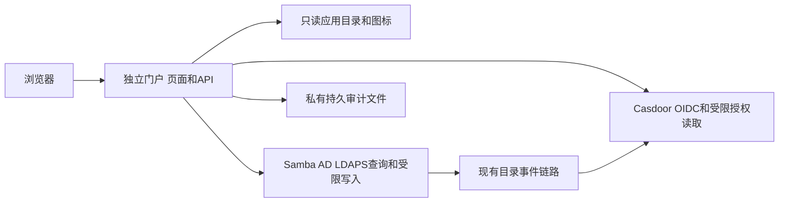

# 独立用户门户设计

**状态：首版及已确认的界面、账号管理和当前浏览器联动退出已实现并在finance复验通过；逐项结果、制品与历史失败保留在配套计划。** 2026-10-11 用户确认“应用入口 +
个人账号 + 委派用户管理”的首版建议及已说明的高复杂度方向。本文细化接线和失败边界；
平台管理使用 ANAS 注册管理员角色；另保留配置显式限定范围的委派路径。
应用展示沿用 [应用目录协议](/architecture/app-catalog-design) 与
[APPCAT-R-001—R-039](https://github.com/anas-project/ANAS/blob/master/dev-docs/requirements/app-catalog.md)。
新增功能满足
[PORTAL-R-001—R-082](https://github.com/anas-project/ANAS/blob/master/modules/user_portal/dev-docs/requirements/user-portal.md) 中仍有效的判据，
实施、能力实验和验收结果只维护在
[门户计划](https://github.com/anas-project/ANAS/blob/master/modules/user_portal/dev-docs/plans/archived/user-portal.md)。
原生协议的能力和限制见 [门户身份与目录能力研究](/research/user-portal-identity-capabilities)；
原生实验通过不代表门户 API、授权或审计已经通过。

2026-10-16 的后续方案单列于[门户用户管理、邮箱归属与域级管理](portal-account-mail-administration.md)：
用户资料编辑、ANAS 管理员管理全部人员、本人域权限与逐次验证、主邮箱/个人自助别名及界面修复。
界面、姓名编辑、平台管理、系统主邮箱和门户建号已在 finance 部署。本地域权限仍使用操作者本人逐次验证，加入域风险组前执行对象所有者移交；域级成功操作只在隔离假域验证。具体制品和验收记录见配套计划；邮件后端与个人别名写入尚未实施。

2026-10-17 已确认新增：门户建号使用指定后端授权账号，只在 Provider 用户 OU 及子 OU 创建普通人员；全部人员管理均限于此边界。Samba mail 由系统按用户名和可配置后缀生成，禁止手工主地址；邮件后端后续消费。当前实现与验收边界分别见模块源码和门户/目录主邮箱配套计划。

## 1. 当前范围与页面

Casdoor 负责日常登录，Samba AD 是用户、组、密码和账号状态的事实来源；
应用文案与图标来自现有只读目录。门户不建立另一套用户/组数据库。

| 页面 | 当前能力 |
| --- | --- |
| 应用首页 | 展示获准应用；用户应用/后台管理两大组；分类开关同时控制两大组的小分类并记住偏好；简介、详情、文档、原样链接及名称/简介搜索；图标按目录实际声明展示 |
| 我的账号 | 编辑姓、名、显示名；只读登录名、实际邮箱；账号和密码状态、到期提示；直接组、间接组和授权来源 |
| 修改密码 | 原密码、新密码与确认；返回目录密码策略结果；成功后重新认证门户 |
| 退出登录 | 清除当前浏览器门户、IAM及已接入Nextcloud/Immich旧会话；保留其他浏览器；部分失败显示未确认和重试，始终可返回主页 |
| 首次/过期改密 | 即使日常 SSO 尚不能完成，也能验证原密码并只修改本人密码；不产生普通门户会话 |
| 用户管理 | ANAS 管理员管理Provider人员OU及子OU中的人员；限定OU建号；受限委派按规则范围搜索、分页、查看账号；重置临时密码、下次登录强改和单独解锁 |
| 分组管理 | 对允许的用户和组增删直接人员成员；展示来源及权限影响 |
| 安全记录 | 用户查看本人的安全操作，审计管理员查看获准范围；记录拒绝、失败、目录结果与同步状态 |

全部账号页面复用目录语言选择：中文和英文，不支持的语言直接选英文；
用户切换语言无需重登，API 与页面一致，不串用身份/语言缓存。
“我的账号”只允许编辑 givenName、sn、displayName，不允许编辑 mail、sAMAccountName 或 anchor。
主邮箱读取目录中由系统生成的mail字段，不用UPN代造，也不允许手工修改；邮件后端之后消费该地址。无法可靠查询的到期时间显示“未知”，不编造日期。

账号停用、无原密码找回、管理员 MFA、跨设备会话列表与撤销、收藏/最近使用、
访问申请、公告和邮件/短信通知保留为后续候选，不进入首版矩阵。
首版在站内显示操作结果；不新增通知渠道或审批工作流。

## 2. 平台角色与受限委派

### 2.1 平台管理员

`administration_enabled` 启用当前 ANAS 注册 Admins 组的 anchor/GUID 角色；Casdoor 原生管理员或同名组不替代该身份。
角色管理Provider人员OU及子OU的账号，不包含服务、计算机和信任主体。默认分组按 Provider 显式注册表及 GUID 识别并按用途分类；未注册/系统组只在页面底部默认折叠的高级视图展示风险。
管理员不能重置本人密码、移除自身管理路径或最后一个可用管理员；姓名修改仍限定三个字段及版本。

`domain_administration_enabled` 默认关闭。开启后的域级人员或分组写入需要当前 ANAS 角色、近期 OIDC、绑定完整参数的限时单次确认，以及操作者本人域密码和原生 AD ACL。
普通写绑定没有全域管理权限，不能代替本人授权。普通操作及ANAS管理员角色组复用5分钟内真实认证；角色组仍需绑定完整参数的页内单次确认。系统组、操作系统权限组和受保护人员操作逐次验证本人域密码；本人改密仍需原密码。普通分组操作不要求确认，全部操作无理由或备注字段。确认及资料写入的细节见扩展方案和 Module 技术文档。

### 2.2 显式范围委派

首版动作集合固定为 `users.read`、`password.reset`、`account.unlock`、
`groups.member.add`、`groups.member.remove`、`audit.read`。
本人查询/改密由本人身份决定，不要求管理员角色。
限定OU建号只由平台管理员路径提供；账号停用和委派配置在线修改没有首版动作。

每条委派规则包含一个稳定规则 ID、操作者组、动作集合、目标人员范围，
以及成员操作可修改的组。操作者组内成员可以按既有嵌套组语义授权，
但一条完整规则必须同时覆盖这次动作、目标人员和目标组。
不能把规则 A 的用户范围与规则 B 的组范围拼起来放行。

目标人员必须在目录 Provider 的人员OU及子OU范围内（默认OU=People）；启用平台管理也不扩大到任意目录位置。
委派规则进一步显式限定目标人员组或人员 anchor，不接受任意 LDAP filter、
任意 DN 或无限制 `*`。目标人员组和操作者组都是授权边界，
不能成为这套门户分组写入的目标。实际部门/业务组名单不由门户猜测。

`delegation_rules` 数组中的单条结构如下；引用替换为实际稳定 anchor 后使用：

```json
{
  "id": "helpdesk-team-a",
  "operator_groups": ["group-anchor-operator"],
  "actions": ["users.read", "password.reset", "account.unlock"],
  "target_user_groups": ["group-anchor-team-a"],
  "target_users": [],
  "editable_groups": []
}
```

同一规则内 target_user_groups/target_users 为显式并集；均为空即不授权。
成员动作必须额外提供 editable_groups。不存在或类型不符的引用拒绝发布，
没有规则时关闭受限委派；本人功能与 §2.1 的平台角色路径分别授权。
`Admins`/`platform_admin` 不隐式拼接或替代这些委派规则。

域管理组、Administrators、Unix Admins、配置中的平台/文件管理员组、
门户操作者组与目标范围组、配置中的额外保护对象全部保护。
目录内置组按 SID 识别，业务用户/组按 immutable anchor 识别；
名称用于展示，DN 仅用于当前 LDAP 寻址。
保护包含直接及间接成员：普通 ROLE 组若能间接授予受保护权力，同样禁止修改。
受保护人员、服务账号和计算机均不能成为委派密码/成员操作的目标。

导航和按钮读取服务器返回的可执行动作。每次 API 请求仍检查当前 AD 人员状态、当前组关系、
委派配置和目标；写入前重新检查，不依赖旧 JWT groups 或前端隐藏按钮。
依赖查询不完整/失败时拒绝请求，不返回旧授权作为降级结果。
密码过期账号只进入受限改密流程，停用/过期的账号不能借此恢复普通访问。

## 3. 单个门户服务与接线

首版按一个独立 Module、单个实例/进程交付静态页面和后端 API，复用 Traefik、TLS、
OIDC 注册、Secret 注入及 deployment 文件共享。Module 名称为 `user_portal`，默认域名前缀 `portal`；参数见 Module 源 README。Module 仍为未发布的 developing 版本；首版运行验收结果见配套计划。



OIDC 使用 Authorization Code + PKCE/S256，由服务器完成 callback、state/nonce、
issuer/audience/signature/有效期与固定回调地址校验。
固定 Casdoor 已实测支持不携带 client_secret 的 PKCE code 交换，首版采用此路径。
不向门户交付普通应用 client_secret：该凭据实测能够调用通用读写 API，不能视为只读授权凭据。
token 保留在服务器；浏览器只持有随机的 Secure/HttpOnly/SameSite Cookie 会话标识。
写请求校验 CSRF/Origin，返回和缓存都不能泄露 Secret。
参考 [OAuth 安全规范 RFC 9700](https://www.rfc-editor.org/rfc/rfc9700.html)；
固定正式镜像的接入正反例已完成验收，具体基线见配套计划。

推荐首版会话仅存服务内存：重启清空会话、要求重新登录，没有额外会话数据库。
登录、敏感操作认证、退出与改密后的会话撤销均操作同一个会话表。
持久状态只保存配置绑定和脱敏审计，不保留密码、人员副本或另一套同步队列。
这比引入数据库/Redis 和高可用会话复制少一层维护；代价是滚动重启不能保留登录，
首版不提供多实例负载均衡。

由 `sub` 中的 immutable anchor 把会话绑定到当前 AD 人员；
同名/同邮箱不能合并或替换身份。查不到、重复、类型不符或不能正常登录时拒绝。
近期重新认证校验已签名 ID Token 的 `auth_time`，不能用 `iat` 或 callback 时间替代。
认证窗口由受管配置给出；初始建议 5 分钟。优先原生 OIDC/API/应用配置，
不预设必须增加 Casdoor 源码补丁。
[OIDC Core](https://openid.net/specs/openid-connect-core-1_0.html) 规定
max_age 与 auth_time 的关系。r12 的真实认证时间、refresh 不更新认证时间和重新输密码更新认证时间
均已实测；但原生浏览器的 max_age=0、prompt=login 会直接复用旧会话。
独立再认证客户端关闭 `enableAutoSignin`/`enableSigninSession` 的原生路径已在 Chrome 验证，
由门户拒绝过期 auth_time，并要求回调身份与原会话 anchor 一致；不能改用 iat 放行。
关闭自动登录不等于禁止旧会话继续授权；实验中直调仍返回旧 auth_time，
新密码表单更新 auth_time，同一身份/近期窗口检查的正反例通过。门户自身已实现拒绝逻辑，并进行真实操作验证。
门户回调中的身份不替换、伪造/缺失时间等反例随实现另验。

目录读取复用 `internal/appcatalog` 的解析、语言和 `BuildView`。
BuildView 只排版已授权条目，不能代替认证/授权。
门户按当前身份及真实 IAM/网关/native 授权事实先过滤，再返回搜索结果、文案和图标。
用用户自己的 OIDC access token 读取原生 UserInfo 和 `/api/get-account` 中的当前组/权限/状态，
按既定正向组 OR 与受管策略绑定校验，核对两个响应的身份与会话 anchor。
`/api/get-user` 会按字段显示规则把停用等字段置零，不作状态依据；
`/api/get-account` 的返回只供后端使用，额外 token 与其他字段不转发给浏览器。
固定模板绑定要求启用/Approved 的 Allow Application 权限、正确的资源和 Read 动作、
固定 `built-in/user-model-built-in` 与完全一致的允许组；当前组取 IAM 本次读取结果。
原生 enforce/batch-enforce 已实验；enforce 对停用/待审批策略仍可能 true，不能单独代替这些检查。
目录缺策略、策略停用、管理员绕过或授权依赖错误均拒绝。
不使用 GetAllowedApplications 原生默认允许，不让门户持有通用 IAM 管理员凭据。
普通应用凭据已实证可读另一组织的用户，不能因此推断用户 token/用户类型 API key 也有相同权限。
原生本人读取路径与拒绝反例已通过能力实验；当前不新增受限接口或源码补丁。
User 类型 key 配合原生 API permission 的组织内单策略读取已验证为备用路径，首版不交付此额外凭据。
接口认证、调用范围和原生目录/图标旁路仍须完成产品反例。
Casdoor 是首要实现；LLNG 的已有目录适配及最终适用判据不被取消，另记验收。

退出从门户受 CSRF/Origin 保护的 POST 发起，先使本地会话失效并丢弃后端 token。
固定退出结果页由浏览器向服务器校验过的 discovery `end_session_endpoint` 发起
`POST`、`credentials: include`，使用当前 IAM Cookie；不发送 id_token_hint 或其他 token，
符合 PORTAL-R-004。后台单独调用登出不能代替清除浏览器的 IAM 会话。
门户与 IAM 使用现有域名布局下的同站 HTTPS，门户回调的 origin 通过原生应用 redirectUris 登记，
供 Casdoor 原生 CORS 放行。只消费原生成功状态，不采用响应中的 HomepageUrl 或浏览器指定的返回地址。
不发送 post_logout_redirect_uri；结果页固定在门户内，已退出 IAM 时仍可完成此步骤。
IAM 不可达、CORS/Cookie 受限或接口拒绝时显示 IAM 登出未确认，并允许重试；本地会话不恢复。
固定版本已用真实 Chrome 验证不传 token 的退出清除当前 IAM Cookie，不能再复用其取得 SSO code，
另一浏览器会话保留，未登记的同站 origin 被拒绝。该补测使用内置组织；其旧 token 仍有效，
不能把 Cookie 退出等同于所有 token 已撤销。ANAS 组织既有补丁的撤销结果另见计划中的集成实验。
门户本地退出、浏览器失败提示及实际 ANAS 接线仍须产品验收。
首版退出范围为当前浏览器；其他设备和未实现对应登出协议的外部应用不承诺同步撤销。
已有 IAM 双向登出与 Back-Channel Logout 的适用要求继续独立追踪。

LDAP 查询复用只读绑定。密码重置/强改/解锁与 group member 写入使用门户专属受限绑定，
不扩大共享 `svc_ldap` 或 `svc_password` 的权限。
现有 svc_password 只有人员 OU 的 Reset Password 权，并拒绝已配置 admin，没有组管理权。
目录 ACL 限定写入属性/对象；门户负责动态操作者、目标人员及间接提权检查。
不能声称 group member 属性 ACL 天然限制其值只能指向某批人员。

LDAPS 校验 CA、服务器名和连接安全，失败拒绝，不退回明文或禁用校验。
门户不持有 Docker socket、宿主 root、Samba Administrator 或任意命令入口。
Provider 所需最小 ACL、保护对象与锚点定位方式先在固定 Samba 版本做反例实验；
不能把现有共享账号的有限权限当成完整委派能力。

## 4. 本人改密、首次/过期改密与管理员重置

本人改密要求原密码；管理员重置依赖受委派权限，不要求知道用户原密码。
AD 的 LDAP Modify 对 `unicodePwd` 使用 old delete/new add 表示 change，
单个 replace 表示管理员 reset。参考
[Microsoft AD 协议](https://learn.microsoft.com/en-us/openspecs/windows_protocols/ms-adts/6e803168-f140-4d23-b2d3-c3a8ab5917d2)。
这解释 AD 协议，不证明 Samba 4.23.6 的全部路径可用。

本人接口从会话取 anchor，不接收另一人员目标。提供原密码与两次新密码；
目录拒绝原密码/策略时不退化为管理员 reset。原密码证明使用目录的 change 语义；
不把普通 bind 因密码状态失败等同于密码错误。

首次/过期入口只接受登录标识、原密码与新密码；服务器定位唯一人员对象并执行原密码验证，
不返回人员资料、组或应用，不生成普通门户会话，不接受委派 reset 凭据替代原密码。
按账号/IP/全局限流；不存在、停用或不符合入口条件的账号采用不泄露存在性的失败响应。
改密后回到 Casdoor 正常登录。固定 Samba 已证明：普通 bind 因首次强改或真实密码到期而拒绝时，
现有只读 svc_ldap 连接仍可提交 unicodePwd 的 delete(当前原密码)/add(新密码)，由目录验证原密码；
错误原密码被拒绝，无需授予 reset 权。普通改密也使用此 change 语义，不以原密码 bind 成功作为唯一前提。
受限入口已实现身份/状态核验、限流和统一失败响应。稳定身份桶命中仍使用统一失败响应，不暴露别名是否存在；提交标识/IP/全局限流在目录查询前执行。
入口可用以前不启用门户管理员强改。

管理员确认目标与操作摘要，近期再认证后提交。系统生成符合实际策略的临时密码，
成功响应中一次交付；不放入日志、URL、后续查询或通知。
下次强改与 reset 有各自的目录结果：全部完成才报告“已重置并要求强改”；
若 reset 成功而强改失败，显示部分完成，不谎称密码已回滚或再次自动重置。
解锁是单独动作，不隐式启用/续期账号或修改密码。

密码策略由 AD 实际判定，包括长度、复杂度、历史、最小年龄和到期；
查不到某项就显示未知。原/新密码与其派生值只在这次请求中使用，不持久保存。
写入超时/连接中断可能已生效；显示结果未知，不自动重放，也不保存密码待补偿。
本人成功改密后注销其门户会话，要求正常重新认证。
AD 改密不等同于所有 IAM/应用 token 立即撤销；跨应用撤销仍按各自既有要求验证。
Samba 默认存在旧密码可用于登录的宽限期，本轮观察到改密后旧密码仍能 bind；
但旧密码不能再用于更改当前密码。不能把改密成功解释为所有密码登录立即失效。
不在门户功能中擅自改动域密码宽限策略。

## 5. 分组修改与结果

页面区分直接成员与角色/嵌套继承，显示其授予的应用和管理动作。
间接成员不能伪装成可删除的直接成员；修改源组需独立拥有其管理权。
首版每次只增删一个指定组中的一个人员成员，不提供组嵌套编辑或 replace 全部 member。
确认页展示人员、组及权限影响；提交时再检查相同规则、保护集合及当前直接成员状态。

LDAP 请求须保证目标仍是查找时的 anchor，改名/DN 复用不能写到另一个对象。
提交前由当前 anchor 对象解析 objectGUID/SID，并再次核验人员、组和保护关系；
组以 <GUID=…> 寻址，member 使用人员的 <GUID=…> 或 <SID=…> 稳定引用。
这些是当前 LDAP 寻址值，不替代业务 immutable anchor。稳定引用不存在时拒绝，不回退到旧 DN。
固定 Samba 已验证这种寻址和单值 add/delete；旧 GUID 在同 DN 重建后失败，不会操作新对象。
只更新这一个成员值，保留其他成员；不替换完整列表，并发添加不同成员也保留彼此结果。
重复 add/缺失 delete 在实验中分别返回 68/53，需结合具体操作和重新读取判断冲突，不能将所有 53 都忽略。
[LDAP Assertion Control RFC 4528](https://datatracker.ietf.org/doc/html/rfc4528)
在固定 Samba 上未获支持，正确编码的 critical 请求返回 12 且不写入；首版不依赖它。
不能把单成员操作宣称为多对象/多组事务。
管理员在门户之外同时修改保护关系也是实验中的并发反例，不靠进程内锁宣称消除了目录竞态。

结果分别表示“AD 已保存”“IAM 同步待完成/已观察”“相关应用会话状态未核实”。
复用现有 Samba→IAM 事件与全量兜底，不添加门户同步守护进程。
权限解释只对已有受管应用/门户动作给出可靠依据，不把每个资源组猜测成某种应用权限。
同期撤权按照现有 APPCAT-R-022 和目录事件/登出要求验收。

## 6. 审计保存与失败语义

推荐首版只用私有持久卷中的 JSONL 追加日志，一个门户进程负责顺序写入并 fsync，
不引入数据库服务或新编译依赖。审计不混入可供其他 Module 读取的目录事件日志，
不公开静态路径。记录操作者/目标 anchor、组 ID、动作、委派规则和配置摘要、
请求 ID/时间、必要差异及各步骤结果，不记 Secret 或完整 LDAP 载荷。

写入顺序为“持久操作意图 → 目录操作 → 持久结果”，审计可写时拒绝和失败也记录；审计不可用时拒绝目录写入并返回带请求 ID 的存储故障。
意图存不下时不发 LDAP 写入。目录已经响应成功、结果落盘失败时保留真实 AD 结果，
向操作者显示审计异常并暂停后续写入；不能声称回滚。
重启读取只有意图的记录为结果未知，供核对，不自动重放密码或成员操作。
最后一条残缺或日志损坏阻止新写入，保留原文件及已完整记录，不自动删除疑似结果。

审计使用单个追加文件，默认容量 64 MiB，配置范围为 1—1024 MiB；容量不足时关闭写入。
维护时保留未完成记录及原始证据，审计文件随 data 备份。
首版审计查询只读取已授权人员范围的记录，并分页；本人只看以自己为目标的安全操作，以及不涉及其他目标人员的本人登录安全记录；
管理员过去操作过其他人员，不因此永久获得这些人员的审计读权。
审计卷随现有 Module 备份/恢复流程覆盖，原记录中的历史配置摘要不能改写。
当前内存会话不纳入备份，恢复后均须重新认证。

审计无法与 LDAP 构成原子事务；记录意图降低“完全无痕写入”风险，但不能凭未完成日志
推断密码是否成功。存储故障、重启、损坏/满盘和部分完成必须作为真实验收反例。
若单实例文件在实测容量下不足，再提出数据库方案并说明新增维护成本；
首版不先引入第二套持久机制。

## 7. 交付顺序和复杂度

按三步交付：先验证固定版本能力和接线，再实现登录/严格应用目录/本人账号与改密，
最后实现范围受限查询、重置、解锁、分组与审计。审计写入保护随首个 LDAP 写入一起交付，
不能留到“管理员功能最后补”。
原应用目录全部适用判据继续归应用目录计划，账号功能用新 PORTAL ID，不重复归属。

整体复杂度仍为 **高**：服务器 OIDC 会话、LDAP 委派 ACL、目录/IAM 同步延迟、
首次/过期密码证明、跨系统结果未知与审计故障都是必要边界。
一个站点进程、内存会话、私有日志和现有同步链保持组件数量最少。
用户已确认该范围与分步方向；不再重复确认是否独立建站或是否具备首版管理功能。
后续候选新增服务/持久机制或扩大目录管理范围时，按实际变化重新评审。

原生 OIDC/API、近期认证、过期密码、最小属性/对象 ACL、稳定成员操作和审计故障的历史验收基线见门户计划；不新增 Casdoor 源码补丁。
2026-10-17 审查补齐配置工具的服务主组检查、资料保存后刷新失败的结果保留和退出后的迟到响应处理；finance新制品复验及后续页内确认、共享分组介绍和手机排版验收已完成，固定制品与逐ID结果见配套门户计划。
目录外并发修改不具备跨对象原子保证。本文描述机制，不代替产品验收。


## 分组共享清单与页内确认

分组信息由各 Module 的 `identity.groups` 声明。Core 在全部 calculate 完成后生成本部署唯一的 `shared/identity-groups/catalog.json`，Samba 与门户通过 `identity.group_catalog: true` 只读挂载到 `/run/anas/identity-groups`。应用入口组沿用既有 `identity.application_group` 和应用元数据；能力组从声明模块发布的列表按所属前缀选取。Samba 的通用组和 AD 内置组介绍在其 manifest 维护。旧 CSV 为清单投影，门户不再猜测 APP_/CAP_ 前缀类别。

默认只列出绑定到实际目录对象的受管组，按应用、能力、文件资源和角色展示名称及介绍。系统和其他分组置于页面底部的“高级”区域，默认折叠；未知组使用 AD 的现有介绍，没有则明确标注。中文/英文随页面语言，未支持语言回退英文。介绍是展示信息，域风险仍根据当前 SID、嵌套关系和 AD 权限计算。

普通受管组（不含 ANAS 管理员角色组）添加直接执行；移除成员及建号、管理员资料修改、重置/解锁在页内对话框核对动作、目标和参数。系统组添加必须页内确认；受管域风险组同样保留本人域凭据及一次性确认。页面及写请求不提供操作理由或备注；写API拒绝已移除的 `reason` 字段。审计仍记录动作、对象、授权和结果，历史记录保留。取消/关闭不执行写入，不使用原生浏览器 alert/confirm/prompt。

ANAS 管理员角色组（含嵌套继承该角色的组）的加入和移出需要 5 分钟内真实认证、页内确认和限时单次参数确认，无需重复输入密码；该角色可管理全部人员和应用，在 anasd 启用 `trusted_proxy` 时还映射为控制台 owner。确认后仍由门户受限分组绑定写成员，不要求开启域级管理，审计规则为 `platform_admin_confirmed`。


## 当前浏览器退出与最小协议元数据

2026-10-19 用户确认当前浏览器范围及最小协议地址例外。门户服务在应用域名固定协议路径提供短期签名的退出桥，父子页面限定 origin、窗口与随机 nonce。桥仅调用内置固定适配器的原生 API，并回读受保护接口；跨源消息不携带应用 Cookie、用户身份或原生返回的 ID Token。Nextcloud 使用本地 core logout，Immich 删除当前 session；现有 IAM 通知继续保留。门户先本地退出、再调用 IAM 及各应用，部分失败可重试，不能回滚成登录态。

此元数据独立于业务目录，不包含应用名称、图标、描述、授权事实或业务 URL。已隐藏/撤权应用仍可能保留旧 Cookie，因此退出覆盖所有已部署、已接入固定协议的应用。外部条目不能声明任意可执行退出地址。当前实现和 finance 验收按门户 M13 跟踪；应用发起来源及全模块矩阵仍归双向登出计划，尚未全量通过。

退出结果的 sessionStorage 只用于匿名会话刷新后保留失败与重试。若 bootstrap 确认已有新的门户登录，应清除旧退出状态并回到应用页，不得继续以旧缓存声称当前浏览器已退出。
