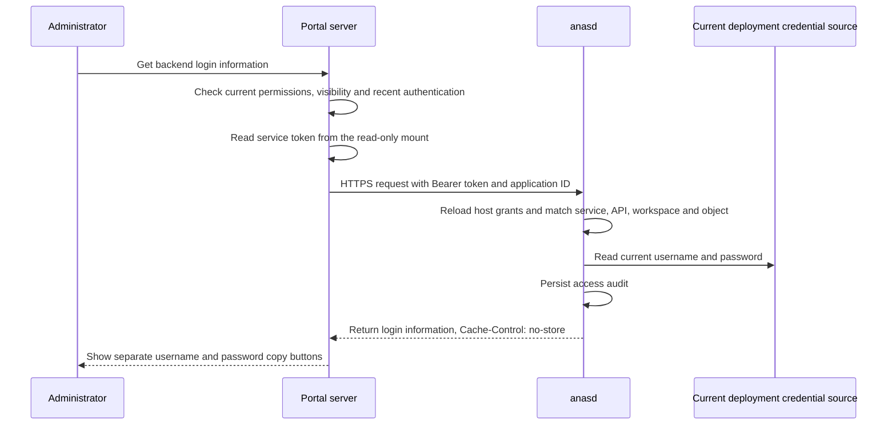

# anasd service authorization and backend credential API

Status: Current model. The code is implemented; scope and verification results are tracked in the [implementation plan](https://github.com/anas-project/ANAS/blob/master/dev-docs/plans/archived/service-api.md).

Requirements: `SVCAPI-R-001` through `SVCAPI-R-018`, in the [requirements matrix](https://github.com/anas-project/ANAS/blob/master/dev-docs/requirements/service-api.md).

## Responsibilities and request flow

Each portal deployment uses one service identity and one token. The portal server checks the current account state, administrator permission, application visibility and existing five-minute recent-authentication window. When that window expires, the portal verifies the administrator's own password; this password is never sent to anasd.

anasd trusts the calling server's user authorization decision while limiting its API, workspace and object access on every request. A service token never becomes a console `owner` identity and does not replace console sessions, CSRF or existing one-use step-up proofs. Other servers can register separate clients and reuse this mechanism; every additional data API still requires an explicit implementation and permission registration in anasd.



The submitted `actor` is a user identifier declared by the calling service and used only for audit correlation. It is never an authorization input and cannot expand the service grant.

## Host configuration and permissions

Service grants belong in root-managed `anasd.yml`, outside workspace configuration. Add this fragment to the existing [service configuration](/en/reference/anasd-service-configuration); `main` must already be registered in `workspaces`.

```yaml
service_api:
  credentials_dir: /var/lib/anas/service-clients
  clients:
    - id: user-portal
      enabled: true
      uid: 65532
      gid: 65532
      grants:
        - permission: application.credentials.read
          workspace: main
          resources:
            - traefik-admin
            - ddns-go-admin
            - collabora-admin
```

| Field | Meaning |
| --- | --- |
| `credentials_dir` | Dedicated absolute directory managed by anasd. It must not overlap a registered workspace or backup target, including resolved symlink paths. The delivery layer rejects symlink ancestors. |
| `clients[].id` | Independent service identity; 1–64 letters, digits, underscores or hyphens, with no duplicates. |
| `enabled` | Explicit enablement. Missing or `false` means no issuance, renewal or authentication. |
| `uid` / `gid` | Host ownership of the delivered token file. The portal process defaults to `65532:65532`. |
| `grants` | A single grant must match the permission, workspace and one resource; scopes cannot be combined across separate grants. |
| `permission` | Currently only `application.credentials.read` is registered. |
| `workspace` / `resources` | Exact workspace ID and explicit application IDs; wildcard scopes are rejected. |

Every service authentication and maintenance cycle reloads and validates host configuration through `LoadService`. Disabling or deleting a client, or removing a grant, takes effect on the next request. Invalid or unreadable configuration fails authentication instead of retaining stale grants. Workspace registration and the delivery directory are fixed at process start; changes require a restart. Adding the entire `service_api` block for the first time also requires a restart to install the API surface.

The configuration file containing service grants must be outside registered workspaces. A workspace restore may change the active application and password but cannot restore revoked host authorization. The service-token directory is not a backend-password replica and is outside workspace backup and restore.

## Token delivery and lifecycle

The default token lifetime is 15 minutes, with maintenance every 30 seconds. These are internal defaults, without YAML tuning fields. Normal renewal preserves the token value. anasd retains only token digests, expiry and delivery identity in memory; plaintext is delivered through the dedicated file.

| Situation | Behavior |
| --- | --- |
| Portal stopped, anasd running | Enabled clients remain renewed; the portal reads a valid token when it returns. |
| anasd restart, including a long host shutdown | Startup issues and atomically replaces the token. An existing delivery file cannot establish its own validity. |
| Expired token, missing file or changed UID/GID | A still-enabled client receives a newly issued token. |
| Client disabled/deleted, or entire configuration block removed | Authentication fails immediately and maintenance withdraws the delivery token. Restart does not restore revoked authorization. |
| Maintenance failure | No longer valid tokens are rejected; errors omit token values and maintenance retries on the next cycle. |

The path is `<credentials_dir>/<client-id>/token`. The root directory is daemon-owned with mode `0700`; each client directory is owned by the daemon UID and client GID with mode `0710`; the token has the configured UID/GID and mode `0400`. With the default root system service, these are a root-owned parent, `root:65532` client directory and `65532:65532` token file. anasd must have permission to set those owners and modes; arbitrary non-root services cannot be assumed to provision files for the portal UID.

Mount the client directory read-only, never the entire delivery root or the token file alone. Atomic token replacement requires a directory mount for the portal to see the new file. The portal rereads the token for each retrieval; on 401, it retries once only if the file now contains a different token. Clients do not need an expired credential to obtain a new one, and there is no public refresh endpoint.

## Backend credential API

```text
POST /api/v1/service/workspaces/{ws}/applications/{application}/credentials
Authorization: Bearer <service-token>
Content-Type: application/json

{"actor":"current-user-stable-anchor","request_id":"optional-correlation-id"}
```

The endpoint is available only through the direct TLS listener in `full` state. Plaintext, bootstrap/enrollment state and the trusted-proxy listener return 404. Existing Host validation remains in effect. The request accepts no query parameters, arbitrary secret keys or host paths; JSON rejects unknown fields and duplicate keys. `actor` is required and limited to 256 bytes; optional `request_id` is limited to 128 bytes. Both reject control characters and surrounding whitespace.

Success includes `api_version`, `workspace_id`, `application`, `username`, `password` and `url`, with `Cache-Control: no-store` and `Pragma: no-cache`. An invalid token returns 401; an unmatched service scope returns 403. Unregistered, hidden, disabled, IAM-connected, non-local or undeclared credential entries never return a password. Audit failure returns 503 without credentials.

The anasd audit type is `service.application.credentials.read`, with `Actor` set to `service:<client-id>`. It records workspace, application, client, `actor_source: service_declared`, the declared user and optional request correlation ID. The audit event structure cannot accept a token, password, username or complete response. The portal retains its own operation audit; closing or leaving the credential dialog clears its page state. Clipboard contents already copied remain under the user's control.

## Credential sources and initial applications

The API reads only an active, running deployment using the shared workspace read lock. It does not execute Hooks or log in to the target backend. The public application catalog exposes only credential availability; source references are frozen in the deployment's Module declarations.

| Application ID | Source |
| --- | --- |
| `traefik-admin` | Declared local administrator record and the existing Secret Store. |
| `ddns-go-admin` | Declared local administrator record and the existing Secret Store. |
| `collabora-admin` | Explicit administrator settings in the active deployment's Module `.env`. |

No additional backend-password replica is created. Rotation reads the current Secret Store; deployment changes read the new deployment. Unapplied desired configuration is never treated as the active password. Older deployments without credential source declarations remain unavailable until the relevant Module is applied again. LAM directory passwords, IAM recovery accounts, ForwardAuth entries and external applications are not enrolled merely because they lack OIDC.

## Portal integration and recovery

1. Ensure anasd has valid TLS, is in `full` state, and its direct HTTPS origin is reachable and resolvable from the portal. The hostname must be allowed by `allowed_dns_hosts` and covered by the certificate. The portal reuses its existing CA-verifying transport and never skips certificate verification.
2. Register the client and grant in host `anasd.yml`, then start or restart anasd. On first installation, let anasd create the delivery directory and token before deploying the portal, preventing Docker from creating a host mount with incompatible permissions. The example `/var/lib/anas/service-clients` fits the default systemd service's writable paths; other locations require matching host write permissions.
3. Set all three workspace `user_portal` parameters and apply through the normal deployment process:

   ```yaml
   service_api_url: https://anas.example.test:8080
   service_api_workspace: main
   service_api_credentials_dir: /var/lib/anas/service-clients/user-portal
   ```

   `service_api_url` is an origin without `/api/v1`. The directory must belong only to this client. Compose mounts it read-only at `/run/anas/service-client`, and the portal reads `/run/anas/service-client/token`.

4. An authorized administrator can open a declared backend, reuse the five-minute recent authentication and retrieve or copy the login information. The service token never reaches the browser.

If the delivery directory is already mounted but the token is temporarily missing, anasd is not ready, or credential reading fails, only retrieval becomes unavailable. Once anasd updates the file, subsequent requests recover without redeploying the portal. Diagnose host client enablement, exact grants, file permissions, the direct URL and certificate, and sanitized audit records. Restoring a workspace cannot restore service authorization.
