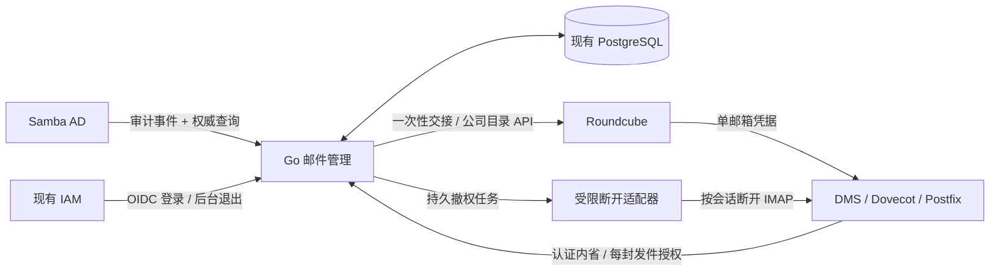

# 邮件管理中间层与门户集成可行性

本文评估在 ANAS 门户与 DMS、Webmail 之间增加邮件管理逻辑，是否能统一多地址管理、稳定账号绑定和无感登录。面向后端选型与开发边界决策；不重新进行 Webmail 产品排名。

> **状态：用户已明确统一方向；隔离 PoC 确认矩阵已完成 20/20，生产实现仍为提案。** 2026-10-24 最新决定：Go 中间件自带 Web 管理页，统一管理邮件身份、主邮箱/别名和独立附加邮箱；Roundcube 与 DMS 都通过 Go 认证并识别邮箱。Go + 现有 PostgreSQL、个人别名最终落 AD、邮件内容保存到邮件 Module 的 `DATA_PATH` 继续成立。人员主邮件地址仍由 `sAMAccountName` 派生，当前不实现改名/任意改主址，只预留将来改名后旧址转本人别名。完整实现复杂度为**高**。finance 实验各轮结果与边界见第 12—15 节；早期失败记录按当时基线阅读，不能覆盖后续复验结果。

正式交付范围现已另立[邮件 Module 与目录集成要求](https://github.com/anas-project/ANAS/blob/master/dev-docs/requirements/mail-integration.md)和[配套计划](https://github.com/anas-project/ANAS/blob/master/dev-docs/plans/mail-integration.md)：一期包含 Go 管理页、主箱/别名/独立箱、AD 公司目录和撤权，二期才实现共享联系人。当前仅新增开发文档，正式实现及验收尚未开始；规范冲突以正式需求矩阵为准。本文继续保存候选机制、实验过程与未验证的生产建议。

## 1. 收敛后的方案

**采用一个邮件 Module：Go 中间件负责管理页面、邮件认证和授权；Roundcube 提供邮件界面；DMS 执行协议认证、收发和存储。** 一个人可有一个主邮箱及其别名，也可有若干独立附加邮箱；它们共用同一套模型、登录与权限判断，不维护两套认证模式。

用户已经选择统一到 Go，本版替代前稿“优先保留 Roundcube 直接对接 IAM、Go 只加邮件授权”的建议。邮件系统只由 Go 对接现有 IAM/AD；Roundcube 不再独立按 OIDC email 认人，DMS 也不再绕过 Go 直接向 IAM 或 AD 校验人的登录凭据。

“全部由 Go 认证”限定在邮件系统边界：Go 验证现有 IAM 的 OIDC 登录结果、建立邮件会话并判断邮箱权限。密码、Passkey、MFA 继续由现有身份设施处理，Go 不复制 AD 密码或重建一个人员身份系统。Roundcube/DMS 仍须验证来自 Go 的凭据并正确执行结果，不能省去协议侧的访问控制。

门户仅提供入口；邮件中间件自己的页面可独立访问并列出本人邮箱、地址及状态。AD、IAM、PostgreSQL、Traefik 复用现有 Provider。首期不引入新的前端框架、Redis、通用消息队列、通用 OIDC Provider 或 IMAP/SMTP 内容代理。把一项地址配置成别名还是独立邮箱，只改变它关联的邮箱资源，不改变人的身份。

## 2. 已有基础与真实缺口

沿用本仓库 DMS 16.0.1、Roundcube 1.7.5、LLNG 2.23.4 的隔离 PoC 结果：

| 项目 | 2026-10-23 原生组合证据 | 对本方案的含义 |
| --- | --- | --- |
| 已有 IAM 登录后进入本人邮箱 | `MAILPOC-R-002` 通过，真实浏览器授权码与 PKCE；没有第二次邮箱密码 | 原生链路提供体验基线，新的 Go 登录交接须独立复验 |
| 无效令牌、跨邮箱访问 | `MAILPOC-R-003` 已测反例通过 | 可复用协议认证起点，完整受众、scope、撤权仍须补验 |
| 多个别名共箱及界面发信 | `MAILPOC-R-005` 通过，别名手工预配 | 中间层需要把预配与授权管理产品化 |
| 主地址变更后的身份连续性 | `MAILPOC-R-004` 失败：原邮件保留，但 Roundcube 新建本地账号，偏好和身份未跟随 | 需修 Webmail 的稳定绑定；只管 DMS 不够 |
| 冒用可见 From | `MAILPOC-R-006` 失败：合法信封配未经授权的 From 被接受 | 需在 DMS 提交邮件的入口强制检查，不能只限制页面选项 |
| 停机备份、空目录恢复 | 已测邮件、附件、状态、Roundcube SQLite 和 Postfix 队列 | 新增的归属库、绑定及操作记录也要纳入恢复 |

上述原生 PoC 的邮箱是预配的，当时未证明 AD 自动开通、个人别名 CRUD、完整登出/禁用或生产公网收发。后续 Go 原型的新增验证见第 12—15 节；正式需求和计划归跨 Module 集成主题，`modules/mail/` 已开始 M1 数据基础（Go Hook、模型和会话存储），尚无可使用的完整邮件服务；执行证据以配套计划为准。当前门户是 Go 服务和自带 JavaScript 界面，不能把 `web/` 管理控制台的 Vue 3 技术栈直接当作门户现状。

规范与执行来源：[PoC 需求矩阵](https://github.com/anas-project/ANAS/blob/master/dev-docs/requirements/mail-webmail-poc.md)、[配套执行计划](https://github.com/anas-project/ANAS/blob/master/dev-docs/plans/archived/mail-webmail-poc.md)。历史结果保留；新增 Go 原型的通过状态单独记录在计划和第 12 节。

## 3. 统一认证与组件职责

```text
ANAS 门户 ──入口──→ Go 邮件中间件 Web
                      ├─ OIDC → 现有 IAM → AD 身份设施
                      ├─ AD：读取身份/主地址，受限写入个人附加地址
                      ├─ PostgreSQL：邮箱归属、地址映射、操作与邮件会话
                      ├─ 一次性登录交接 → Roundcube 插件
                      └─ 配置生成/应用 → DMS

浏览器 ──已交接的会话──→ Roundcube
                          ├─ 登录兑换、续期、当前箱身份 → Go
                          └─ IMAP / SMTP + 单邮箱 token → DMS
                                                           ├─ Dovecot 认证 → Go
                                                           └─ 发件授权适配 → Go
```

| 组件 | 本轮目标职责 | 不再自行决定的内容 |
| --- | --- | --- |
| Go 中间件 | 验证登录、用户与邮箱归属、主地址/别名、开通/停用、单邮箱凭据、发件许可、审计与恢复协调 | 不存放邮件正文，不重新实现 IMAP/SMTP |
| Roundcube 插件 | 兑换登录交接、维护本地邮箱账号/会话、续期、读取当前邮箱可用发件身份 | 不按同名 email 认领用户，不编辑独立地址权威表 |
| Dovecot / Postfix | 校验协议凭据、定位邮箱、执行收件路由和发件拒绝 | 不自行把 AD 用户的全部地址映射成同一个邮箱或一组无限制发件许可 |
| DMS 内的发件适配 | 提取可信认证账号、信封和 From，向 Go 请求判断并执行允许/拒绝 | 不再用另一份 Lua/页面业务规则决定地址归属 |

Go 是邮件权限的唯一决策入口；DMS 的用户表、地址映射和 Roundcube 的 identities 是受管投影。DMS 不需要把每次投递和正文读写变成 Go API：Go 预先确认并生成版本化的账号/路由，协议认证和发送权限查询在线调用 Go。公网入站 SMTP 通常不认证收件人，依靠这些已应用的路由投递，不要求外部发件服务器先登录 Go。

管理服务使用 **Go + PostgreSQL**。通过现有 `relational_database` Contract 的 `postgres` interface 申请独立数据库和普通角色，复用 Provider、Secret 交付及凭据生命周期。[数据库契约](/reference/module-contracts/relational_database)

Roundcube 在同一 Provider 申请另一数据库/角色，核心表及插件表由 Roundcube 维护，Go 不直接改其核心用户表。1.7.5 有 PostgreSQL schema，但本轮没有数据库接线和恢复实测；旧 PoC 的 SQLite 恢复结论不能转用。[Roundcube schema](https://github.com/roundcube/roundcubemail/blob/1.7.5/SQL/postgres.initial.sql)

同一个 Go 进程提供管理、鉴权、目录事件消费和配置核对，不新拆多个服务。配置应用和受控重载走 Module 的受限执行路径，不向门户或管理 API 暴露 Docker socket、任意命令或任意 LDAP 写入。

## 4. 用户、邮箱、地址的统一模型

统一分成三层：**用户是人，邮箱是邮件存储资源，地址决定投递到哪个邮箱及能否用于发送。** 已开通邮件的用户有一个主邮箱，可以再拥有独立附加邮箱；每个邮箱有一个默认地址和零到多个别名。邮箱 ID 只是资源编号，不替代用户的永久身份锚点。

```text
用户 U：同一个 AD anchor / OIDC sub
  ├─ 主邮箱 M1
  │    ├─ alice@example.com        默认地址，来自 AD mail
  │    └─ shopping@example.com     别名，与 M1 共用所有邮件
  └─ 独立邮箱 M2
       └─ work@example.com         默认地址，独立 Inbox / Sent / Drafts
```

在管理页新增地址时，选择“作为已有邮箱的别名”或“新建独立邮箱”。前者只增加地址归属与路由，后者增加邮箱资源、存储、配额和 Webmail 本地账号。两种方式使用同一 Go 授权逻辑；不需要新 AD 人员账号或另起一套 DMS/Roundcube。既有地址在两种类型之间转换涉及邮件归属与迁移，不因提供创建选择就自动支持在线转换。

| 对象/字段 | 保存与规则 |
| --- | --- |
| 人员身份 | AD `anasIdentityAnchor`；受验 OIDC `sub` 必须对应此值，用户名/email 是可变标签 |
| 人员主邮箱地址 | AD 单值 `mail`，仍按 `sAMAccountName` 与配置后缀派生；“设定主邮箱”是预配并绑定主箱，不新增任意主址编辑 |
| 个人别名与附加地址 | 最终保存在 AD；建议复用多值 `proxyAddresses` 表达本人地址归属，不把多箱主址塞进单值 `mail` |
| 邮箱资源 | PostgreSQL 保存 `mailbox_id`、`owner_anchor`、主箱/附加箱标记、状态、存储引用及固定协议登录名 |
| 地址到邮箱的绑定 | PostgreSQL 保存规范化地址到唯一 `mailbox_id` 的映射、该箱默认地址/别名角色、发送策略和应用状态；有效地址归属仍须经 AD 确认 |
| 邮箱本地用户 | Roundcube 维护 `mailbox_id → user_id` 的资源绑定；同一人的不同邮箱使用不同本地用户，偏好自然隔离 |
| 会话/凭据 | PostgreSQL 保存邮件会话、授权版本、交接码/不透明 token 的散列、有效期和撤销状态；不保存 AD 密码 |
| 历史与执行 | PostgreSQL 保存地址预留/退役占用、未完成操作及下游应用版本，支持查询未知结果和幂等恢复 |

个人别名必须落 AD；PostgreSQL 的地址映射补充“投到哪一箱”和操作状态，不成为可绕过 AD 独立生效的有效地址清单。`proxyAddresses` 本身既不表达多个邮箱资源，也不提供全局唯一、配额或发送许可。已有 LDAP 消费者若把某人的所有 `proxyAddresses` 默认指向一箱，必须调整为消费 Go 的映射；不能让 DMS 再独立套用该推断。[Microsoft 属性定义](https://learn.microsoft.com/en-us/windows/win32/adschema/a-proxyaddresses)

附加地址的 AD 投影沿用本人对象和 SMTP 值，先盘点已有 `SMTP:` 主址投影与其他协议值并保留非受管项；本轮不新增 AD schema 或额外登录用户。管理服务当前只需读取人员身份与 `mail`、受限写 `proxyAddresses`；不为未来改名提前取得 `sAMAccountName` / `mail` 写权限。目录变更纳入已有事件机制及全量核对。

Go 只向 Roundcube 返回**当前选中邮箱**的默认地址和已授权别名，不返回这个人全部邮箱的地址并允许混发。没有别名的独立箱只有一个发件地址；有别名的箱可沿用此前已经确认的别名收发能力。Roundcube 的身份列表只是显示，DMS 提交入口仍调用 Go 执行发送许可。若以后希望某些别名仅收信，由明确策略表达，不能因为地址名称叫“别名”就自动允许或禁止发送。

删除别名撤销该地址收发并保留历史邮件；停用独立邮箱保留该箱正文、草稿及历史，不能当作删一条别名直接销毁数据。受保护旧主址不由个人页面任意删除，退役地址首期不自动分配给其他人。用户禁用撤销其所有邮箱访问，单箱停用只影响目标箱；账号禁用后的收信策略不等于自动删除邮箱。

### 为未来修改 sAMAccountName 预留，当前不实现改址

将来若开放把 `sAMAccountName` 从 `alice` 改为 `a.wang`，同一邮件后缀下的目标结果是：

```text
mail: a.wang@example.com
proxyAddresses: smtp:alice@example.com
proxyAddresses: smtp:shopping@example.com
```

当前只预留四项不变量：身份按 anchor 绑定；邮箱存储位置不依赖用户名或地址；Webmail 绑定可定位原有用户；地址记录能表达当前主址、有效别名与历史占用。将来变更时才协调新地址冲突、AD 更新及旧址转别名，保持邮件、签名、文件夹和偏好。新地址若原本就是本人别名，应在该变更内处理重叠，不因此新增“设为主地址”功能。

不在当前实现改名表单、改址 API、批量迁移任务或完整改名恢复流程。未来设计需要将 `sAMAccountName`、派生 `mail` 与旧址保留一起考虑，并验证其他消费登录名的应用；单对象 LDAP Modify 的原子性不等于 AD、PostgreSQL、DMS 和 Webmail 的共同事务。[LDAP Modify 语义](https://www.rfc-editor.org/rfc/rfc4511.html#section-4.6)

当前 `anchor_worker/mail_policy.py` 按用户名和后缀计算主地址，`anchor_worker.py` 会在事件/全量核对时写回；`save_mail()` 只改 `mail`，不会自动保留旧址。**本轮保留系统派生规则，不让邮件管理服务接管任意主址编辑，也不要求 Worker 停止计算。** 以后开放改名时再接入统一变更流程。绕过受管入口直接修改 AD 登录名并不能获得上述尚未实现的保证。

既有目录阶段支持配置后缀及更新派生地址，这项历史实现仍存在；最新邮件提案不把它扩展为已支持的邮箱迁移功能。现行 `MAIL-R-003`—`MAIL-R-005`、`MAIL-R-007` 及历史验收保留。邮件 Module 接入后，既有后缀变更路径仍需评估准入与冲突，不能任其绕过邮件归属约束；当前提案不新增主域迁移能力，也不承诺后端迁移已可用。

### 全局唯一性不能只靠门户里的锁

地址库可以用规范化地址的唯一索引防止两人同时申请同一别名，但这**不能自动防止**目录建号或主域迁移抢占同一地址。现有 `create.go` 是 LDAP 预查再建号；Samba 主地址维护也不是邮件库事务的一部分。

要承诺受管流程内的全局唯一，门户建号、Samba 主地址维护和个人别名写入都需要接入同一地址预留机制：先持久预留，再写目录/下游，最后确认；结果未知时查实际状态，不能超时便释放地址。这会改动现有主地址调用路径，是本方案主要复杂度之一。

这也需要区分“未安装邮件 Module”和“已安装但管理组件暂时离线”：前者沿用目录建号，安装邮件时全量盘点导入；后者暂停可能冲突的地址写入，不能退回不预留的路径。启动时先读取已有目录完成导入，再开放邮件地址变更，避免让 AD 初始化与依赖 AD 的邮件管理服务互相等待。

对绕过 ANAS 的直接 LDAP 写入，数据库无法提供跨系统原子约束。应通过 ACL 和运维边界限制写入，检测到冲突时停止为该冲突地址开通或重分配并报告，保留原邮箱。不要用事件最终到达来声称消除了并发竞态。若不接受统一预留，需另行确认“受管主地址与别名使用不重叠命名空间”等简化策略，不能暗中降低唯一性保证。

### 同时支持两种地址形态的成本

原来比较的是“一箱多别名”和“每个地址独立邮箱”二选一；用户现在明确由 Go 统一管理两种形态。对应模型只需要“人 → 多个邮箱 → 每箱多个地址”，不做两套认证或两份地址权限规则。单箱别名共享历史，独立箱隔离历史，二者可在同一用户下并存。

Roundcube 1.7.5 可配置单身份且不可修改 email（`identities_level = 3`），或只允许编辑签名（`4`）。有别名的邮箱由插件投影多个受管身份并禁止地址自行编辑；无别名的箱只展示一个身份。具体按箱配置与已有身份清理仍需验证，不能仅设置全局单身份模式就满足混合模型。[固定配置](https://github.com/roundcube/roundcubemail/blob/1.7.5/config/defaults.inc.php)

一套 DMS 预配多个账号是原生能力；增加别名和增加账号是不同操作。[DMS 固定版本说明](https://github.com/docker-mailserver/docker-mailserver/blob/v16.0.1/docs/content/config/account-management/provisioner/file.md) 邮箱数量增多会增加开通/停用、配额、备份对象，集中到 Go 能避免各组件重复解释归属，但不会取消这些资源生命周期。

Roundcube session 保存一组 `user_id`、用户名和存储连接；同源标签页通常共用 cookie。因此管理页选择 M2 不能只覆盖 M1 的全局会话后任由旧写信页继续提交。建议首个隔离实验先用单个活动邮箱验证切换和旧请求拒绝，再明确多标签页同时使用不同邮箱的会话方式；这不是已经确认的产品功能限制。[登录与会话源码](https://github.com/roundcube/roundcubemail/blob/1.7.5/program/include/rcmail.php)

原 `MAILPOC-R-005` 的“同箱两个别名可收发”仍适用于主箱别名这一部分，历史实验结论保持。独立附加箱和 Go 统一认证属于新增目标，不能用原有 8/10 结果宣称通过；进入实施时需要扩展配对需求与计划。

## 5. 当前如何认人，认证能否放到 Go 中间层

### 5.1 当前 PoC 有三种不同的“身份”

下面是仓库隔离 PoC 的真实配置，不是已经上线的邮件 Module，也不代表 DMS 默认只支持这一种认证方式。

| 层次 | 当前依据 | 实际含义 |
| --- | --- | --- |
| IAM / AD | 永久 `anasIdentityAnchor`；OIDC `sub` 为该 anchor | 判断登录的是哪个人；不随邮箱地址变化 |
| Roundcube 浏览器与本地用户 | 授权码 + PKCE；`oauth_identity_fields = ['email']`；本地按 `username + mail_host` 找 `user_id` | 拿到 OIDC 身份和 access token 后，仍以 email 匹配保存偏好、身份等数据的账号 |
| DMS / Dovecot | XOAUTH2/OAUTHBEARER 中的登录用户名 + access token；向 IAM UserInfo 校验，默认以返回的 email 匹配用户名 | 验证邮件协议访问；不是看到门户登录 cookie 就信任用户 |
| DMS 账号与存储 | 手工生成 `postfix-accounts.cf`；email 账号映射固定 `userdb_mail_path` | userdb 决定实际打开哪个邮箱目录；OAuth 不自动开通邮箱 |
| DMS / Postfix | SMTP AUTH 使用 Dovecot 认证；另检查发件地址 | 登录身份、信封发件人、可见 From 是不同字段；认证成功不等于任意地址均可发信 |

PoC 只启用 `oauthbearer xoauth2`，文件内的随机密码不是 AD 密码，也不是为了 SSO 复制的密码。Roundcube 把 access token 作为邮件协议凭据交给 DMS；DMS 配置 `OAUTH2_INTROSPECTION_URL` 指向 IAM `/oauth2/userinfo`，不能因此声称已经验证 RFC 7662 introspection、所有受众/scope 或目录撤权。依据为本地 `mail-webmail-poc-prepare.py` 与协议实验；固定源码见 [Roundcube 登录](https://github.com/roundcube/roundcubemail/blob/1.7.5/program/include/rcmail.php)、[OAuth 实现](https://github.com/roundcube/roundcubemail/blob/1.7.5/program/include/rcmail_oauth.php)。

这也解释了已有失败：更换 email 后，DMS 仍可找到固定邮件目录，但 Roundcube 按新 email 建了另一个 `user_id`。别名路由本身只表示“邮件投到哪”，既不创建独立用户，也不自动赋予网页登录资格或可见 From 的发送权限。

### 5.2 当前选择：Go 是邮件系统唯一认证与授权入口

三项决策统一在 Go：验证当前登录的人；判断其能否访问选中的邮箱；判断该邮箱能否使用某个地址。Roundcube 和 DMS 各自保留必要协议校验，但不再自行解释 AD email、别名、多箱归属。此前“Roundcube 原生 OIDC + Go 部分校验”只保留为历史比较，不是本版推荐接线。

Go 作为一个 OIDC client 复用现有 IAM，会检查 issuer、audience、签名、有效期、state/nonce、PKCE 和主体绑定，再建立自己的邮件会话。已有且符合策略的 IAM 会话可实现免重复输入密码；会话过期或 MFA/近期认证要求交互时照常处理。直接打开 Roundcube 也回到 Go 的入口，不保留可绕开 Go 的备用密码登录。

Go 对外提供邮件管理页和有限用户操作；内部接口按调用方分别授权：Roundcube 只能兑换与自己的待登录状态关联的交接、续用已绑定会话、获取当前箱展示信息；Dovecot 只能验证协议凭据；发件适配只能请求发送许可。不能给任一服务一个可任意指定 anchor 代登录所有人的通用接口。

### 5.3 浏览器登录交接与 Roundcube 适配

1. 用户在 Go 页点击某箱的“打开邮箱/写邮件”。目标 `mailbox_id` 只是资源选择，Go 必须用当前已认证主体核对归属、准入和开通状态。
2. 浏览器进入 Roundcube 插件的受控起点，建立待登录状态并回到 Go。Go 将本次授权绑定到主体、目标邮箱、Roundcube 实例和固定回调，生成短时单次交接 code。
3. 浏览器只携带该 code 返回 Roundcube；插件验证原浏览器状态，经有服务鉴权的后端接口兑换。Go 原子消费 code，返回目标箱的固定协议登录名、短时邮件凭据、当前箱发件身份及会话绑定。
4. Roundcube 插件走正常登录链路，以该凭据连接 DMS；成功后由 Roundcube 自己设置浏览器 session cookie。Go 的后台 HTTP 客户端登录所得 cookie 不能代替这一步。
5. Roundcube 只通过这条会话关联向 Go 续期；Go 每次检查用户/邮箱状态和授权有效性。退出、禁用或单箱停用使相应会话/凭据失效，不能仅销毁一次性交接码。

交接 code 必须短时、单次、不可跨实例/浏览器状态重放；回调不接受任意外部地址，日志与 Referer 不泄漏 code。浏览器 URL 不包含邮件 access token、refresh token 或密码；Roundcube 服务端所需凭据按其加密会话机制保存，Go 数据库只保存不透明凭据散列及授权元数据。

固定 1.7.5 的官方 `autologon` 示例使用 `startup` / `authenticate` 注入用户名和凭据，说明具备接入点；示例硬编码 localhost，仅用于说明扩展机制。[源码](https://github.com/roundcube/roundcubemail/blob/1.7.5/plugins/autologon/autologon.php) `storage_init`、`smtp_connect` 支持设置协议认证参数；专用插件负责 XOAUTH2/OAUTHBEARER、续期、当前箱身份投影和登出。[OAuth 参考实现](https://github.com/roundcube/roundcubemail/blob/1.7.5/program/include/rcmail_oauth.php)

插件是必要适配，不把官方示例当作现成生产 SSO 接口，也不另实现完整 OIDC Provider 来伪装给 Roundcube。Go 集中业务规则，PHP 插件只做协议/会话接线；固定版本能否完全通过插件完成、是否有小范围补丁，仍由窄原型判断。

### 5.4 DMS 向 Go 认证：每个凭据仅绑定一个邮箱

推荐 Go 签发高熵、短时、可撤销的不透明邮件 token，绑定经过验证的人员 anchor、`mailbox_id`、邮件会话、有效期、授权版本和允许用途。它是邮件协议的访问凭据，不是新的人员密码，也不是修改 IAM 的 `sub` 或 email。IAM 登录令牌不直接转发给 DMS，DMS 不接受任意门户 token。

```text
Roundcube server
   └─ XOAUTH2 / OAUTHBEARER：固定邮箱登录名 + 邮件 token
        └─ DMS / Dovecot
             └─ 有服务鉴权的校验请求 → Go
                  ├─ token 是否存在、有效、未撤销
                  ├─ 绑定会话、人员和目标邮箱是否仍有效
                  └─ 返回 active、唯一协议 username、有效期等字段
```

Dovecot 原生 OAuth passdb 支持 HTTP JSON 校验，可配置 `username_attribute`、`active_attribute` 与 `active_value`。建议按固定版本验证 `POST` 校验、`active=true` 判定、强制在线校验、缓存与失效策略，并要求返回的用户名与协议请求的用户名相匹配。拿 M1 的 token 请求 M2 必须失败；不能只验证 token 合法就允许随意切换用户名。[Dovecot 2.3 文档](https://doc.dovecot.org/2.3/configuration_manual/authentication/oauth2/)、[RFC 7662](https://www.rfc-editor.org/rfc/rfc7662.html)

接口协议优先采用标准 introspection 的请求/响应语义并按 Dovecot 固定版本接线；这不意味着要实现公开的通用 OAuth 授权服务器。Go 可以由受控邮件会话生成内部单箱凭据。只保存散列和绑定，续期轮换凭据并重查授权；不能让 Roundcube 持有一个不关联用户会话、可无限换取任意邮箱 token 的总钥匙。具体期限和缓存窗口需满足既有撤权要求，不在研究里任意放宽。

Go 拒绝服务或权限状态无法确认时，新认证失败；不退回本地密码、直接 AD 或 Dovecot master 用户绕过统一策略。Dovecot userdb 与 Postfix 收件账号仍须提前预配；token 校验不负责凭空创建邮件目录。SMTP AUTH 复用 Dovecot 认证。[DMS OAuth2 说明](https://docker-mailserver.github.io/docker-mailserver/latest/config/account-management/supplementary/oauth2/)

token 过期/撤销不会自动断开已经建立的 IMAP/SMTP 连接。既有连接撤权、Webmail 失效与 Dovecot 会话终止必须一起实验；不能以新认证拒绝通过来代替完整退出验收。非浏览器邮件客户端若以后接入，也应通过 Go 的受限凭据能力，不新增绕过入口；本轮不扩展其客户端配置/凭据产品范围。

### 5.5 稳定邮箱身份及多个邮箱的绑定

身份链固定为：**受验 anchor → 有权访问的 mailbox_id → 固定协议登录名 / 存储位置 / Roundcube user_id**。同一人有 M1/M2 时得到两个资源绑定，但人的 `sub` 不变；主地址和别名都只是该资源的地址属性。

优先验证从首次预配起固定每箱的 `protocol_login`，Roundcube 按此登录名和 host 复用本地账号，Dovecot 按此定位邮箱。协议登录名使用独立资源标识，不使用原始 anchor；DMS 文件 provisioner 要求的邮箱格式、默认发件地址、收件路由、配额/Sieve/管理脚本需一起验证。若采用邮箱形式的内部登录名，它不能自动成为公开可收发地址或泄漏为用户默认 From。

Roundcube 插件再保存 `mailbox_id → user_id` 对照并检查一致性，不仅保存 `anchor → user_id`，否则同一人的多个邮箱会冲突。Go 保持 owner 关系，插件不按相同 email 自动认领或合并账号。固定源码仍按 `username + mail_host` 查询用户，这条路径需要实测，不能只添加一个数据库字段便宣称改址兼容已解决。[登录实现](https://github.com/roundcube/roundcubemail/blob/1.7.5/program/include/rcmail.php)

如果 DMS/插件不能可靠使用固定内部登录名，再评估范围明确的用户映射适配，不能悄悄改回 email 作为永久身份。将来修改 `sAMAccountName` 时只改主箱的地址映射，旧址仍指该箱，附加箱不自动改名。生产改名功能仍延后，`MAILPOC-R-004` 历史失败状态保持。

### 5.6 其他前端是否更适合中间层代办登录

| 产品 | 官方接入能力 | 仍需解决的部分 | 对 ANAS 的判断 |
| --- | --- | --- | --- |
| **Roundcube** | 原生 OAuth；官方自动登录示例及认证、协议连接 hook | Go 交接需专用 PHP 插件；稳定本地身份需验证 | 保留首选，有现成 PoC，不能判断为“做不到” |
| **SnappyMail** | `CreateUserSsoHash()`；`login-external-sso` 接收 Email/Password/SsoKey，返回供浏览器跳转的 hash | 接口仍要求邮件凭据，不能只提交 anchor；OAuth/刷新适配、email 相关用户状态与正式发布维护需另验 | 代办登录入口更现成，但不保证总改造量更小 |
| **SOGo** | `SOGoTrustProxyAuthentication` 信任受控代理用户头；另有原生 OIDC + XOAUTH2 | 信任 Web 身份不自动获得 IMAP/SMTP 凭据；可信头防伪、协议 token、稳定用户与登出仍需集成 | 若强制集中代理认证，最值得做独立比较；运行栈更重 |
| **Afterlogic WebMail Lite** | 官方 PHP `GenerateSsoToken(email, password, login)` + 浏览器 SSO 跳转 | 仍需密码式邮件凭据；文档明确 login 与 email 不同不受支持，未来改址绑定需额外设计 | 有现成 SSO API，但当前未显示优于 Roundcube 的综合收益 |

SnappyMail 固定 v2.38.2 的 [API](https://github.com/the-djmaze/snappymail/blob/v2.38.2/snappymail/v/0.0.0/app/libraries/RainLoop/Api.php) 是 PHP 进程内调用；Go 可对接其[外部 SSO 插件](https://github.com/the-djmaze/snappymail/blob/v2.38.2/plugins/login-external-sso/index.php)或受限桥接，不能把 PHP 函数当作现成 Go SDK。其 [proxy-auth 示例](https://github.com/the-djmaze/snappymail/blob/v2.38.2/plugins/proxy-auth/README.md)使用 Dovecot master user，代价是特权协议凭据，不能省略。SSO hash 接口的现成存在也不代表单次消费、浏览器绑定等边界已经通过 ANAS 验证。

SOGo 的[代理认证说明](https://www.sogo.nu/support/faq/how-to-use-webauth-with-sogo.html)是较早 FAQ，现行[安装手册](https://www.sogo.nu/files/docs/SOGoInstallationGuide.html)另说明 OIDC 模式只有 token、必须为邮件协议配置 XOAUTH2；不能把两个模式随意混配便视为已接通。mailcow 有可核对的[代理代登录实现说明](https://docs.mailcow.email/troubleshooting/debug-admin_login_sogo/)，但使用所有邮箱通用的 Dovecot master 密码，属于另一种权限模型，不建议直接照搬为 ANAS 默认。可信头方案必须清除外部同名头且限制后端直达。

Afterlogic 的依据是当前 [WebMail Lite SSO 文档](https://afterlogic.com/docs/webmail-lite/developers-guide/integration-via-single-sign-on)，不是旧 Lite 7 的 `CApi` 示例。本轮只确认接口语义，未测试当前制品。Nextcloud Mail、MailFlow 的站点 OIDC 登录同样不等于已取得 DMS 凭据，详见[产品比较](./self-hosted-webmail-ui-research.md)。

## 6. DMS 预配与发件授权

Go 从已确认的 AD 归属和 PostgreSQL 邮箱映射生成 DMS 账号、收件路由及必要的发件映射，带应用版本并回读结果。每个独立邮箱对应自己的账号和存储位置；别名路由指向已有箱。一个地址不能既归 M1 又归 M2，不把“用户拥有两个箱”扩大为“一个箱可任意使用另一个箱的地址”。

优先验证 DMS 文件 provisioner。固定协议登录名与存储引用从预配起保持稳定；若需使用 userdb 附加字段改路径，固定 v16.0.1 文档明确警告其他管理脚本可能有路径假设，因此配额、Sieve、删除、升级与恢复不能直接判为兼容。[固定说明](https://github.com/docker-mailserver/docker-mailserver/blob/v16.0.1/docs/content/config/account-management/provisioner/file.md)

发件有两个约束，均由 Go 的当前箱地址策略决定：

| 检查 | Go 的决策 | DMS 的执行 |
| --- | --- | --- |
| 信封 `MAIL FROM` | 已认证邮箱是否允许使用这个地址 | 可由 Go 生成版本化 sender-login 映射先行拒绝；该映射是可重建投影，不是另一份可手改策略 |
| 邮件头可见 `From` | 已认证邮箱是否允许使用解析后的 From；同时复核信封、账号及地址当前状态 | DMS 内容检查适配调用 Go；拒绝结果必须在 SMTP 提交结束前生效 |

建议复用 DMS 的 Rspamd：很薄的 Lua 适配只从受信 MTA 元数据提取认证用户名、信封及原始/解析后的 From，带服务鉴权向 Go 查询，执行允许/拒绝/临时失败。归属、有效状态和允许地址集合只在 Go 判断；适配器不另存一份业务白名单，也不把整个邮件正文发送到 Go。[Rspamd task API](https://docs.rspamd.com/lua/rspamd_task/)、[HTTP 请求接口](https://docs.rspamd.com/lua/rspamd_http/)

这是上游接口支持的候选路径，尚未在 DMS 制品中通过验证。必须验证 Postfix 的可信认证账号确实传到适配器，不能信任浏览器或邮件头自报的用户；同时覆盖所有允许用户提交的入口，避免内部容器路径绕过检查。Go 无法确认许可时用户提交应临时失败，不能降级为只相信页面身份列表。公网他人入站、退信、本机系统发信按不同来源处理，不误套用户提交策略。

显示一个发件地址不代表服务器已经限制为一个地址；SMTP 信封检查也不能替代可见 From 授权。无论主箱有多个别名还是附加箱仅一个地址，这些检查均保留。旧 PoC `MAILPOC-R-006` 仍失败，新适配必须以绕过 Webmail 的协议反例证明修复。

## 7. 地址、邮箱操作与部分失败

**新增别名**：Go 校验当前人员对目标箱的操作权限、域和配额 → PostgreSQL 预留地址并保存操作 → 受限 LDAP 写 AD 并回读 → 配置到原箱的收件路由/发件规则 → 确认下游版本 → Roundcube 插件显示当前箱的新身份。不新增收件箱或协议账号。

**新增独立邮箱**：沿用同一地址预留与 AD 归属确认，再创建 `mailbox_id`、固定协议账号、独立存储/配额和本地 Webmail 绑定；全部就绪后才允许 Go 签发该箱凭据。IAM/AD 中仍是同一个人。具体哪些角色可自助开通独立箱、数量与配额属于后续部署策略，不因研究中支持资源类型就默认放开所有用户权限。

**移除别名/停用邮箱**：Go 先持久记录撤销意图并拒绝受影响的新凭据或发件许可，再停止相应新路由、更新 AD/下游并回读。移除别名保留原箱邮件；停用独立箱保留整个资源及数据，不直接调用带数据删除语义的后端命令。未知结果保持“处理中/待核对”，不自动恢复授权或释放占用。

AD、PostgreSQL、DMS、Roundcube 没有共同事务。Go 保存操作和配置版本，以幂等方式应用并回读；AD 成功而下游失败时继续完成原操作，不能用旧数据库快照覆盖回 AD。未写入 AD 的待申请地址不能被当作有效地址；有 AD 值但还未完成邮箱映射的地址也不能被任意认领。相关配置未确认时阻止受影响的新访问/发送。

Go 是唯一受管入口不等于可以忽略其他目录写入：目录建号、已有后缀更新与邮件地址预留仍要协调，绕过入口的 LDAP 修改要检测冲突并阻止错误投影。若 MX 走 Cloudflare，外部路由也成功后才能显示收件就绪；不以本地配置成功代替完整收件路径完成。[托管与路由研究](/research/mail-routing-alias-and-module-access)

## 8. 管理页面、权限和故障边界

中间件 Web 是邮件功能入口。个人页显示主箱/独立附加箱、每箱地址、收发状态和“打开邮箱/写邮件”；新增时区分“为已有箱添加别名”和“新增独立邮箱”。管理页显示人员目录及其邮件资源，姓名和登录名来自 AD，资料修改沿用既有受限接口。当前没有改 `sAMAccountName`、任意改人员主地址或别名提升入口。

普通操作从 Go 已认证主体确定 owner，并校验选定 `mailbox_id`；管理员管理邮箱资源使用独立动作和目标授权，不自动获得读取邮件或代登录他人的能力。Roundcube 只收到当前箱的身份集合，签名等允许编辑的偏好留其本地账号；所有地址编辑统一回到 Go。

门户只登记入口，直接打开中间件也能经 IAM 登录。直接打开 Roundcube 会回到 Go 的受控登录流程。优先独立页面和返回管理页入口，不默认用 iframe 或重写邮件内容 UI。切换邮箱时必须防止旧标签页、草稿及提交请求继续使用错误的邮箱上下文；多箱并行会话能力仍待验证。

| 故障/事件 | 目标行为 |
| --- | --- |
| 门户不可用 | 可直接访问 Go 邮件页，或从 Roundcube 回到 Go 登录 |
| Go 不可用 | 新登录、交接、续期、Dovecot 新认证和需实时发件授权的用户提交失败；没有直接 IAM/AD 或 master 密码回退 |
| PostgreSQL 不可用 | 不能确认会话、邮箱绑定和权限，Go 拒绝新授权；使用 PostgreSQL 的 Roundcube 本身也可能不可用 |
| IAM 不可用 | 新人员登录或需重新认证/刷新上游会话的操作失败；已建立 Go 会话是否仍有效按既有认证和撤权策略，不无限期续用 |
| AD 不可用或事件滞后 | 冻结目录相关变更；身份/地址状态的新鲜度超过既有要求后拒绝相应新访问和发送 |
| Go/数据库故障期间入站投递 | DMS 已确认的收件路由、邮箱和队列可按自身依赖继续工作；不承诺离线新增地址或立即获知目录变更 |
| 人员禁用/退出 | 撤销相应 Go 会话/凭据、Roundcube 会话，处理既有协议连接；不能只清除浏览器 cookie |
| 单箱停用 | 撤销该箱凭据和发件许可，保留数据；其他箱不因资源操作被删除 |

状态新鲜度与撤权时效继承[目录事件要求](https://github.com/anas-project/ANAS/blob/master/dev-docs/requirements/directory-event-subscription.md)。集中认证使 Go 成为关键运行依赖，需要健康检查、超时和故障可见性；本轮不因此提前增加集群、Redis 或通用任务系统。

## 9. 保存、备份与技术栈

邮件正文、草稿、已发送、附件、临时附件、隔离区和 Postfix 队列继续放邮件 Module 的 `DATA_PATH`，管理组件不另缓存完整正文。**复用共享 PostgreSQL 后，数据库物理文件由 postgres Module 保存，AD 文件由 samba_dc 保存；它们逻辑上属于邮件恢复依赖，但不会物理搬进邮件目录。** 这是本次数据库选择对前稿保存描述的修订，不能继续承诺“只备份邮件目录就能完整恢复”。原始 anchor 只在内部绑定字段与允许的管理视图使用。

首期优先复用已有 ANAS workspace 停机备份/恢复集合，覆盖邮件文件、AD、共享 PostgreSQL、IAM 和 Secret，并记录各应用一致基线。现有 `relational_database` Contract 负责 ensure/inspect/轮换等生命周期，没有可直接假定的单邮箱事务备份接口。若将来要求只恢复邮件而不回退其他 PostgreSQL/AD 消费者，需要另外验证应用停写、指定数据库导出和目录核对；不将这一能力算作已支持。

恢复后先核对 AD 身份、主地址、有效别名、独立邮箱映射和 PostgreSQL 的历史占用/撤销状态，确认配置版本，再开放用户提交；旧备份不能自动复活已撤销地址或覆盖后来转让的归属。仅从当前 AD 别名列表无法重建已移除地址的保留记录。若保留人工地址释放，需可对照的最新归属记录；本地旧快照无法凭空推断备份之后的变更。配置加密密钥、IAM client 凭据及 CA 按既有 Secret/备份规则保存。恢复数据库时不能复活快照中的有效交接码、邮件 token 或浏览器会话；建议统一失效并重新登录，同时验证不会误恢复过期归属。

Go 管理逻辑与 ANAS 后端匹配，PostgreSQL 复用现有 Provider；Module 的管理页面可用 Go 和简单 JavaScript，不要求迁移门户为 Vue。Roundcube 插件需要 PHP，Rspamd 自定义规则可能需要 Lua，这两部分仍是维护成本。Traefik、TLS、Module 配置、数据库 Resource 和备份机制可以复用，但不能据此宣称无集成工作。

更换 Webmail 后，AD 地址权威、管理流程和 DMS 服务端发件检查可以复用；稳定账号、登录和发信身份展示仍要逐个适配。SOGo 值得比较；Nextcloud Mail、MailFlow 的网页登录成功并不自动提供可用于 DMS 的邮件凭据。中间层不会自动把所有产品变成可替换的纯前端。产品事实见[Webmail 研究](/research/self-hosted-webmail-ui-research)。

## 10. 当前决定与下一轮验证

用户已经明确的方向为：Go Web 中间件统一邮件认证与授权，可配置主箱加别名及独立附加箱；Roundcube/DMS 通过 Go 认证识别；Go + 共享 PostgreSQL；个人别名落 AD；主地址仍系统派生，未来改名兼容仅预留。无需再把“是否集中到 Go”或“是否允许独立箱”当作未决二选一。

以下为选定方向的验证顺序。2026-10-24 已执行其中的最小身份链、发件授权和部分生命周期验证；完整产品边界仍按下表，实际结果见第 12 节：

| 优先级 | 验证主题 | 主要待证事项 |
| --- | --- | --- |
| 1 | 一个人、两个箱、一个别名的最小身份链 | M1 与 M2 存储独立，别名投到 M1；同一 anchor，固定协议登录名和各自 Roundcube 用户；无凭据绕过 Go |
| 2 | Go 登录交接与单箱凭据 | 真实浏览器免二次密码；code 单次/绑定；M1 token 不能访问 M2，另一用户不能认领两箱；续期和失效可控 |
| 3 | 统一发件授权 | M1 只用自身地址，M2 只用自身地址；通过直接 SMTP 提交证明信封、可见 From 和已移除别名均受 Go 限制，修复历史 `MAILPOC-R-006` |
| 4 | 切箱、退出与目录禁用 | 旧标签页/草稿不串箱；token 撤销不留协议连接绕过；禁用人员覆盖所有箱，停用单箱不影响其他箱 |
| 5 | AD 与 PostgreSQL 操作及恢复 | 地址冲突/并发、AD 成功下游失败、配置应用与重试；全量恢复邮件/队列/绑定/偏好而不复活会话或错误归属 |
| 后续预留 | 将来修改 sAMAccountName | 原 anchor、箱 ID、存储和 Webmail 用户不变，旧址转同箱别名；当前不提供生产改名入口 |

**复杂度仍为高，但业务规则集中于 Go 后更容易保持一致。** 主要成本是一次性登录交接、单箱 token 生命周期、多邮箱会话、AD/数据库/邮件配置的部分失败和成组恢复。简化来自一个 Go 服务、一种资源模型、一套授权规则、复用 Provider 与原生成熟邮件 UI，而不是声称同步、协议状态或撤权问题消失。

用户已授权并执行隔离可实现性验证，尚未实施生产 Module。进入实施前，将具体接口、固定版本插件边界、撤权/恢复与多箱会话范围整理到对应需求和配对计划，按仓库高复杂度规则确认尚未明确的部分；不为用户已经选定的方向重复请求确认。历史原生 OIDC PoC 8/10 不能作为新 Go 认证链路的通过证据，`MAILPOC-R-004` 与 `MAILPOC-R-006` 的失败仍保留。

## 11. 证据与限制

本地复核基线为 `a9242c2acef71e14a1a3097c3fb59bf5fc1a9d59` 加已有未提交修改；重点检查 `modules/user_portal/portal/server.go`、`create.go`、门户 Compose、目录身份矩阵和邮件 PoC 夹具。未把工作区其他任务的改动认定为本轮交付。

上游固定源码为 Roundcube 1.7.5、DMS v16.0.1、SnappyMail v2.38.2。2026-10-24 复核 Roundcube 自动登录/HTTP 认证插件、OAuth 协议连接与刷新 hook、SnappyMail SSO API/插件，以及 Dovecot 2.3 OAuth 校验文档、SOGo 官方认证说明、mailcow 代登录说明和 Afterlogic 当前 SSO 文档；SOGo 代理认证没有在本轮固定制品复验。独立邮箱比较另核对固定 Roundcube 的 `identities_level`、会话字段、本地用户/身份表，以及固定 DMS 的账号、别名、配额和删除行为。此前还核对 Microsoft `proxyAddresses`、LDAP Modify 和本地数据库 Contract、目录 Worker。Rspamd 扩展证据沿用 2026-10-23；Postfix SASL 全文此前抓取失败，信封边界结合官方摘要与已有实测。以上为研究阶段的证据边界；后续已在独立环境运行 Go 实验，未访问生产目录，未进行性能验收。本轮再核对 Dovecot introspection 字段、RFC 7662、Roundcube 自动登录源码与 Rspamd HTTP/任务 API；Postfix Milter/策略服务页面抓取失败，未用其未读内容证明新接法。


## 12. 2026-10-24：finance 实机原型

已在用户指定的 `whl@finance.hlong.wang` 独立工作区实际运行 Go + PostgreSQL、Roundcube 插件和 DMS/Rspamd 适配。**核心接法可实现，Roundcube 可以继续使用；尚未完成生产邮件 Module。** 原型代码在 `test-env/mail-go-poc/`，逐项结果和固定摘要以 [PoC 执行计划](https://github.com/anas-project/ANAS/blob/master/dev-docs/plans/archived/mail-webmail-poc.md) 为准。

| 问题 | 本轮实测结论 |
| --- | --- |
| Go 能否统一邮件身份 | 真实 AD/LLNG→Go OIDC + PKCE→一次性交接→Roundcube→DMS 内省通过，Roundcube 不再直接对接 IAM |
| 是否无感进入不同邮箱 | 同一人的主箱与独立箱都进入成功，没有第二次密码；另一个人只得到自己的箱 |
| 别名和独立邮箱是否能共存 | shopping/work 共用 Alice 主箱；projects 有独立 INBOX/Sent 和 Roundcube user_id，界面只显示当前箱的发件地址 |
| 别名是否真的在 AD | 通过 Go 管理页增加 webui 后从 AD 独立读取到 proxyAddresses；移除后 AD 属性消失，旧邮件保留 |
| 单箱 token 是否有效隔离 | 同人跨箱、跨人、无效 token 的 IMAP/SMTP 均拒绝；错误绑定、交接重放和无服务认证的内省请求也拒绝 |
| 发件授权能否放 Go | 信封与可见 From 均由 Go 判定，真实 SMTP 拒绝冒用他人、另一个自有箱、已删除别名和内部技术地址；合法界面邮件的 From/Return-Path 由独立 IMAP 核验 |
| 令牌过期是否需要重新登录 | 90 秒 access token 的真实浏览器续期测试通过，Roundcube 能继续打开邮箱 |
| 公开地址变化是否丢状态 | 测试预配改址后原邮件哈希、文件夹、Roundcube user_id/偏好不变；新址默认发信、旧址同箱保留；自动 sAMAccountName 修改未实现 |
| Go 挂掉是否放行发信 | 已认证 SMTP 会话提交的新邮件得到 4xx 暂拒；新 IMAP 在客户端 20 秒超时内未认证成功，不能宣传为立即返回拒绝 |

实际检查了七个容器的挂载、标签和 Docker 数据根，无匿名持久卷。Go 与 PostgreSQL 使用现有 Go 依赖和 ANAS PostgreSQL 镜像，不引入 Redis。DMS 内实际为 Dovecot 2.4.1-4、Postfix 3.10.13、Rspamd 4.1.5；原生邮件组件和 IAM 版本仍沿用前次固定镜像。这是功能可行性证据，不是容量或性能验收。

仍须解决三类真实问题：

1. **已有连接撤权。** 禁用邮箱后旧 IMAP 连接仍能 NOOP，Go 邮件会话注销后旧 SMTP 连接仍接受发信；新的 IMAP/SMTP 认证均被拒绝。只撤销 token 不会自动结束已认证协议会话。正式设计需要 Dovecot 踢线、Roundcube 会话撤销，以及 SMTP 会话与 Go 会话的关联/有效期策略。
2. **配置生效和部分失败。** DMS 读取地址文件后异步重载，实测重载窗口发生过新登录中断。Go 已避免无变化时重写文件，但仍没有 AD/PostgreSQL/DMS 的失败恢复和“已应用”确认。管理页必须区分保存与实际就绪。
3. **产品化与恢复。** 独立箱仍由夹具预配；权限委派、外部 AD 变更订阅、完整人员禁用/全局登出、多标签页草稿隔离和新增 PostgreSQL 状态的空目录恢复尚未完成。不能把原生组合过去的备份通过结果算到新架构。

本轮复核依据包括 [Dovecot 2.4.1 OAuth2](https://doc.dovecot.org/2.4.1/core/config/auth/databases/oauth2.html)、[Roundcube 1.7.5 自动登录插件](https://github.com/roundcube/roundcubemail/blob/1.7.5/plugins/autologon/autologon.php)、[Roundcube XOAUTH2 实现](https://github.com/roundcube/roundcubemail/blob/1.7.5/program/lib/Roundcube/rcube_imap_generic.php) 和 [Rspamd HTTP API](https://docs.rspamd.com/lua/rspamd_http/)。最终判断以上述实际浏览器/协议结果为主。

## 13. Samba 通讯录、共享联系人与事件撤权

**2026-10-24 补充结论：三类通讯录均可在既定架构中实现，保留 Roundcube；AD 事件可以触发撤权，但必须补齐各端的执行动作。** 本节为固定源码、接口和本地事件过滤检查，不是新增的 finance 实机通过记录。个人地址仍以 AD 为准；通讯录中保存的客户、供应商等外部联系人不因此成为 AD 账号或可登录邮箱。

2026-10-24 用户后续确认：**组内和全局共享通讯录延期到二期；一期只验证 AD 公司目录，保留通讯录来源标识、只读能力和后端授权接口。** 下文共享联系人读写方案作为二期候选，不属于本轮要实现的产品功能。本轮实机追加结果以配对 PoC 计划为准。

### 13.1 通讯录的范围与权限

| 类型 | 内容与事实来源 | 建议的读写规则 |
| --- | --- | --- |
| 公司目录 | AD 中允许公开的用户、业务组、姓名、主邮件地址、部门、职务和工作电话 | Go 自动同步，邮件用户只读；人员与组资料继续在目录管理入口修改 |
| 组内共享通讯录 | 例如财务组共同维护的供应商联系人；联系人保存在邮件 PostgreSQL，读者绑定 AD 组 | 指定组成员可读；指定维护者可写，可配置全体该组成员维护。退出组后失去相应权限 |
| 全局共享通讯录 | 例如公司公共客户、服务商联系人；保存在邮件 PostgreSQL | 全体有邮件访问权限的用户可读，明确委派的维护者可写；“全局共享”不默认意味着人人可修改 |

上述读写默认值是本次建议，尚未作为实施验收范围确认。组内共享既可显示该组的 AD 人员，也可保存该组共同维护的外部联系人；两个来源在界面中标明，不能编辑缓存后反向覆盖 AD 人员资料。

通讯录权限按人员 `anasIdentityAnchor` 判断。用户切换自己的独立邮箱时，看到相同的公司目录和本人有权访问的共享簿，邮件历史仍各箱隔离。原生 Roundcube 私人通讯录以其本地 `user_id` 隔离，在当前一箱一个 Roundcube 用户的模型下也会分箱；本轮不将其静默合并。若以后需要跨本人各箱共享私人联系人，可增加一个按人员归属的 Go 通讯录，沿用同一接口。

用户和组都使用本仓库已有的 `anasIdentityAnchor` 绑定，名称和 DN 只用于定位、显示。Go 计算直接与嵌套成员关系，不能仅相信登录时 token 中的旧组名。组删除、重新创建同名组不能继承原共享簿权限。AD 主组的关系与普通 `member` 关系不同；若它参与授权，需要独立解析并订阅 `primaryGroupID`，不能假定递归 `member` 查询已经覆盖。

组可以作为通讯录分组、成员筛选和共享范围，但 **AD 安全组不会自动变成可投递的邮件列表**。无邮件地址的组只用于分组；要发给整组可由界面展开允许公开的成员，真正的 `finance@example.com` 群组投递仍需单独的邮件路由功能。共享通讯录也不授予读取组员邮箱的权限。

个人别名和独立附加地址可以包含在 AD 的 `proxyAddresses` 中，但默认公司目录只展示主地址和明确公开的其他地址，不将所有私人用途别名或技术登录名自动公开。目录搜索只纳入选定业务 OU、具备有效地址的人员与允许展示的组，排除服务账号、计算机账号及不应公开的管理组。

### 13.2 Roundcube 的接入方式

固定 Roundcube 1.7.5 已提供以下扩展点：

- 原生 `ldap_public` 能读取 LDAP 通讯录，配置包含只读开关、属性映射、组过滤器、成员属性、组地址和搜索补全。AD 的 `group/member` 可以显式配置；默认示例的 `groupOfNames` 不能原样照搬。
- `addressbooks_list` 可以增加当前用户可见的通讯录，`addressbook_get` 返回自定义 `rcube_addressbook` 后端。接口包含列表、搜索、详情、计数和可选增删改；无需修改 Roundcube 核心。
- 官方 `example_addressbook` 演示了注册后端并加入 `autocomplete_addressbooks`，可用于写信时收件人补全。它是接口示例，不是现成的共享权限插件。

依据为固定版本的 [LDAP 配置](https://github.com/roundcube/roundcubemail/blob/1.7.5/config/defaults.inc.php#L1092)、[后端加载](https://github.com/roundcube/roundcubemail/blob/1.7.5/program/include/rcmail.php#L328)、[通讯录基类](https://github.com/roundcube/roundcubemail/blob/1.7.5/program/lib/Roundcube/rcube_addressbook.php)、[官方示例](https://github.com/roundcube/roundcubemail/blob/1.7.5/plugins/example_addressbook/example_addressbook.php)及[个人 SQL 通讯录](https://github.com/roundcube/roundcubemail/blob/1.7.5/program/lib/Roundcube/rcube_contacts.php#L70)。这些接口证明适配路径存在，不证明本项目的 AD、共享权限插件已经完成。

推荐扩展已经需要维护的邮件 PHP 插件，由它调用 Go 通讯录 API：

```text
Samba AD ── LDAPS + 持久变更日志 ──► Go 邮件服务 ◄── IAM 登录/后台登出
                                      │
                                      ├── PostgreSQL：目录缓存、共享联系人、权限、会话
                                      ├── Go Web：共享簿与联系人管理
                                      └── Roundcube 插件：列表、详情、搜索、收件人补全
```

若只有全局只读目录，Roundcube 直连 LDAP 的开发量更小。当前还要求组内共享、权限统一到 Go、多个独立箱使用同一人员权限，采用一个 Go 后端可避免在 PHP、LDAP 绑定与 Go 中分别维护授权。首期推荐在 Go Web 编辑共享联系人，Roundcube 显示和补全；若要求在 Roundcube 内直接编辑，仍可扩展同一后端的写方法，由 Go 执行相同授权，无需换 Webmail。

Go 保存一份可重建的目录查询缓存，以及共享簿、联系人和簿的读写授权；复用 PostgreSQL 和现有 Go 进程，不增加 CardDAV 服务、消息队列或新的目录系统。共享联系人和权限是持久业务数据，必须纳入既有备份集合，不能按目录缓存删除后重建。只有将来要求手机或独立客户端同步通讯录，才需要另评估 CardDAV。

Roundcube 服务调用须绑定已验证的 Go 人员会话，不能允许浏览器用 `owner`、邮箱地址或组名指定操作者。列表、直接按 ID 读取、补全、导出和写入均在 Go 检查共享簿权限；只隐藏左侧通讯录入口不足以撤权。撤权后不能通过 Roundcube 的旧搜索结果缓存继续请求受限数据；已经展示或导出的联系人无法远程收回。

### 13.3 现有 Samba 事件能力与实际缺口

本工作区已具备 `samba_dc` 审计跟随器和 `events.jsonl`，消费者只读挂载 `ANAS_DIRECTORY_EVENTS_DIR` 并保存独立游标。事件携带序号、DN、操作和属性名，不包含属性值；Go 收到后仍须通过 LDAPS 读取权威现值。沿用[目录事件设计](/architecture/directory-event-journal)和[目录事件要求](https://github.com/anas-project/ANAS/blob/master/dev-docs/requirements/directory-event-subscription.md)，不用另造 Samba webhook。

| 检查项 | 当前证据 | 邮件接入需要补齐的内容 |
| --- | --- | --- |
| 成员与账号状态 | 默认发布 `member/memberOf`、`userAccountControl`、`lockoutTime`、`accountExpires` | Go 根据现值更新准入和直接/嵌套成员关系，按受影响人员撤权 |
| 目录展示和别名 | 默认有 `displayName/mail`，没有 `proxyAddresses`、`telephoneNumber`、`department` 等 | 生产者和消费者同时覆盖实际读取的字段，例如 `givenName/sn/title/mobile`；仅改 Go 过滤器收不到生产者已丢弃的事件 |
| 改名与移动 | 规范化函数当前只接受 `Add/Modify/Delete`；构造的 `Rename` 输入被丢弃 | 先捕获 Samba 实际改名/移动审计格式再扩展，保留旧 DN 到 anchor 的映射并全量核对；此项不代表本轮开放 `sAMAccountName` 修改 |
| 订阅范围 | 仅覆盖配置的人员与组基准 DN；现有 LLNG 计划记录过范围外账号没有删除事件 | 通讯录读取范围与事件生产范围保持一致，移动到范围外也要收敛 |
| 丢事件与断流 | 日志轮转保留有限；现有要求已经规定全量兜底 | Go 保存持久游标、待处理撤权和同步健康状态；检测缺口后完整核对，失败不能当作“所有账号已删除” |
| 多 DC 与时间条件 | 当前审计源只覆盖本 DC 的写操作；账户到期时刻到来本身不是新的 AD 写操作 | 多 DC 要覆盖各写入来源；到期按已知时间安排复查，不能仅等下一条事件 |

本地对当前 `normalize_change` 执行了八个构造输入：`mail/member/userAccountControl` 的 Modify 会发布；`proxyAddresses/telephoneNumber/department/primaryGroupID` 的 Modify 和 `Rename` 输入不发布。该检查验证当前默认过滤行为，未验证真实 Samba 改名时究竟产生哪些关联事件。Hook 的默认属性字符串与 Python 默认列表在这些结果上相符；已部署环境若另配属性列表，实际行为需单独检查。

现有 LLNG 的 `DirectoryWatch.pm`、`DirectoryJournal.pm`、`DirectoryRevoke.pm` 已实现防抖、持久待通知、失败重试、缺口核对和原生 OIDC 后台登出。配套[执行计划](https://github.com/anas-project/ANAS/blob/master/modules/llng/dev-docs/plans/llng-production-readiness.md)记录了 finance 上真实目录禁用、直接/嵌套组撤权、门户旧会话失效与无关用户/客户端保持的通过结果；全部消费者矩阵仍未完成。不能将技术文档中较早的“主机待验收”一概当作当前无实测，也不能把门户通过外推成邮件已通过。本段为上一轮源码研究基线；其后隔离原型新增了事件消费者和 OIDC 后台登出接收端，验证结论见第 14 节。

### 13.4 订阅事件怎样真正撤销邮件访问

建议 Go 接收三种触发：Samba 目录事件、IAM 标准 OIDC 后台登出、Go 本地退出。它们调用同一套撤权逻辑，但保留用户级、邮箱级和单登录会话级的不同范围。用户主动退出 IAM 不一定修改 AD，不能只订阅 Samba。

| 触发 | 建议动作和范围 |
| --- | --- |
| AD 账号禁用/删除/按现有政策不可登录，或失去邮件准入组 | 拒绝该人员所有邮箱的后续授权，撤销其邮件会话与凭据，并终止关联协议连接；其他人员不受影响 |
| 退出某共享通讯录组，仍满足邮件准入 | 立即撤销该共享簿读写，更新目录视图；无需为此退出全部邮箱 |
| 共享簿维护者角色被移除 | 后续写入被 Go 拒绝；保留其仍有的读取权限 |
| 电话、部门、显示名变化 | 更新目录缓存；邮件侧不主动踢线。IAM 若因其实际导出的 claim 变化发送有效登出通知，Go 仍按通知范围执行 |
| 别名删除 | 更新路由及发件许可；不因此删除邮箱历史或扩大为该用户全部登出 |
| Go 单次退出或 IAM 带 `sid` 的登出 | 撤销对应邮件会话及其衍生凭据；不能静默改成同一人所有设备退出 |

执行顺序是先在 PostgreSQL 事务中写入最新账号/组状态、撤销凭据并持久记录待处理目标，再执行外部踢线，失败保留重试。共享簿授权和目录刷新成功后才提交相应同步进度；协议撤权未完成必须显示待处理，不能报告为全部完成。账号重新启用可以允许新的登录，但不能复活已撤销的旧会话，也不能自动启用原本被管理员单独停用的邮箱。

各执行端的边界不同：

1. **Go 与 Roundcube。** 撤销 Go 会话、access/refresh token 和未兑换交接码；PHP 插件在受保护请求上检查对应会话是否有效并清理本地状态，配合后台失效通知。仅等待 90 秒 access token 过期不满足主动撤权。已有页面可以停留，但旧 Cookie 再读取邮件、通讯录或发信必须失败。
2. **Dovecot。** 人员禁用时将 anchor 展开为其所有固定邮箱登录名，再定向执行 `doveadm kick <固定登录名>` 结束 IMAP 连接，且已撤销凭据不能重连。通过受限内部适配执行，不把通用 Docker socket 或任意命令权限交给 Go。Dovecot 2.4.1 另支持按 passdb 返回的 `user_*` 字段踢线，为单会话标记提供路径；后续隔离实测已验证字段透传和精确范围，见第 14 节。[官方命令说明](https://doc.dovecot.org/2.4.1/core/man/doveadm-kick.1.html)
3. **Postfix SMTP。** Dovecot 踢线不会终止 Postfix 已认证连接。现有 Rspamd→Go 发件检查应在每封提交时重查人员、邮箱及地址状态，这能阻止禁用期间旧连接继续发信，但并不等于终止会话。第 12 节首轮适配只传固定邮箱登录名，没有 Go 会话标识；单会话退出，以及禁用后重新启用但旧连接仍在的场景，仍需可信的 SMTP 会话关联或定向连接终止。用户可填写的邮件头不能作为可信会话标识；仅缩短 token TTL 或取消空闲连接都不能证明已修复。

OIDC 接收端应验证签名、issuer、audience、时间、专用 `events` 声明及 `sid/sub`，拒绝把 ID Token 当作登出令牌，处理 `jti` 重放并保持幂等；按已验证的范围撤销。依据为 [OIDC Back-Channel Logout 1.0](https://openid.net/specs/openid-connect-backchannel-1_0.html)。可复用门户验证逻辑及持久化模式，但邮件的数据库与下游连接生命周期须单独实现和验收。

建议参照现有 LLNG 的健康依赖目标，以 **60 秒内完成相关目录变更传播和撤权**作为邮件实测候选目标，300 秒完整核对用于漏事件修复，账户到期另按到期时刻触发。这些在本节研究时仍为候选目标；第 14 节给出后续隔离测量，不能据此承诺断网或依赖不可用时也能在相同时间内完成撤权。同步健康过期后，对新的敏感授权拒绝或实时复核，不无限使用陈旧组成员缓存。

因此，**订阅 AD 能补齐“何时应该撤权”，仍须实现“怎样撤权”**；它不会修复第 12 节的配置应用确认、AD/PG/DMS 部分失败恢复、备份恢复和多标签页草稿隔离问题。按用户最新范围，一期在新隔离夹具验证公司目录及扩展接口，再测退组/嵌套退组、账号禁用及重新启用后的旧 Cookie、IMAP/SMTP 长连接；组共享簿、全局共享簿及其读写授权延期二期。特别要保留另一用户、同人另一有效登录会话不被误伤的反例。

### 13.5 本轮证据与实施界线

上一轮源码研究基线为 `a9242c2acef71e14a1a3097c3fb59bf5fc1a9d59` 加当时未提交工作区；该轮只修改研究和方案文档，没有修改生产者、LLNG、邮件原型或服务器。事件过滤探针与九个相关源码文件的 SHA-256 在私有 `test-env/reports/mail-directory-research-20261024/local-check.json`，该证据文件 SHA-256 为 `8fe3ae0040f258d9fb597adb235f82d6a72cb36da40ad1519e0477f639294254`；它是本地研究记录，不是共享持久证据库或实机验收。

新增通讯录本身复杂度为**中等**：目录字段映射、共享簿读写规则、组成员同步、PHP 适配和联系人备份。完整方案仍为**高复杂度**，主要风险继续集中于多端会话撤销和跨 AD/PG/邮件配置的一致性。共享通讯录已按用户要求延期二期；二期可由 Go Web 管理共享联系人、Roundcube 只读展示和补全，减少重复编辑界面；届时再确认维护者权限和需否 Roundcube 内编辑。本节研究阶段未新增正式需求编号；后续用户授权验证后新增 R-016～020，结果见第 14 节及配套计划。


## 14. 公司目录与撤权隔离验证（2026-10-24）

用户已确认：共享通讯录作为二期，一期只保留来源标识、查询和授权接口。当前原型仅发布 `company` 只读目录，不创建组共享或全局共享联系人表。组及成员关系可以同步和筛选联系人；这不等于共享通讯录、分发组或共享邮箱已经实现。

实测结论：一期 AD 公司目录、收件人补全、来源权限接口和健康依赖下的会话撤权可实现。本地/IAM 退出约 1～3 秒，AD 禁用/删除/退组约 6～15 秒完成本次旧 Cookie 与协议访问检查，均低于 60 秒；重启、日志缺口和 LDAP 恢复场景通过。本轮结束时尚未完成新版 SMTP 会话适配后的 Roundcube 实际发送回归和新架构备份恢复；同日晚补测结果见第 15 节。

新增实验继续使用 Go + PostgreSQL，Roundcube 和 DMS 作为协议/界面执行端：



本次已在 `whl@finance.hlong.wang` 新隔离工作区实施上述原型，生产 Module 未修改。最终逐项结果、固定制品、失败重试、清理状态和未执行范围均以[配套验证计划](https://github.com/anas-project/ANAS/blob/master/dev-docs/plans/archived/mail-webmail-poc.md)为准。

实现中确认了两个关键边界：

- Dovecot 本地 IMAP 连接需要会话标记同时传到 userdb，单独返回 passdb 字段不足以定向踢线。使用 `user_mailgo_sid` / `userdb_user_mailgo_sid` 后，原生 `doveadm kick -f user_mailgo_sid` 可以按 Go 登录断开；邮箱固定登录名保持不变。同人另一个 Go 登录不共享该会话引用。[固定版本命令](https://doc.dovecot.org/2.4.1/core/man/doveadm-kick.1.html)、[固定版本会话字段实现](https://github.com/dovecot/core/blob/2.4.1/src/lib-storage/mail-user.c)。
- SMTP 必须让服务器取得可信的 Go 会话关联。原型给 SMTP 分配独立的短期凭据和 SASL 登录标识，由 Go 映射至具体邮箱、人员和登录会话；Rspamd 每封提交都复核。旧连接可保持 TCP 连接，但撤权后不能继续提交新邮件，重新启用账号也不恢复旧凭据。邮件头不能替代该关联。

目录事件不是跨系统事务。原型使用真实 LDAP 完整读取、PostgreSQL 原子替换和持久游标；遇到 journal 缺口重新核对，读取失败不推进游标或清空人员。它适合证明接入点可用，生产仍需补充目录新鲜度、规模优化、多 DC/生产者故障处理、监控和冷启动依赖就绪。AD 不可用时如何隔离目录同步失败与已有待撤权任务，也须作为生产实现的独立故障路径验收。

本节当时列出的后续工作包括新版 SMTP 会话适配后的 Roundcube 实际发信回归、新增 Go/PostgreSQL/订阅状态后的完整备份及恢复，以及地址修改跨 AD、数据库及 DMS 配置的应用确认和失败恢复。前两项的补测结论见第 15 节；跨系统应用确认与失败恢复仍待生产设计。二期再实现共享联系人及维护者/组权限，不在本次验证中扩大范围。

## 15. 发信回归与新架构恢复结论（2026-10-24 补测）

第 14 节结束时遗留的三项已补齐，隔离 PoC 确认矩阵达到 **20/20**。新版 SMTP 会话适配下，Roundcube 的两个个人别名和独立邮箱实际发信通过，独立 IMAP 核对 From/Return-Path 与 Sent 隔离通过。继续采用 Go + PostgreSQL 邮件管理层、DMS 协议服务和 Roundcube 界面的选型具有实测依据。

新架构完整停机备份约 141 MB，包含邮件、DMS 队列/配置、Roundcube SQLite、Go PostgreSQL、Samba、IAM、目录事件状态和测试密钥。恢复至此前不存在的目录后，1,560 个 data 文件/链接一致，三个邮箱的正文、附件、文件夹和标志保持，Webmail 用户身份及非默认偏好保持，目录与邮箱归属可用。真实 hold 邮件恢复后原文哈希一致并只投递一次；Postfix 队列文件 ID 随 inode 变化，不能用文件名相等代替内容与投递核验。

补测发现停机顺序也需要产品化：候选 IAM 镜像的 shell 不转发 TERM，本实验通过 nginx 原生退出后再停目录/数据库完成停机；Go 在 TERM 后仍退出 2，尚未实现优雅停机。不能把恢复成功解释为生产服务生命周期已完善。详细失败记录、制品摘要和判据见[配套计划](https://github.com/anas-project/ANAS/blob/master/dev-docs/plans/archived/mail-webmail-poc.md)。

当前完成的是同版本、单 DC、小规模隔离可实现性实验。正式 Module 仍需落实生命周期、目录同步失败与撤权任务隔离、地址跨系统应用确认/失败恢复、最小权限与生产备份集成；这些不属于本轮已通过的 20 项。共享通讯录仍为二期，先保留来源、查询与授权接口。
